# 04 — Data Model: Entity-Relationship Diagrams and Data Dictionary

Schema as of migration **V42** (2026-10-26): 112 application tables plus Flyway's `flyway_schema_history`.
Sections 2–4 are generated from a migrated database and the migration comments by
`scripts/docs/gen-data-dictionary.py` (table purposes in `scripts/docs/table-purposes.json`). Rerun it after
every new migration; edit only this introduction by hand.

## 1. Conventions and cross-cutting rules

**Keys and identifiers**
* Primary keys are `id UUID`, generated by the application (UUIDv4). Sequential ids are never exposed by the API.
  The audit and security event tables are the exception: a `BIGINT` id assigned by the hash-chain trigger.
* Business numbers (JEV, DV, receipt, ticket numbers) come from `numbering_sequences`: gap-free per document
  type and fiscal year, with the counter row locked until commit. The official formats are pending (C-23, C-29).

**Money, dates and time**
* Money is `NUMERIC(19,2)` in PHP, the single functional currency (C-21 for foreign currency). Rates and unit
  costs use more decimals where the column says so. Rounding is HALF_EVEN in the services.
* Timestamps are `TIMESTAMPTZ`, stored in UTC; accounting and business dates are `DATE`.

**Change control on rows**
* Mutable tables carry `version BIGINT` for optimistic locking, plus `created_*`/`updated_*` audit columns.
  Services compare the version on every update and answer 409 when it is stale.
* Status columns are `VARCHAR` with a `CHECK` listing the legal values; transitions are enforced in the services.
* Posted and decided records are immutable. Triggers reject UPDATE and DELETE on journal entries and their
  lines, approval decisions, inventory movements, ticket events, migration batch rows, and the audit and security
  events. The ledger, decision and event tables also reject TRUNCATE. A deferred constraint trigger keeps every
  posted entry balanced at commit. Corrections are new documents (reversals, memos, adjustments).
* Partial unique indexes enforce "at most one live …" rules, for example one live reversal per entry, one
  active clearing per ledger line, and one active SLA policy per phase, type and priority.

**Security of stored data**
* Only SHA-256 hashes of refresh and password-reset tokens are stored (`refresh_tokens`, `password_reset_tokens`).
* Passwords are Argon2id PHC strings (`users.password_hash`).
* AES-256-GCM with `CAS_DATA_ENCRYPTION_KEY` protects MFA secrets (`mfa_methods.secret_ciphertext`), supplier bank
  account numbers (`supplier_bank_accounts`), and, since V35, stored files: `document_contents`, `report_jobs`
  output and `payment_batches` files. `content_encryption` records the scheme per row.
* MIAA's own bank accounts are held with the last four digits only (`bank_accounts`).
* Audit `details` must never contain passwords, tokens, OTP codes or secrets. Logs are masked separately
  (docs/05).

**Audit chain**
* `audit_events` and `security_events` are append-only and hash-chained. Each row's `row_hash` covers its content
  and the previous row's hash, computed by `cas_event_hash` under an advisory lock in the chain trigger (V3, V6).
* Since V34 the actor's roles at the time of the event (`actor_roles`) are part of the hash. Rows written before
  V34 hash exactly as before, so the whole chain still verifies.
* The chain is tamper-evident, not tamper-proof: a database superuser could rebuild it, which is why sealed
  exports are planned (C-05, C-13).

**Placeholder data**
* Seed rows that MIAA must replace or confirm carry `placeholder = TRUE` and a `[PLACEHOLDER]` label: the chart
  of accounts (PLC- codes, C-22), tax codes, SLA policies (C-15), close tasks (C-33) and ticket categories (C-34).
* Roles and their permissions are proposals pending the role matrix (C-08).

**Schema ownership**
* Flyway owns the schema. Applied migrations are never edited, and every change is a new migration.
* `flyway clean` is disabled outside the test profile.
* The persistence approach is described in [ADR-006](adr/ADR-006-jdbc-persistence.md).

<!-- generated by scripts/docs/gen-data-dictionary.py: do not edit below this line -->

## 2. Migration index

| Version | File | Purpose (from the migration header) |
|---|---|---|
| V1 | `V1__identity_and_organization.sql` | Organization structure and identity / access management core tables. All timestamps are TIMESTAMPTZ (stored UTC); identifiers exposed via the API are UUIDs. |
| V2 | `V2__sessions_and_mfa.sql` | Server-side session state for stateless JWT authentication. Only SHA-256 hashes of refresh and reset tokens are stored; MFA secrets are AES-256-GCM ciphertext. |
| V3 | `V3__audit_and_outbox.sql` | Append-only, hash-chained audit and security event stores, plus the notification outbox. See docs/adr/ADR-003-audit-integrity.md. |
| V4 | `V4__seed_permissions_roles.sql` | Default permission catalogue, roles and segregation-of-duties rules. These role definitions are PROPOSALS pending MIAA sign-off of the role-permission matrix (docs/03-clarification-register.md C-08). |
| V5 | `V5__mfa_enrollment_challenge.sql` | Binds a PENDING authenticator secret to the sign-in challenge (MFA token jti) that created it, so repeated enrolment requests within one challenge return the same secret while a new sign-in always receives a fresh secret. |
| V6 | `V6__event_sequence_single_source.sql` | The chain trigger assigns event ids under its advisory lock (V3). Dropping the column default stops each insert consuming a second sequence value, so sequence numbers only skip when a transaction rolls back. |
| V7 | `V7__general_ledger.sql` | Phase 2: chart of accounts, fiscal calendar, journal vouchers, immutable journal entries, derived ledger balances, approval workflow, supporting documents, idempotency. Money: NUMERIC(19,2) in PHP (the functional currency). |
| V8 | `V8__seed_accounting_permissions_workflows.sql` | Phase 2 permissions, their (proposed) role assignments, SoD rules and default voucher workflows. Like V4, these are proposals pending MIAA sign-off (C-08) and are editable through the role API. |
| V9 | `V9__payables_budget_treasury_base.sql` | Phase 3a: generic document workflow, sub-ledger posting, tax codes, GL account mappings, suppliers, supplier invoices (AP), disbursement vouchers, bank accounts, check register, budgets. ---------------------------------------------------------------- generic workflow & sub-ledger posting |
| V10 | `V10__seed_payables_budget_permissions.sql` | Phase 3a permissions, proposed role assignments (pending MIAA sign-off, C-08), SoD rules and document workflows for supplier invoices, disbursement vouchers, budgets and budget adjustments. |
| V11 | `V11__receivables_billing.sql` | Phase 3b: customers / concessionaires, contracts, billing invoices, credit and debit memos, receipts (collections) with allocations, and the link from portal users to their customer. |
| V12 | `V12__seed_receivables_permissions.sql` | Phase 3b permissions, proposed role assignments (pending MIAA sign-off, C-08), SoD rules and workflows. |
| V13 | `V13__treasury_deposits_statements_reconciliation.sql` | Phase 3c: deposits of collections, imported bank statements, and bank reconciliation. |
| V14 | `V14__seed_treasury_permissions.sql` | Phase 3c permissions, proposed role assignments (pending MIAA sign-off, C-08), SoD rules and workflow. |
| V15 | `V15__fixed_assets.sql` | Phase 3d: asset categories, assets under construction, the asset register, depreciation runs and disposals. |
| V16 | `V16__seed_fixed_asset_permissions.sql` | Phase 3d permissions, proposed role assignments (pending MIAA sign-off, C-08) and SoD rules. |
| V17 | `V17__inventory_accounting.sql` | Phase 3e: inventory accounting at weighted average cost. Items keep one cost pool (quantity and value) across warehouses; quantities are also kept per warehouse. |
| V18 | `V18__seed_inventory_permissions.sql` | Phase 3e permissions, a proposed inventory clerk role (pending MIAA sign-off, C-08) and SoD rules. |
| V19 | `V19__financial_reporting.sql` | Phase 4a: statement templates (versioned configuration mapping statement line codes of the chart to presentation lines) and background report jobs with their exported files. |
| V20 | `V20__management_report_jobs.sql` | Phase 4b: management reports and the audit-trail export run through the same report job queue. |
| V21 | `V21__integrations_payment_files.sql` | Phase 4c: outbound integration transmissions with retries, supplier bank accounts for electronic payment (encrypted, verified by a second person), and payment-file batches for ADA disbursements. |
| V22 | `V22__seed_integration_permissions.sql` | Phase 4c permissions, proposed role assignments (pending MIAA sign-off, C-08) and SoD rules. |
| V23 | `V23__ticketing.sql` | Phase 4d: support tickets (incidents, service requests, change requests, enhancements) with SLA policies held as configuration per contract phase (C-15), a holiday calendar for business-hours clocks, and an append-only event history per ticket. |
| V24 | `V24__seed_ticket_permissions.sql` | Phase 4d permissions and a proposed support role (pending MIAA sign-off, C-08). Raising and following one's own tickets is open to every internal role. |
| V25 | `V25__portal_link_requests.sql` | Phase 4e: linking a concessionaire portal account to a customer is requested by one person, with the identity evidence relied on, and approved by another (C-18). Self-registration does not exist. |
| V26 | `V26__migration_batches.sql` | Phase 5a: opening-balance migration. A batch is one uploaded CAS-template CSV with every row validated and kept. |
| V27 | `V27__migration_assets_stock_advances.sql` | Phase 5b: opening balances for the fixed-asset register, stock on hand, unapplied collections and supplier advances. Like the 5a open items, nothing here posts: each record names the posted opening entry that holds its balance and must agree with it. |
| V28 | `V28__index_billing_related_invoice.sql` | Phase 5c finding: AR aging and open-item queries look up each invoice's credit memos by related_invoice_id, which had no index, so every invoice scanned the whole billing table (quadratic in volume: 3.9 s for 8,000 documents in the performance kit's seed). Only memos carry the column, so the index is partial and small. |
| V29 | `V29__parallel_run_comparisons.sql` | Phase 5e: parallel-run comparison. A legacy trial balance for one CAS period is compared account by account with CAS. |
| V30 | `V30__report_schedules.sql` | Recurring report runs (MS §11.8). A schedule queues an ordinary report job for its owner; parameters may use relative tokens such as {prevMonthStart} that are resolved when the job is queued. |
| V31 | `V31__portal_inquiries.sql` | Concessionaire inquiries and payment references submitted through the portal (MS §11.3). A payment reference informs the cashier; it posts nothing and is not a receipt. |
| V32 | `V32__notifications.sql` | In-app notifications (MS §8, §12): a per-user feed of outcomes that concern the user, such as a decision on a document they prepared or a report that has finished. Written in the same transaction as the business change. |
| V33 | `V33__parallel_run_unclosed_line.sql` | The trial balance carries the unclosed result of prior fiscal years (year-end closing not yet posted) as a row without an account. A parallel run on the closing basis shows it as a CAS-only line coded UNCLOSED, which must be explained (or the year-end close posted) before sign-off. |
| V34 | `V34__audit_actor_roles.sql` | The actor's roles at the time of each audit and security event (MS §10). The roles join the hash chain only when they are recorded: rows written before this migration hash exactly as before and still verify, and every later row's hash also covers its roles. |
| V35 | `V35__stored_content_encryption.sql` | Application-level encryption of stored files (MS §9.4): supporting documents, generated report files and ADA payment files (which carry payee bank account numbers). AES-256-GCM with CAS_DATA_ENCRYPTION_KEY, each ciphertext bound to its row. |
| V36 | `V36__api_rate_limits_and_alerts.sql` | Cluster-wide API rate limiting (MS §9.4): fixed one-minute windows counted in the database, so every application instance enforces one shared limit. UNLOGGED: counters are short-lived and need no crash safety or replication. |
| V37 | `V37__access_governance.sql` | Access governance (MS §9.3): maker-checker for financial access (C-19), per-role approval limits (C-24) and periodic access reviews (FR-RBAC-08). Role assignments of the new permissions are proposals pending MIAA sign-off (C-08, C-19). |
| V38 | `V38__organization_administration.sql` | Organisation administration (MS §6.2, §4 item 18, FR-ORG-01) over the V1 tables. MIAA's offices and departments are entered by administrators; none are seeded (the structure is MIAA's to supply). |
| V39 | `V39__asset_transfers_inventory_revaluation.sql` | Fixed assets and inventory (MS §11.5, §11.7): asset transfers between units with history, and inventory price adjustments (revaluation of an item's average-cost pool). An asset transfer moves an asset to another cost centre, location or custodian. |
| V40 | `V40__clearing_and_close_calendar.sql` | General ledger (MS §11.1, §5.4): open-item clearing (FR-GL-17), and the closing schedule with day-end, month-end, quarter-end and year-end close checklists. ---------------------------------------------------------------- open-item clearing Posted lines on an open-item managed account stay open until a group of them that nets to zero is cleared. |
| V41 | `V41__ticket_classification_and_change_control.sql` | Support tickets (MS §11.11, §22): severity and category, attachments (supporting_documents, owner TICKET), requester closure confirmation with auto-close of unconfirmed resolutions, and change control on change requests and enhancements: a rollback plan before approval, staging validation and release notes before release. |
| V42 | `V42__movement_statements.sql` | Statement engine (MS §11.8, gap 14): movement-based lines, so a cash flow statement (SCF, direct method) and a statement of changes in equity (SCE) can be configured. Formats stay templates until MIAA's framework is approved (C-07). |
| V43 | `V43__mfa_recovery_codes.sql` | One-time recovery codes for the authenticator (MS §9.2): shown once when an authenticator is enrolled, stored only as Argon2 hashes. A code is spent (used_at) when it replaces an authenticator code at sign-in, and every unused code is withdrawn (revoked_at) when a new set is issued or an administrator resets the user's MFA. |

## 3. Entity-relationship diagrams by domain

Generated from the foreign keys of the live schema. Each diagram shows the domain's tables with their primary-key and foreign-key columns; references to tables of other domains are listed under the diagram.

### 3.1 Identity, access and sessions

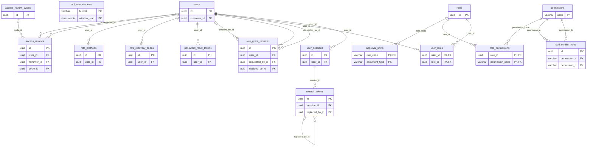

References to other domains: `users.customer_id` → `customers`.

### 3.2 Organisation

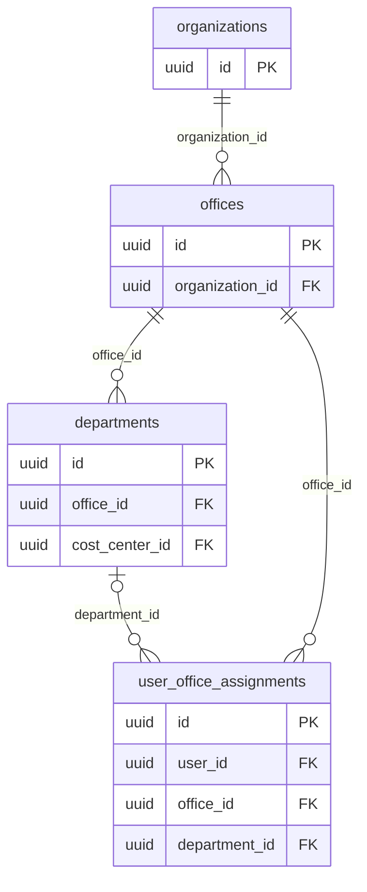

References to other domains: `departments.cost_center_id` → `cost_centers`; `user_office_assignments.user_id` → `users`.

### 3.3 General ledger and journals

```mermaid
erDiagram
    accounting_periods {
        uuid id PK
        uuid fiscal_year_id FK
    }
    approval_decisions {
        uuid id PK
        uuid actor_id FK
    }
    approval_workflow_steps {
        uuid id PK
        varchar voucher_type FK
        varchar required_permission FK
    }
    approval_workflows {
        varchar voucher_type PK
    }
    chart_of_accounts {
        uuid id PK
        uuid parent_id FK
    }
    close_task_completions {
        uuid id PK
        uuid task_id FK
        uuid completed_by_id FK
    }
    close_tasks {
        uuid id PK
        varchar responsible_permission FK
    }
    cost_centers {
        uuid id PK
    }
    currencies {
        char code PK
    }
    fiscal_years {
        uuid id PK
    }
    gl_account_mappings {
        varchar mapping_key PK
        uuid account_id FK
    }
    gl_clearing_lines {
        uuid clearing_id PK,FK
        uuid line_id PK,FK
    }
    gl_clearings {
        uuid id PK
        uuid account_id FK
        uuid cleared_by_id FK
    }
    journal_entries {
        uuid id PK
        uuid voucher_id FK
        uuid fiscal_year_id FK
        uuid period_id FK
        char currency_code FK
        uuid reversal_of_entry_id FK
        uuid posted_by_id FK
    }
    journal_entry_lines {
        uuid id PK
        uuid entry_id FK
        uuid account_id FK
        uuid cost_center_id FK
        uuid subsidiary_account_id FK
        uuid period_id FK
    }
    journal_voucher_lines {
        uuid id PK
        uuid voucher_id FK
        uuid account_id FK
        uuid cost_center_id FK
        uuid subsidiary_account_id FK
    }
    journal_vouchers {
        uuid id PK
        varchar voucher_type FK
        uuid period_id FK
        char currency_code FK
        uuid prepared_by_id FK
        uuid posted_entry_id FK
        uuid reversal_of_entry_id FK
        uuid recurring_journal_id FK
    }
    ledger_balances {
        uuid account_id PK,FK
        uuid period_id PK,FK
    }
    numbering_sequences {
        varchar document_type PK
        integer fiscal_year PK
    }
    period_status_changes {
        uuid id PK
        uuid period_id FK
        uuid requested_by_id FK
        uuid decided_by_id FK
    }
    recurring_journal_lines {
        uuid id PK
        uuid recurring_journal_id FK
        uuid account_id FK
        uuid cost_center_id FK
        uuid subsidiary_account_id FK
    }
    recurring_journals {
        uuid id PK
        uuid owner_id FK
    }
    subsidiary_ledger_accounts {
        uuid id PK
    }
    tax_codes {
        uuid id PK
        uuid account_id FK
    }
    fiscal_years ||--o{ accounting_periods : "fiscal_year_id"
    approval_workflows ||--o{ approval_workflow_steps : "voucher_type"
    chart_of_accounts |o--o{ chart_of_accounts : "parent_id"
    close_tasks ||--o{ close_task_completions : "task_id"
    chart_of_accounts ||--o{ gl_account_mappings : "account_id"
    gl_clearings ||--o{ gl_clearing_lines : "clearing_id"
    journal_entry_lines ||--o{ gl_clearing_lines : "line_id"
    chart_of_accounts ||--o{ gl_clearings : "account_id"
    currencies ||--o{ journal_entries : "currency_code"
    fiscal_years ||--o{ journal_entries : "fiscal_year_id"
    accounting_periods ||--o{ journal_entries : "period_id"
    journal_entries |o--o{ journal_entries : "reversal_of_entry_id"
    journal_vouchers ||--o{ journal_entries : "voucher_id"
    chart_of_accounts ||--o{ journal_entry_lines : "account_id"
    cost_centers |o--o{ journal_entry_lines : "cost_center_id"
    journal_entries ||--o{ journal_entry_lines : "entry_id"
    accounting_periods ||--o{ journal_entry_lines : "period_id"
    subsidiary_ledger_accounts |o--o{ journal_entry_lines : "subsidiary_account_id"
    chart_of_accounts ||--o{ journal_voucher_lines : "account_id"
    cost_centers |o--o{ journal_voucher_lines : "cost_center_id"
    subsidiary_ledger_accounts |o--o{ journal_voucher_lines : "subsidiary_account_id"
    journal_vouchers ||--o{ journal_voucher_lines : "voucher_id"
    journal_entries |o--o{ journal_vouchers : "posted_entry_id"
    recurring_journals |o--o{ journal_vouchers : "recurring_journal_id"
    journal_entries |o--o{ journal_vouchers : "reversal_of_entry_id"
    currencies ||--o{ journal_vouchers : "currency_code"
    accounting_periods ||--o{ journal_vouchers : "period_id"
    approval_workflows ||--o{ journal_vouchers : "voucher_type"
    chart_of_accounts ||--o{ ledger_balances : "account_id"
    accounting_periods ||--o{ ledger_balances : "period_id"
    accounting_periods ||--o{ period_status_changes : "period_id"
    chart_of_accounts ||--o{ recurring_journal_lines : "account_id"
    cost_centers |o--o{ recurring_journal_lines : "cost_center_id"
    recurring_journals ||--o{ recurring_journal_lines : "recurring_journal_id"
    subsidiary_ledger_accounts |o--o{ recurring_journal_lines : "subsidiary_account_id"
    chart_of_accounts ||--o{ tax_codes : "account_id"
```

References to other domains: `approval_decisions.actor_id` → `users`; `approval_workflow_steps.required_permission` → `permissions`; `close_task_completions.completed_by_id` → `users`; `close_tasks.responsible_permission` → `permissions`; `gl_clearings.cleared_by_id` → `users`; `journal_entries.posted_by_id` → `users`; `journal_vouchers.prepared_by_id` → `users`; `period_status_changes.decided_by_id` → `users`; `period_status_changes.requested_by_id` → `users`; `recurring_journals.owner_id` → `users`.

### 3.4 Documents, workflow and idempotency

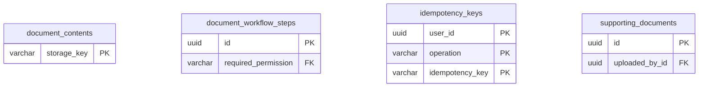

References to other domains: `document_workflow_steps.required_permission` → `permissions`; `supporting_documents.uploaded_by_id` → `users`.

### 3.5 Budgeting

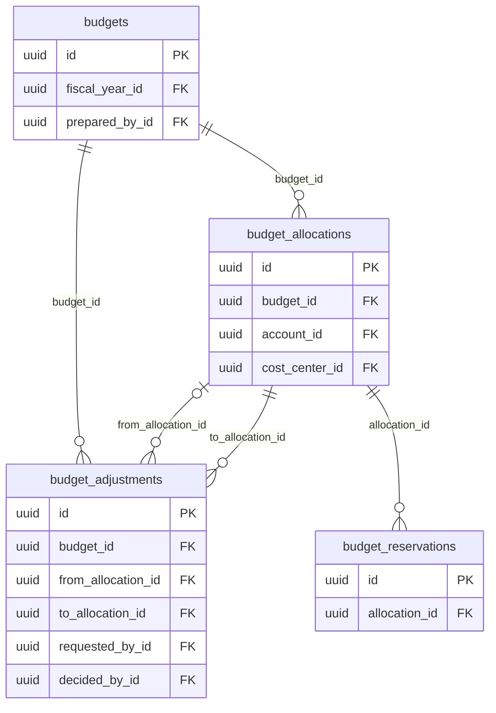

References to other domains: `budget_adjustments.decided_by_id` → `users`; `budget_adjustments.requested_by_id` → `users`; `budget_allocations.account_id` → `chart_of_accounts`; `budget_allocations.cost_center_id` → `cost_centers`; `budgets.fiscal_year_id` → `fiscal_years`; `budgets.prepared_by_id` → `users`.

### 3.6 Payables

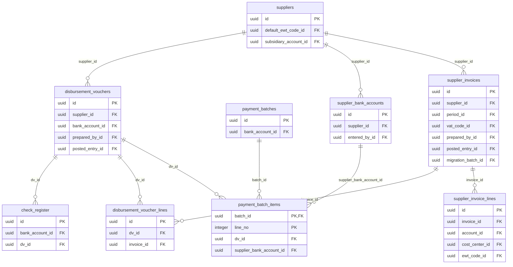

References to other domains: `check_register.bank_account_id` → `bank_accounts`; `disbursement_vouchers.bank_account_id` → `bank_accounts`; `disbursement_vouchers.posted_entry_id` → `journal_entries`; `disbursement_vouchers.prepared_by_id` → `users`; `payment_batches.bank_account_id` → `bank_accounts`; `supplier_bank_accounts.entered_by_id` → `users`; `supplier_invoice_lines.account_id` → `chart_of_accounts`; `supplier_invoice_lines.cost_center_id` → `cost_centers`; `supplier_invoice_lines.ewt_code_id` → `tax_codes`; `supplier_invoices.migration_batch_id` → `migration_batches`; `supplier_invoices.period_id` → `accounting_periods`; `supplier_invoices.posted_entry_id` → `journal_entries`; `supplier_invoices.prepared_by_id` → `users`; `supplier_invoices.vat_code_id` → `tax_codes`; `suppliers.default_ewt_code_id` → `tax_codes`; `suppliers.subsidiary_account_id` → `subsidiary_ledger_accounts`.

### 3.7 Receivables and portal

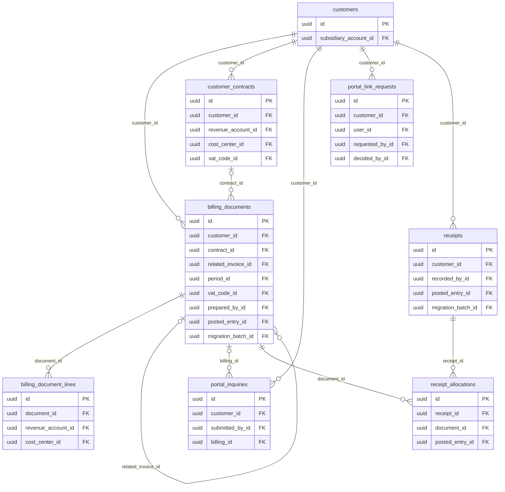

References to other domains: `billing_document_lines.cost_center_id` → `cost_centers`; `billing_document_lines.revenue_account_id` → `chart_of_accounts`; `billing_documents.migration_batch_id` → `migration_batches`; `billing_documents.period_id` → `accounting_periods`; `billing_documents.posted_entry_id` → `journal_entries`; `billing_documents.prepared_by_id` → `users`; `billing_documents.vat_code_id` → `tax_codes`; `customer_contracts.cost_center_id` → `cost_centers`; `customer_contracts.revenue_account_id` → `chart_of_accounts`; `customer_contracts.vat_code_id` → `tax_codes`; `customers.subsidiary_account_id` → `subsidiary_ledger_accounts`; `portal_inquiries.submitted_by_id` → `users`; `portal_link_requests.decided_by_id` → `users`; `portal_link_requests.requested_by_id` → `users`; `portal_link_requests.user_id` → `users`; `receipt_allocations.posted_entry_id` → `journal_entries`; `receipts.migration_batch_id` → `migration_batches`; `receipts.posted_entry_id` → `journal_entries`; `receipts.recorded_by_id` → `users`.

### 3.8 Treasury

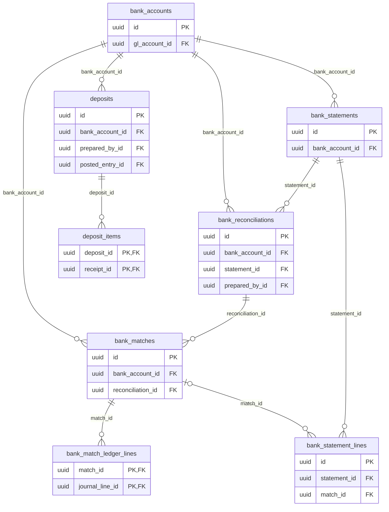

References to other domains: `bank_accounts.gl_account_id` → `chart_of_accounts`; `bank_match_ledger_lines.journal_line_id` → `journal_entry_lines`; `bank_reconciliations.prepared_by_id` → `users`; `deposit_items.receipt_id` → `receipts`; `deposits.posted_entry_id` → `journal_entries`; `deposits.prepared_by_id` → `users`.

### 3.9 Fixed assets

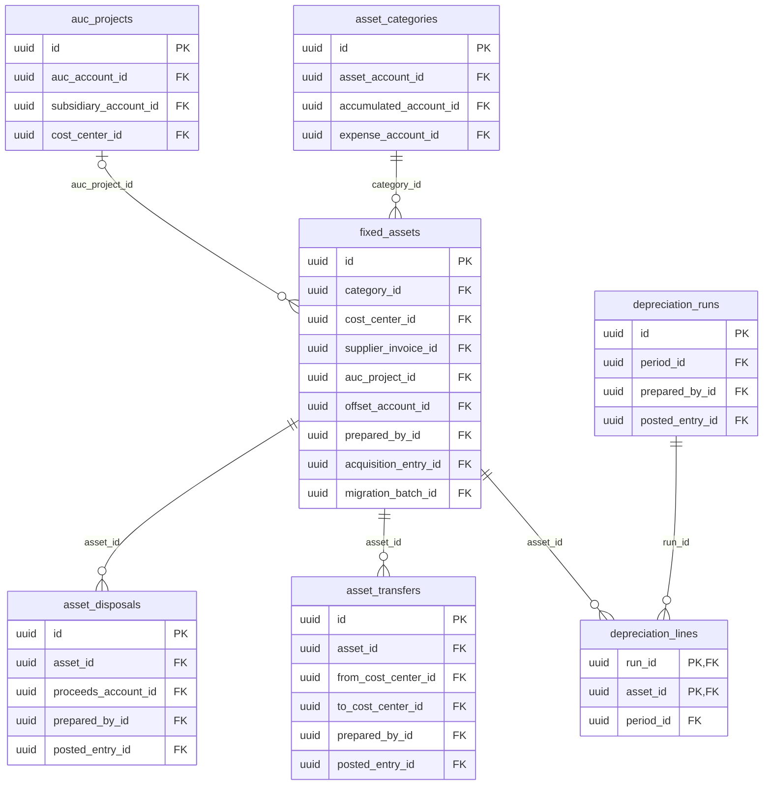

References to other domains: `asset_categories.accumulated_account_id` → `chart_of_accounts`; `asset_categories.asset_account_id` → `chart_of_accounts`; `asset_categories.expense_account_id` → `chart_of_accounts`; `asset_disposals.posted_entry_id` → `journal_entries`; `asset_disposals.prepared_by_id` → `users`; `asset_disposals.proceeds_account_id` → `chart_of_accounts`; `asset_transfers.from_cost_center_id` → `cost_centers`; `asset_transfers.posted_entry_id` → `journal_entries`; `asset_transfers.prepared_by_id` → `users`; `asset_transfers.to_cost_center_id` → `cost_centers`; `auc_projects.auc_account_id` → `chart_of_accounts`; `auc_projects.cost_center_id` → `cost_centers`; `auc_projects.subsidiary_account_id` → `subsidiary_ledger_accounts`; `depreciation_lines.period_id` → `accounting_periods`; `depreciation_runs.period_id` → `accounting_periods`; `depreciation_runs.posted_entry_id` → `journal_entries`; `depreciation_runs.prepared_by_id` → `users`; `fixed_assets.acquisition_entry_id` → `journal_entries`; `fixed_assets.cost_center_id` → `cost_centers`; `fixed_assets.migration_batch_id` → `migration_batches`; `fixed_assets.offset_account_id` → `chart_of_accounts`; `fixed_assets.prepared_by_id` → `users`; `fixed_assets.supplier_invoice_id` → `supplier_invoices`.

### 3.10 Inventory

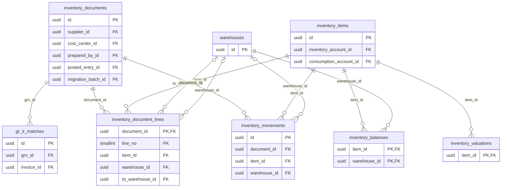

References to other domains: `gr_ir_matches.invoice_id` → `supplier_invoices`; `inventory_documents.cost_center_id` → `cost_centers`; `inventory_documents.migration_batch_id` → `migration_batches`; `inventory_documents.posted_entry_id` → `journal_entries`; `inventory_documents.prepared_by_id` → `users`; `inventory_documents.supplier_id` → `suppliers`; `inventory_items.consumption_account_id` → `chart_of_accounts`; `inventory_items.inventory_account_id` → `chart_of_accounts`.

### 3.11 Reporting

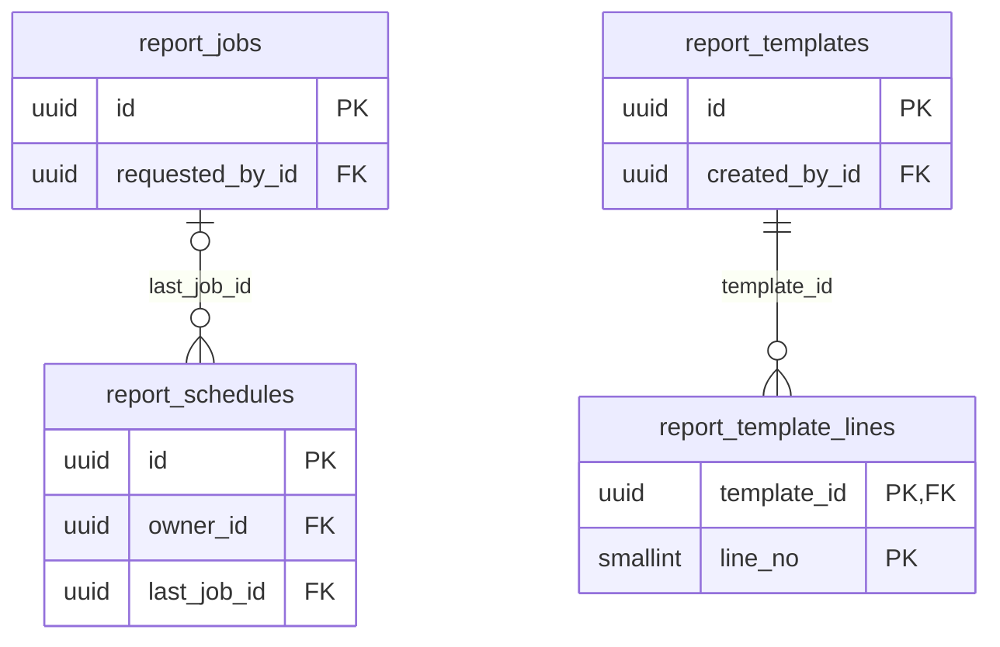

References to other domains: `report_jobs.requested_by_id` → `users`; `report_schedules.owner_id` → `users`; `report_templates.created_by_id` → `users`.

### 3.12 Integrations and notifications

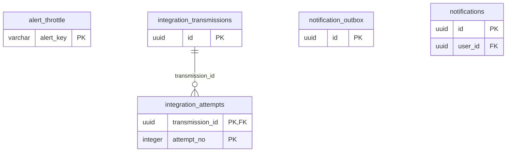

References to other domains: `notifications.user_id` → `users`.

### 3.13 Tickets

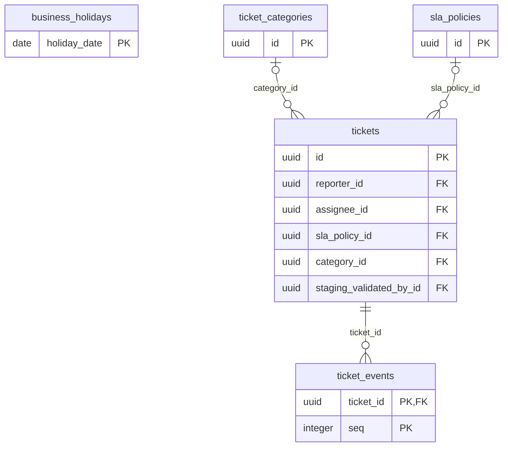

References to other domains: `tickets.assignee_id` → `users`; `tickets.reporter_id` → `users`; `tickets.staging_validated_by_id` → `users`.

### 3.14 Audit

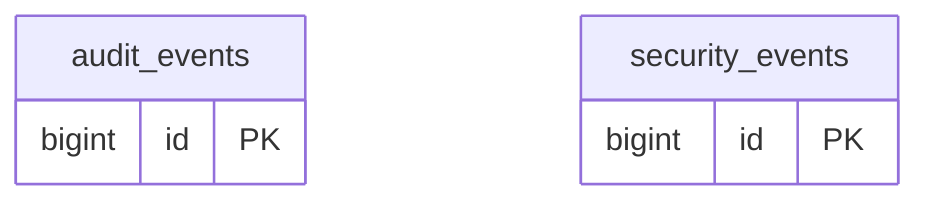

### 3.15 Migration and parallel run

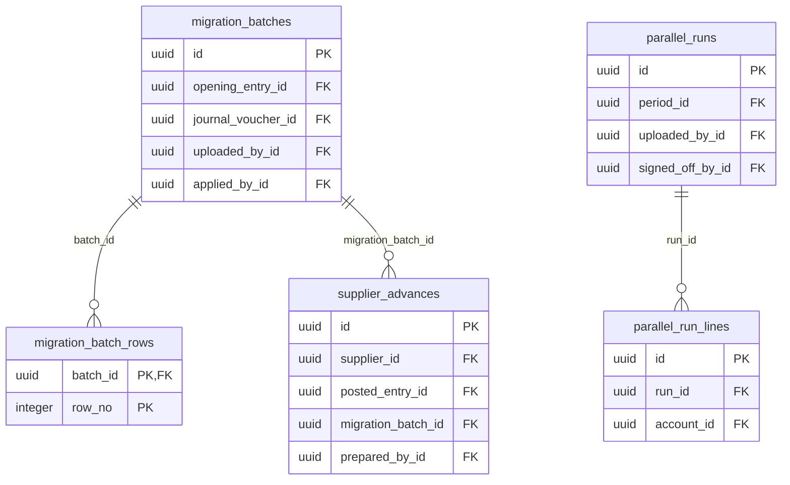

References to other domains: `migration_batches.applied_by_id` → `users`; `migration_batches.journal_voucher_id` → `journal_vouchers`; `migration_batches.opening_entry_id` → `journal_entries`; `migration_batches.uploaded_by_id` → `users`; `parallel_run_lines.account_id` → `chart_of_accounts`; `parallel_runs.period_id` → `accounting_periods`; `parallel_runs.signed_off_by_id` → `users`; `parallel_runs.uploaded_by_id` → `users`; `supplier_advances.posted_entry_id` → `journal_entries`; `supplier_advances.prepared_by_id` → `users`; `supplier_advances.supplier_id` → `suppliers`.

## 4. Data dictionary

One section per table, in domain order. *Created in* names the migration that created the table; columns added later name their migration. Column meanings come from the migration comments, then from naming conventions (keys, foreign keys, audit columns); a blank meaning means the column name is the whole story or the table notes explain it. Rules (CHECK, UNIQUE and partial indexes, triggers) are copied from the database catalogue.

### 4.1 Identity, access and sessions

#### `access_review_cycles`

Created in `V37__access_governance.sql`. A periodic access-review campaign; closes only when every review and resulting change is done (FR-RBAC-08). *Migration note:* Review cycles over the access_reviews table of V1.

| Column | Type | Null | Default | Meaning |
|---|---|---|---|---|
| id | uuid | N |  | Primary key (UUID generated by the application) |
| name | varchar(200) | N |  | Display name |
| due_date | date | N |  | Due date |
| status | varchar(10) | N |  | Lifecycle status; legal values in the rules below |
| started_by | varchar(64) | N |  |  |
| started_at | timestamptz | N |  | When started |
| closed_by | varchar(64) | Y |  |  |
| closed_at | timestamptz | Y |  | When closed |
| version | bigint | N | 0 | Optimistic-lock version, incremented on every update |

Rules: `access_review_cycles_status_check`: CHECK status IN (OPEN, CLOSED); `uq_review_cycle_open`: UNIQUE INDEX btree (status) WHERE ((status) = 'OPEN').

#### `access_reviews`

Created in `V1__identity_and_organization.sql`. One user's access reviewed by a reviewer within a cycle, with the outcome and notes.

| Column | Type | Null | Default | Meaning |
|---|---|---|---|---|
| id | uuid | N |  | Primary key (UUID generated by the application) |
| user_id | uuid | N |  | References `users` |
| reviewer_id | uuid | Y |  | References `users` |
| review_due | date | N |  |  |
| reviewed_at | timestamptz | Y |  | When reviewed |
| outcome | varchar(20) | Y |  |  |
| notes | varchar(1000) | Y |  |  |
| created_at | timestamptz | N | now() | When the row was created |
| cycle_id | uuid | Y |  | References `access_review_cycles` (added in V37) |
| roles_snapshot | varchar(1000) | Y |  | (added in V37) |
| financial | bool | N | false | (added in V37) |
| reviewer | varchar(64) | Y |  | (added in V37) |
| actioned_by | varchar(64) | Y |  | (added in V37) |
| actioned_at | timestamptz | Y |  | When actioned (added in V37) |
| action_note | varchar(1000) | Y |  | (added in V37) |
| version | bigint | N | 0 | Optimistic-lock version, incremented on every update (added in V37) |

Rules: `access_reviews_outcome_check`: CHECK outcome IN (RETAIN, MODIFY, REVOKE); `ck_access_review_not_self`: CHECK (((reviewer_id IS NULL) OR (reviewer_id <> user_id))); `ck_access_review_outcome`: CHECK (((outcome IS NULL) = (reviewed_at IS NULL))); `ix_access_reviews_due`: INDEX btree (review_due) WHERE (reviewed_at IS NULL); `uq_access_review_cycle_user`: UNIQUE INDEX btree (cycle_id, user_id).

#### `api_rate_windows` (UNLOGGED)

Created in `V36__api_rate_limits_and_alerts.sql`. Cluster-wide API rate-limit counters in fixed one-minute windows (UNLOGGED, short-lived).

| Column | Type | Null | Default | Meaning |
|---|---|---|---|---|
| bucket | varchar(80) | N |  |  |
| window_start | timestamptz | N |  |  |
| hits | integer | N |  |  |

#### `approval_limits`

Created in `V37__access_governance.sql`. The most a holder of a role may approve on one document of a type; no values seeded (C-24). *Migration note:* The most a holder of the role may approve on one document of the type. No values are seeded (C-24).

| Column | Type | Null | Default | Meaning |
|---|---|---|---|---|
| role_code | varchar(64) | N |  | References `roles` |
| document_type | varchar(40) | N |  |  |
| max_amount | numeric(19,2) | N |  |  |
| updated_by | varchar(64) | N |  | Username that last changed the row |
| updated_at | timestamptz | N |  | When the row last changed |

Rules: `approval_limits_max_amount_check`: CHECK ((max_amount >= (0))).

#### `mfa_methods`

Created in `V2__sessions_and_mfa.sql`. Enrolled second factors (TOTP), with the secret encrypted and the last used time step.

| Column | Type | Null | Default | Meaning |
|---|---|---|---|---|
| id | uuid | N |  | Primary key (UUID generated by the application) |
| user_id | uuid | N |  | References `users` |
| method_type | varchar(20) | N |  |  |
| secret_ciphertext | bytea | Y |  |  |
| status | varchar(20) | N |  | Lifecycle status; legal values in the rules below |
| last_used_step | bigint | Y |  |  |
| created_at | timestamptz | N |  | When the row was created |
| activated_at | timestamptz | Y |  | When activated |
| revoked_at | timestamptz | Y |  | When revoked |
| enrollment_challenge_id | varchar(64) | Y |  | (added in V5) |

Rules: `mfa_methods_method_type_check`: CHECK method_type IN (TOTP, EMAIL_OTP, SMS_OTP, WEBAUTHN); `mfa_methods_status_check`: CHECK status IN (PENDING, ACTIVE, REVOKED); `uq_mfa_active_per_type`: UNIQUE INDEX btree (user_id, method_type) WHERE ((status) = 'ACTIVE'); `uq_mfa_pending_per_type`: UNIQUE INDEX btree (user_id, method_type) WHERE ((status) = 'PENDING').

#### `mfa_recovery_codes`

Created in `V43__mfa_recovery_codes.sql`. Single-use recovery codes for a lost authenticator, stored as Argon2id hashes; spent or withdrawn rows are kept for audit.

| Column | Type | Null | Default | Meaning |
|---|---|---|---|---|
| id | uuid | N |  | Primary key (UUID generated by the application) |
| user_id | uuid | N |  | References `users` |
| code_hash | varchar(255) | N |  |  |
| created_at | timestamptz | N |  | When the row was created |
| used_at | timestamptz | Y |  | When used |
| revoked_at | timestamptz | Y |  | When revoked |

Rules: `ck_recovery_code_spent_once`: CHECK (((used_at IS NULL) OR (revoked_at IS NULL))); `ix_mfa_recovery_codes_unused`: INDEX btree (user_id) WHERE ((used_at IS NULL) AND (revoked_at IS NULL)).

#### `password_reset_tokens`

Created in `V2__sessions_and_mfa.sql`. Password-reset tokens (SHA-256 hashes only), single use.

| Column | Type | Null | Default | Meaning |
|---|---|---|---|---|
| id | uuid | N |  | Primary key (UUID generated by the application) |
| user_id | uuid | N |  | References `users` |
| token_hash | char(64) | N |  |  |
| created_at | timestamptz | N |  | When the row was created |
| expires_at | timestamptz | N |  | When expires |
| used_at | timestamptz | Y |  | When used |

Rules: `password_reset_tokens_token_hash_key`: UNIQUE (token_hash).

#### `permissions`

Created in `V1__identity_and_organization.sql`. The permission catalogue; `financial` marks permissions that authorise financial transactions.

| Column | Type | Null | Default | Meaning |
|---|---|---|---|---|
| code | varchar(64) | N |  | Business code |
| description | varchar(300) | N |  | Free-text description |
| category | varchar(40) | N |  |  |
| financial | bool | N | false |  |

Rules: `permissions_code_check`: CHECK (((code) ~ '^[A-Z][A-Z0-9_]{2,63}$')).

#### `refresh_tokens`

Created in `V2__sessions_and_mfa.sql`. Refresh tokens of a session (SHA-256 hashes only), rotated on every use.

| Column | Type | Null | Default | Meaning |
|---|---|---|---|---|
| id | uuid | N |  | Primary key (UUID generated by the application) |
| session_id | uuid | N |  | References `user_sessions` |
| token_hash | char(64) | N |  |  |
| issued_at | timestamptz | N |  | When issued |
| expires_at | timestamptz | N |  | When expires |
| used_at | timestamptz | Y |  | When used |
| replaced_by_id | uuid | Y |  | References `refresh_tokens` |

Rules: `refresh_tokens_token_hash_key`: UNIQUE (token_hash).

#### `role_grant_requests`

Created in `V37__access_governance.sql`. Maker-checker requests for role assignments carrying financial permissions (C-19). *Migration note:* A role change that adds a role carrying financial permissions waits for a second person's approval.

| Column | Type | Null | Default | Meaning |
|---|---|---|---|---|
| id | uuid | N |  | Primary key (UUID generated by the application) |
| user_id | uuid | N |  | References `users` |
| roles_before | varchar(1000) | N |  |  |
| roles_requested | varchar(1000) | N |  |  |
| financial_added | varchar(1000) | N |  |  |
| status | varchar(10) | N |  | Lifecycle status; legal values in the rules below |
| requested_by_id | uuid | N |  | References `users` |
| requested_by | varchar(64) | N |  |  |
| requested_at | timestamptz | N |  | When requested |
| decided_by_id | uuid | Y |  | References `users` |
| decided_by | varchar(64) | Y |  |  |
| decided_at | timestamptz | Y |  | When decided |
| decision_note | varchar(1000) | Y |  |  |
| version | bigint | N | 0 | Optimistic-lock version, incremented on every update |

Rules: `ck_rgr_decided`: CHECK ((((status) = ANY (ARRAY[('APPROVED'), ('REJECTED')])) = (decided_by_id IS NOT NULL))); `ck_rgr_two_person`: CHECK (((decided_by_id IS NULL) OR ((decided_by_id <> requested_by_id) AND (decided_by_id <> user_id)))); `role_grant_requests_status_check`: CHECK status IN (PENDING, APPROVED, REJECTED, CANCELLED); `uq_rgr_pending`: UNIQUE INDEX btree (user_id) WHERE ((status) = 'PENDING').

#### `role_permissions`

Created in `V1__identity_and_organization.sql`. Permissions granted by each role.

| Column | Type | Null | Default | Meaning |
|---|---|---|---|---|
| role_id | uuid | N |  | References `roles` |
| permission_code | varchar(64) | N |  | References `permissions` |

#### `roles`

Created in `V1__identity_and_organization.sql`. Roles (proposed matrix pending MIAA sign-off, C-08).

| Column | Type | Null | Default | Meaning |
|---|---|---|---|---|
| id | uuid | N |  | Primary key (UUID generated by the application) |
| code | varchar(64) | N |  | Business code |
| name | varchar(120) | N |  | Display name |
| description | varchar(500) | Y |  | Free-text description |
| system_role | bool | N | false |  |
| version | bigint | N | 0 | Optimistic-lock version, incremented on every update |
| created_at | timestamptz | N | now() | When the row was created |
| created_by | varchar(64) | N |  | Username that created the row |
| updated_at | timestamptz | N | now() | When the row last changed |
| updated_by | varchar(64) | N |  | Username that last changed the row |

Rules: `roles_code_check`: CHECK (((code) ~ '^[A-Z][A-Z0-9_]{2,63}$')); `roles_code_key`: UNIQUE (code).

#### `sod_conflict_rules`

Created in `V1__identity_and_organization.sql`. Segregation-of-duties rules: pairs of permissions one user may not hold together (BLOCK) or that are flagged (WARN).

| Column | Type | Null | Default | Meaning |
|---|---|---|---|---|
| id | uuid | N |  | Primary key (UUID generated by the application) |
| permission_a | varchar(64) | N |  | References `permissions` |
| permission_b | varchar(64) | N |  | References `permissions` |
| severity | varchar(10) | N |  |  |
| rationale | varchar(500) | N |  |  |

Rules: `ck_sod_distinct`: CHECK (((permission_a) <> (permission_b))); `sod_conflict_rules_severity_check`: CHECK severity IN (BLOCK, WARN); `uq_sod_pair`: UNIQUE (permission_a, permission_b).

#### `user_roles`

Created in `V1__identity_and_organization.sql`. Roles held by each user.

| Column | Type | Null | Default | Meaning |
|---|---|---|---|---|
| user_id | uuid | N |  | References `users` |
| role_id | uuid | N |  | References `roles` |
| granted_at | timestamptz | N | now() | When granted |
| granted_by | varchar(64) | N |  |  |

#### `user_sessions`

Created in `V2__sessions_and_mfa.sql`. One row per sign-in session; the access token carries its id.

| Column | Type | Null | Default | Meaning |
|---|---|---|---|---|
| id | uuid | N |  | Primary key (UUID generated by the application) |
| user_id | uuid | N |  | References `users` |
| created_at | timestamptz | N |  | When the row was created |
| last_refreshed_at | timestamptz | N |  | When last refreshed |
| expires_at | timestamptz | N |  | When expires |
| revoked_at | timestamptz | Y |  | When revoked |
| revoke_reason | varchar(40) | Y |  |  |
| client_ip | varchar(45) | Y |  |  |
| user_agent | varchar(300) | Y |  |  |

Rules: `ix_user_sessions_user_active`: INDEX btree (user_id) WHERE (revoked_at IS NULL).

#### `users`

Created in `V1__identity_and_organization.sql`. User accounts (internal staff, concessionaire portal users, external auditors).

| Column | Type | Null | Default | Meaning |
|---|---|---|---|---|
| id | uuid | N |  | Primary key (UUID generated by the application) |
| username | varchar(64) | N |  |  |
| email | varchar(254) | N |  |  |
| display_name | varchar(200) | N |  |  |
| user_type | varchar(20) | N |  |  |
| status | varchar(20) | N |  | Lifecycle status; legal values in the rules below |
| password_hash | varchar(255) | N |  |  |
| password_changed_at | timestamptz | N |  | When password changed |
| must_change_password | bool | N | false |  |
| failed_login_count | integer | N | 0 |  |
| locked_until | timestamptz | Y |  |  |
| access_expires_at | timestamptz | Y |  | When access expires |
| last_login_at | timestamptz | Y |  | When last login |
| version | bigint | N | 0 | Optimistic-lock version, incremented on every update |
| created_at | timestamptz | N | now() | When the row was created |
| created_by | varchar(64) | N |  | Username that created the row |
| updated_at | timestamptz | N | now() | When the row last changed |
| updated_by | varchar(64) | N |  | Username that last changed the row |
| customer_id | uuid | Y |  | References `customers` (added in V11) |

Rules: `ck_users_customer_link`: CHECK (((customer_id IS NULL) OR ((user_type) = 'CONCESSIONAIRE'))); `users_failed_login_count_check`: CHECK ((failed_login_count >= 0)); `users_status_check`: CHECK status IN (ACTIVE, INACTIVE); `users_user_type_check`: CHECK user_type IN (INTERNAL, CONCESSIONAIRE, EXTERNAL_AUDITOR); `users_username_check`: CHECK (((username) ~ '^[a-z0-9._-]{3,64}$')); `users_username_key`: UNIQUE (username); `ix_users_customer`: INDEX btree (customer_id) WHERE (customer_id IS NOT NULL); `uq_users_email_lower`: UNIQUE INDEX btree (lower((email))).

### 4.2 Organisation

#### `departments`

Created in `V1__identity_and_organization.sql`. Departments within an office.

| Column | Type | Null | Default | Meaning |
|---|---|---|---|---|
| id | uuid | N |  | Primary key (UUID generated by the application) |
| office_id | uuid | N |  | References `offices` |
| code | varchar(20) | N |  | Business code |
| name | varchar(200) | N |  | Display name |
| status | varchar(20) | N | 'ACTIVE'::character varying | Lifecycle status; legal values in the rules below |
| version | bigint | N | 0 | Optimistic-lock version, incremented on every update |
| created_at | timestamptz | N | now() | When the row was created |
| created_by | varchar(64) | N |  | Username that created the row |
| updated_at | timestamptz | N | now() | When the row last changed |
| updated_by | varchar(64) | N |  | Username that last changed the row |
| cost_center_id | uuid | Y |  | References `cost_centers` (added in V38) |

Rules: `departments_status_check`: CHECK status IN (ACTIVE, INACTIVE); `uq_departments_office_code`: UNIQUE (office_id, code).

#### `offices`

Created in `V1__identity_and_organization.sql`. Offices of an organisation.

| Column | Type | Null | Default | Meaning |
|---|---|---|---|---|
| id | uuid | N |  | Primary key (UUID generated by the application) |
| organization_id | uuid | N |  | References `organizations` |
| code | varchar(20) | N |  | Business code |
| name | varchar(200) | N |  | Display name |
| status | varchar(20) | N | 'ACTIVE'::character varying | Lifecycle status; legal values in the rules below |
| version | bigint | N | 0 | Optimistic-lock version, incremented on every update |
| created_at | timestamptz | N | now() | When the row was created |
| created_by | varchar(64) | N |  | Username that created the row |
| updated_at | timestamptz | N | now() | When the row last changed |
| updated_by | varchar(64) | N |  | Username that last changed the row |

Rules: `offices_status_check`: CHECK status IN (ACTIVE, INACTIVE); `uq_offices_org_code`: UNIQUE (organization_id, code).

#### `organizations`

Created in `V1__identity_and_organization.sql`. The organisation (MIAA) at the top of the structure.

| Column | Type | Null | Default | Meaning |
|---|---|---|---|---|
| id | uuid | N |  | Primary key (UUID generated by the application) |
| code | varchar(20) | N |  | Business code |
| name | varchar(200) | N |  | Display name |
| tin | varchar(20) | Y |  |  |
| status | varchar(20) | N | 'ACTIVE'::character varying | Lifecycle status; legal values in the rules below |
| version | bigint | N | 0 | Optimistic-lock version, incremented on every update |
| created_at | timestamptz | N | now() | When the row was created |
| created_by | varchar(64) | N |  | Username that created the row |
| updated_at | timestamptz | N | now() | When the row last changed |
| updated_by | varchar(64) | N |  | Username that last changed the row |

Rules: `organizations_code_key`: UNIQUE (code); `organizations_status_check`: CHECK status IN (ACTIVE, INACTIVE).

#### `user_office_assignments`

Created in `V1__identity_and_organization.sql`. Effective-dated assignment of users to offices and departments.

| Column | Type | Null | Default | Meaning |
|---|---|---|---|---|
| id | uuid | N |  | Primary key (UUID generated by the application) |
| user_id | uuid | N |  | References `users` |
| office_id | uuid | N |  | References `offices` |
| department_id | uuid | Y |  | References `departments` |
| effective_from | date | N |  |  |
| effective_to | date | Y |  |  |
| created_at | timestamptz | N | now() | When the row was created |
| created_by | varchar(64) | N |  | Username that created the row |
| ended_by | varchar(64) | Y |  | (added in V38) |

Rules: `ck_uoa_dates`: CHECK (((effective_to IS NULL) OR (effective_to >= effective_from))); `uq_uoa_current`: UNIQUE INDEX btree (user_id) WHERE (effective_to IS NULL).

### 4.3 General ledger and journals

#### `accounting_periods`

Created in `V7__general_ledger.sql`. Periods 1-12 and the adjustment period 13 of a fiscal year, with status (FUTURE, OPEN, SOFT_CLOSED, CLOSED); sequence_key = year*100 + period.

| Column | Type | Null | Default | Meaning |
|---|---|---|---|---|
| id | uuid | N |  | Primary key (UUID generated by the application) |
| fiscal_year_id | uuid | N |  | References `fiscal_years` |
| period_number | smallint | N |  |  |
| name | varchar(40) | N |  | Display name |
| period_type | varchar(12) | N |  |  |
| start_date | date | N |  | Start date |
| end_date | date | N |  | End date |
| status | varchar(12) | N |  | Lifecycle status; legal values in the rules below |
| sequence_key | integer | N |  | Global ordering key (fiscal_year * 100 + period_number) used for cumulative balances. |
| version | bigint | N | 0 | Optimistic-lock version, incremented on every update |
| updated_at | timestamptz | N |  | When the row last changed |
| updated_by | varchar(64) | N |  | Username that last changed the row |

Rules: `accounting_periods_period_number_check`: CHECK (((period_number >= 1) AND (period_number <= 13))); `accounting_periods_period_type_check`: CHECK period_type IN (REGULAR, ADJUSTMENT); `accounting_periods_sequence_key_key`: UNIQUE (sequence_key); `accounting_periods_status_check`: CHECK status IN (FUTURE, OPEN, SOFT_CLOSED, CLOSED); `ck_adjustment_is_13`: CHECK ((((period_type) = 'ADJUSTMENT') = (period_number = 13))); `ck_period_dates`: CHECK ((end_date >= start_date)); `uq_period_number`: UNIQUE (fiscal_year_id, period_number).

#### `approval_decisions`

Created in `V7__general_ledger.sql`. Append-only log of every workflow decision (approve, return, reject, post) on vouchers and documents. *Migration note:* Append-only decision log (submit / step approvals / return / reject / cancel / post).

| Column | Type | Null | Default | Meaning |
|---|---|---|---|---|
| id | uuid | N |  | Primary key (UUID generated by the application) |
| document_type | varchar(30) | N |  |  |
| document_id | uuid | N |  |  |
| action | varchar(12) | N |  |  |
| step_order | smallint | Y |  |  |
| step_code | varchar(20) | Y |  |  |
| actor_id | uuid | N |  | References `users` |
| actor_username | varchar(64) | N |  |  |
| comment | varchar(1000) | Y |  |  |
| decided_at | timestamptz | N |  | When decided |

Rules: `approval_decisions_action_check`: CHECK action IN (SUBMIT, APPROVE, RETURN, REJECT, CANCEL, POST, INSTRUCT, CONFIRM, VOID); trigger `trg_approval_decisions_immutable`: BEFORE DELETE OR UPDATE FOR EACH ROW EXECUTE FUNCTION cas_reject_modification(); trigger `trg_approval_decisions_no_truncate`: BEFORE TRUNCATE FOR EACH STATEMENT EXECUTE FUNCTION cas_reject_modification().

#### `approval_workflow_steps`

Created in `V7__general_ledger.sql`. Ordered steps of a journal-voucher approval workflow, with optional amount thresholds and the permission each step needs.

| Column | Type | Null | Default | Meaning |
|---|---|---|---|---|
| id | uuid | N |  | Primary key (UUID generated by the application) |
| voucher_type | varchar(12) | N |  | References `approval_workflows` |
| step_order | smallint | N |  |  |
| step_code | varchar(20) | N |  |  |
| required_permission | varchar(64) | N |  | References `permissions` |
| min_amount | numeric(19,2) | Y |  | Step applies only when the voucher total is at least this amount (NULL = always). |

Rules: `approval_workflow_steps_min_amount_check`: CHECK (((min_amount IS NULL) OR (min_amount >= (0)))); `approval_workflow_steps_step_order_check`: CHECK ((step_order > 0)); `uq_workflow_step`: UNIQUE (voucher_type, step_order).

#### `approval_workflows`

Created in `V7__general_ledger.sql`. Approval workflow per journal-voucher type.

| Column | Type | Null | Default | Meaning |
|---|---|---|---|---|
| voucher_type | varchar(12) | N |  |  |
| description | varchar(300) | N |  | Free-text description |
| requires_attachment | bool | N |  |  |

Rules: `approval_workflows_voucher_type_check`: CHECK voucher_type IN (STANDARD, ADJUSTING, REVERSAL, OPENING, RECURRING, CLOSING, SUBLEDGER).

#### `chart_of_accounts`

Created in `V7__general_ledger.sql`. Hierarchical chart of accounts with attributes (type, normal balance, postable, statement line, cost-centre and sub-ledger requirements, budget control, open-item management). Development uses [PLACEHOLDER] PLC- codes (C-22).

| Column | Type | Null | Default | Meaning |
|---|---|---|---|---|
| id | uuid | N |  | Primary key (UUID generated by the application) |
| code | varchar(30) | N |  | Business code |
| name | varchar(200) | N |  | Display name |
| description | varchar(1000) | Y |  | Free-text description |
| account_type | varchar(10) | N |  |  |
| normal_balance | varchar(6) | N |  |  |
| parent_id | uuid | Y |  | References `chart_of_accounts` |
| postable | bool | N |  |  |
| status | varchar(10) | N |  | Lifecycle status; legal values in the rules below |
| effective_from | date | N |  |  |
| effective_to | date | Y |  |  |
| fs_line_code | varchar(30) | Y |  |  |
| requires_cost_center | bool | N | false |  |
| subsidiary_type | varchar(12) | Y |  |  |
| budget_controlled | bool | N | false |  |
| tax_code | varchar(20) | Y |  |  |
| placeholder | bool | N | false | TRUE for [PLACEHOLDER] seed data that MIAA must replace or confirm |
| version | bigint | N | 0 | Optimistic-lock version, incremented on every update |
| created_at | timestamptz | N |  | When the row was created |
| created_by | varchar(64) | N |  | Username that created the row |
| updated_at | timestamptz | N |  | When the row last changed |
| updated_by | varchar(64) | N |  | Username that last changed the row |
| open_item_managed | bool | N | false | (added in V40) |

Rules: `chart_of_accounts_account_type_check`: CHECK account_type IN (ASSET, LIABILITY, EQUITY, REVENUE, EXPENSE); `chart_of_accounts_code_check`: CHECK (((code) ~ '^[A-Za-z0-9][A-Za-z0-9.-]{0,29}$')); `chart_of_accounts_code_key`: UNIQUE (code); `chart_of_accounts_normal_balance_check`: CHECK normal_balance IN (DEBIT, CREDIT); `chart_of_accounts_status_check`: CHECK status IN (ACTIVE, INACTIVE); `chart_of_accounts_subsidiary_type_check`: CHECK subsidiary_type IN (SUPPLIER, CUSTOMER, EMPLOYEE, OTHER); `ck_coa_dates`: CHECK (((effective_to IS NULL) OR (effective_to >= effective_from))); `ck_coa_not_self_parent`: CHECK (((parent_id IS NULL) OR (parent_id <> id))).

#### `close_task_completions`

Created in `V40__clearing_and_close_calendar.sql`. A close task ticked off for one scope (day, period, quarter or year) with outcome and note. *Migration note:* One completion per task and scope: a date (DAY_END), a period id (MONTH_END), '<fiscal year id>:Q<n>' (QUARTER_END) or a fiscal year id (YEAR_END).

| Column | Type | Null | Default | Meaning |
|---|---|---|---|---|
| id | uuid | N |  | Primary key (UUID generated by the application) |
| task_id | uuid | N |  | References `close_tasks` |
| scope_key | varchar(60) | N |  |  |
| outcome | varchar(16) | N |  |  |
| note | varchar(1000) | N |  |  |
| completed_by_id | uuid | N |  | References `users` |
| completed_by | varchar(64) | N |  |  |
| completed_at | timestamptz | N |  | When completed |

Rules: `close_task_completions_outcome_check`: CHECK outcome IN (DONE, NOT_APPLICABLE); `uq_close_task_scope`: UNIQUE (task_id, scope_key).

#### `close_tasks`

Created in `V40__clearing_and_close_calendar.sql`. Manual tasks of the close calendar per frequency, with the responsible permission and due offset ([PLACEHOLDER] seed, C-33). *Migration note:* Manual close tasks; the automatic reconciliation and exception checks are computed, not stored. Due date = the day, period, quarter or year end plus the offset (calendar days).

| Column | Type | Null | Default | Meaning |
|---|---|---|---|---|
| id | uuid | N |  | Primary key (UUID generated by the application) |
| code | varchar(30) | N |  | Business code |
| name | varchar(200) | N |  | Display name |
| frequency | varchar(12) | N |  |  |
| due_offset_days | integer | N |  |  |
| responsible_permission | varchar(64) | N |  | References `permissions` |
| instructions | varchar(1000) | Y |  |  |
| sort_order | integer | N | 100 | Display order |
| status | varchar(10) | N |  | Lifecycle status; legal values in the rules below |
| placeholder | bool | N | false | TRUE for [PLACEHOLDER] seed data that MIAA must replace or confirm |
| version | bigint | N | 0 | Optimistic-lock version, incremented on every update |
| updated_by | varchar(64) | N |  | Username that last changed the row |
| updated_at | timestamptz | N |  | When the row last changed |

Rules: `close_tasks_code_key`: UNIQUE (code); `close_tasks_due_offset_days_check`: CHECK (((due_offset_days >= 0) AND (due_offset_days <= 90))); `close_tasks_frequency_check`: CHECK frequency IN (DAY_END, MONTH_END, QUARTER_END, YEAR_END); `close_tasks_status_check`: CHECK status IN (ACTIVE, INACTIVE).

#### `cost_centers`

Created in `V7__general_ledger.sql`. Cost centres (line dimension).

| Column | Type | Null | Default | Meaning |
|---|---|---|---|---|
| id | uuid | N |  | Primary key (UUID generated by the application) |
| code | varchar(30) | N |  | Business code |
| name | varchar(200) | N |  | Display name |
| status | varchar(10) | N |  | Lifecycle status; legal values in the rules below |
| placeholder | bool | N | false | TRUE for [PLACEHOLDER] seed data that MIAA must replace or confirm |
| version | bigint | N | 0 | Optimistic-lock version, incremented on every update |
| created_at | timestamptz | N |  | When the row was created |
| created_by | varchar(64) | N |  | Username that created the row |

Rules: `cost_centers_code_key`: UNIQUE (code); `cost_centers_status_check`: CHECK status IN (ACTIVE, INACTIVE).

#### `currencies`

Created in `V7__general_ledger.sql`. Currencies; PHP is the single functional currency.

| Column | Type | Null | Default | Meaning |
|---|---|---|---|---|
| code | char(3) | N |  | Business code |
| name | varchar(60) | N |  | Display name |
| minor_units | smallint | N |  |  |
| functional | bool | N | false |  |

Rules: `currencies_minor_units_check`: CHECK (((minor_units >= 0) AND (minor_units <= 4))); `uq_currencies_functional`: UNIQUE INDEX btree (functional) WHERE functional.

#### `fiscal_years`

Created in `V7__general_ledger.sql`. Fiscal years and their status (OPEN, CLOSED).

| Column | Type | Null | Default | Meaning |
|---|---|---|---|---|
| id | uuid | N |  | Primary key (UUID generated by the application) |
| fiscal_year | integer | N |  |  |
| start_date | date | N |  | Start date |
| end_date | date | N |  | End date |
| status | varchar(10) | N |  | Lifecycle status; legal values in the rules below |
| closed_at | timestamptz | Y |  | When closed |
| closed_by | varchar(64) | Y |  |  |
| version | bigint | N | 0 | Optimistic-lock version, incremented on every update |
| created_at | timestamptz | N |  | When the row was created |
| created_by | varchar(64) | N |  | Username that created the row |

Rules: `ck_fy_dates`: CHECK ((end_date > start_date)); `fiscal_years_fiscal_year_check`: CHECK (((fiscal_year >= 2000) AND (fiscal_year <= 2200))); `fiscal_years_fiscal_year_key`: UNIQUE (fiscal_year); `fiscal_years_status_check`: CHECK status IN (OPEN, CLOSED).

#### `gl_account_mappings`

Created in `V9__payables_budget_treasury_base.sql`. Configurable control accounts used by automatic postings (e.g. AP_TRADE_PAYABLE, INPUT_VAT, INVENTORY_REVALUATION). *Migration note:* Configurable control accounts used by automatic postings (e.g. AP_TRADE_PAYABLE, INPUT_VAT).

| Column | Type | Null | Default | Meaning |
|---|---|---|---|---|
| mapping_key | varchar(40) | N |  |  |
| account_id | uuid | N |  | References `chart_of_accounts` |
| description | varchar(300) | N |  | Free-text description |
| updated_at | timestamptz | N |  | When the row last changed |
| updated_by | varchar(64) | N |  | Username that last changed the row |

Rules: `gl_account_mappings_mapping_key_check`: CHECK (((mapping_key) ~ '^[A-Z][A-Z0-9_]{2,39}$')).

#### `gl_clearing_lines`

Created in `V40__clearing_and_close_calendar.sql`. Journal-entry lines in a clearing; a line is in at most one active clearing.

| Column | Type | Null | Default | Meaning |
|---|---|---|---|---|
| clearing_id | uuid | N |  | References `gl_clearings` |
| line_id | uuid | N |  | References `journal_entry_lines` |
| active | bool | N | true |  |

Rules: `uq_gl_clearing_line_active`: UNIQUE INDEX btree (line_id) WHERE active.

#### `gl_clearings`

Created in `V40__clearing_and_close_calendar.sql`. A group of open items on an open-item managed account cleared together (manual, by reference or by amount); reversible.

| Column | Type | Null | Default | Meaning |
|---|---|---|---|---|
| id | uuid | N |  | Primary key (UUID generated by the application) |
| account_id | uuid | N |  | References `chart_of_accounts` |
| rule | varchar(10) | N |  |  |
| line_count | integer | N |  |  |
| total | numeric(19,2) | N |  |  |
| note | varchar(500) | Y |  |  |
| status | varchar(10) | N |  | Lifecycle status; legal values in the rules below |
| cleared_by_id | uuid | N |  | References `users` |
| cleared_by | varchar(64) | N |  |  |
| cleared_at | timestamptz | N |  | When cleared |
| reversed_by | varchar(64) | Y |  |  |
| reversed_at | timestamptz | Y |  | When reversed |
| reversal_reason | varchar(500) | Y |  |  |

Rules: `ck_clearing_reversed`: CHECK ((((status) = 'REVERSED') = (reversed_at IS NOT NULL))); `gl_clearings_line_count_check`: CHECK ((line_count >= 2)); `gl_clearings_rule_check`: CHECK rule IN (MANUAL, REFERENCE, AMOUNT); `gl_clearings_status_check`: CHECK status IN (ACTIVE, REVERSED); `gl_clearings_total_check`: CHECK ((total > (0))).

#### `journal_entries`

Created in `V7__general_ledger.sql`. Posted, immutable journal entries (the general ledger).

| Column | Type | Null | Default | Meaning |
|---|---|---|---|---|
| id | uuid | N |  | Primary key (UUID generated by the application) |
| entry_number | varchar(30) | N |  |  |
| voucher_id | uuid | N |  | References `journal_vouchers` |
| voucher_type | varchar(12) | N |  |  |
| fiscal_year_id | uuid | N |  | References `fiscal_years` |
| period_id | uuid | N |  | References `accounting_periods` |
| accounting_date | date | N |  | Accounting date |
| description | varchar(1000) | N |  | Free-text description |
| source_type | varchar(30) | N |  |  |
| source_reference | varchar(100) | Y |  |  |
| currency_code | char(3) | N |  | ISO 4217 currency (PHP only today) |
| total_debit | numeric(19,2) | N |  |  |
| total_credit | numeric(19,2) | N |  |  |
| reversal_of_entry_id | uuid | Y |  | References `journal_entries` |
| prepared_by | varchar(64) | N |  | Username of the preparer |
| posted_by_id | uuid | N |  | References `users` |
| posted_by | varchar(64) | N |  |  |
| posted_at | timestamptz | N |  | When posted |

Rules: `ck_je_balanced`: CHECK (((total_debit = total_credit) AND (total_debit > (0)))); `journal_entries_entry_number_key`: UNIQUE (entry_number); `journal_entries_reversal_of_entry_id_key`: UNIQUE (reversal_of_entry_id); `journal_entries_voucher_id_key`: UNIQUE (voucher_id); `uq_je_subledger_source`: UNIQUE INDEX btree (source_type, source_reference) WHERE ((source_type) ~~ 'SL\_%'); trigger `trg_journal_entries_immutable`: BEFORE DELETE OR UPDATE FOR EACH ROW EXECUTE FUNCTION cas_reject_modification(); trigger `trg_journal_entries_no_truncate`: BEFORE TRUNCATE FOR EACH STATEMENT EXECUTE FUNCTION cas_reject_modification().

#### `journal_entry_lines`

Created in `V7__general_ledger.sql`. Lines of posted journal entries.

| Column | Type | Null | Default | Meaning |
|---|---|---|---|---|
| id | uuid | N |  | Primary key (UUID generated by the application) |
| entry_id | uuid | N |  | References `journal_entries` |
| line_no | smallint | N |  |  |
| account_id | uuid | N |  | References `chart_of_accounts` |
| cost_center_id | uuid | Y |  | References `cost_centers` |
| subsidiary_account_id | uuid | Y |  | References `subsidiary_ledger_accounts` |
| description | varchar(500) | Y |  | Free-text description |
| debit | numeric(19,2) | N |  |  |
| credit | numeric(19,2) | N |  |  |
| period_id | uuid | N |  | Denormalised from the header for ledger queries. |
| accounting_date | date | N |  | Accounting date |

Rules: `ck_jel_one_side`: CHECK (((debit >= (0)) AND (credit >= (0)) AND (((debit > (0)) AND (credit = (0))) OR ((credit > (0)) AND (debit = (0)))))); `uq_jel_line`: UNIQUE (entry_id, line_no); `ix_jel_cost_center`: INDEX btree (cost_center_id) WHERE (cost_center_id IS NOT NULL); `ix_jel_subsidiary`: INDEX btree (subsidiary_account_id, account_id) WHERE (subsidiary_account_id IS NOT NULL); trigger `trg_journal_entry_balanced`: AFTER INSERT DEFERRABLE INITIALLY DEFERRED FOR EACH ROW EXECUTE FUNCTION cas_check_entry_balanced(); trigger `trg_journal_entry_lines_immutable`: BEFORE DELETE OR UPDATE FOR EACH ROW EXECUTE FUNCTION cas_reject_modification(); trigger `trg_journal_entry_lines_no_truncate`: BEFORE TRUNCATE FOR EACH STATEMENT EXECUTE FUNCTION cas_reject_modification().

#### `journal_voucher_lines`

Created in `V7__general_ledger.sql`. Lines of editable journal vouchers.

| Column | Type | Null | Default | Meaning |
|---|---|---|---|---|
| id | uuid | N |  | Primary key (UUID generated by the application) |
| voucher_id | uuid | N |  | References `journal_vouchers` |
| line_no | smallint | N |  |  |
| account_id | uuid | N |  | References `chart_of_accounts` |
| cost_center_id | uuid | Y |  | References `cost_centers` |
| subsidiary_account_id | uuid | Y |  | References `subsidiary_ledger_accounts` |
| description | varchar(500) | Y |  | Free-text description |
| debit | numeric(19,2) | N | 0 |  |
| credit | numeric(19,2) | N | 0 |  |

Rules: `ck_jvl_one_side`: CHECK (((debit >= (0)) AND (credit >= (0)) AND (((debit > (0)) AND (credit = (0))) OR ((credit > (0)) AND (debit = (0)))))); `journal_voucher_lines_line_no_check`: CHECK ((line_no > 0)); `uq_jvl_line`: UNIQUE (voucher_id, line_no).

#### `journal_vouchers`

Created in `V7__general_ledger.sql`. Journal vouchers (JEVs) before posting: draft, in review and approval, posted, reversed, cancelled.

| Column | Type | Null | Default | Meaning |
|---|---|---|---|---|
| id | uuid | N |  | Primary key (UUID generated by the application) |
| voucher_number | varchar(30) | Y |  |  |
| voucher_type | varchar(12) | N |  | References `approval_workflows` |
| status | varchar(12) | N |  | Lifecycle status; legal values in the rules below |
| accounting_date | date | N |  | Accounting date |
| period_id | uuid | N |  | References `accounting_periods` |
| description | varchar(1000) | N |  | Free-text description |
| supporting_reference | varchar(200) | Y |  |  |
| source_type | varchar(30) | N | 'MANUAL'::character varying |  |
| source_reference | varchar(100) | Y |  |  |
| currency_code | char(3) | N | 'PHP'::bpchar | ISO 4217 currency (PHP only today) |
| total_debit | numeric(19,2) | N | 0 |  |
| total_credit | numeric(19,2) | N | 0 |  |
| current_step_order | smallint | Y |  | Current workflow step (NULL when not awaiting approval) |
| prepared_by_id | uuid | N |  | References `users` |
| prepared_by | varchar(64) | N |  | Username of the preparer |
| submitted_at | timestamptz | Y |  | When submitted |
| posted_entry_id | uuid | Y |  | Journal entry created when the document was posted |
| reversal_of_entry_id | uuid | Y |  | References `journal_entries` |
| recurring_journal_id | uuid | Y |  | References `recurring_journals` |
| version | bigint | N | 0 | Optimistic-lock version, incremented on every update |
| created_at | timestamptz | N |  | When the row was created |
| updated_at | timestamptz | N |  | When the row last changed |
| updated_by | varchar(64) | N |  | Username that last changed the row |

Rules: `journal_vouchers_status_check`: CHECK status IN (DRAFT, SUBMITTED, APPROVED, POSTED, RETURNED, REJECTED, CANCELLED); `journal_vouchers_voucher_number_key`: UNIQUE (voucher_number); `uq_jv_live_reversal`: UNIQUE INDEX btree (reversal_of_entry_id) WHERE ((reversal_of_entry_id IS NOT NULL) AND ((status) <> ALL (ARRAY[('REJECTED'), ('CANCELLED')]))).

#### `ledger_balances`

Created in `V7__general_ledger.sql`. Derived totals per account and period; rebuildable from the entries. *Migration note:* Derived per-account, per-period totals. Not a source of truth: rebuildable from journal_entry_lines.

| Column | Type | Null | Default | Meaning |
|---|---|---|---|---|
| account_id | uuid | N |  | References `chart_of_accounts` |
| period_id | uuid | N |  | References `accounting_periods` |
| debit_total | numeric(21,2) | N | 0 |  |
| credit_total | numeric(21,2) | N | 0 |  |
| updated_at | timestamptz | N |  | When the row last changed |

#### `numbering_sequences`

Created in `V7__general_ledger.sql`. Gap-free official numbering per document type and fiscal year (row-locked counter).

| Column | Type | Null | Default | Meaning |
|---|---|---|---|---|
| document_type | varchar(20) | N |  |  |
| fiscal_year | integer | N |  |  |
| prefix | varchar(20) | N |  |  |
| next_value | bigint | N |  |  |

Rules: `numbering_sequences_next_value_check`: CHECK ((next_value > 0)).

#### `period_status_changes`

Created in `V7__general_ledger.sql`. History of period opening, soft-closing, closing (with waived checks) and reopen requests and decisions. *Migration note:* Close/open/reopen history; reopen requests need a second user's approval.

| Column | Type | Null | Default | Meaning |
|---|---|---|---|---|
| id | uuid | N |  | Primary key (UUID generated by the application) |
| period_id | uuid | N |  | References `accounting_periods` |
| change_type | varchar(12) | N |  |  |
| from_status | varchar(12) | N |  |  |
| to_status | varchar(12) | N |  |  |
| request_status | varchar(10) | N |  |  |
| reason | varchar(1000) | Y |  |  |
| waived_checks | jsonb | N | '[]'::jsonb |  |
| requested_by_id | uuid | Y |  | NULL for system actions (e.g. dev seeding) |
| requested_by | varchar(64) | N |  |  |
| requested_at | timestamptz | N |  | When requested |
| decided_by_id | uuid | Y |  | References `users` |
| decided_by | varchar(64) | Y |  |  |
| decided_at | timestamptz | Y |  | When decided |
| decision_note | varchar(1000) | Y |  |  |
| version | bigint | N | 0 | Optimistic-lock version, incremented on every update |

Rules: `ck_reopen_two_people`: CHECK (((decided_by_id IS NULL) OR ((change_type) <> 'REOPEN') OR (decided_by_id <> requested_by_id))); `period_status_changes_change_type_check`: CHECK change_type IN (OPEN, SOFT_CLOSE, CLOSE, REOPEN); `period_status_changes_request_status_check`: CHECK request_status IN (PENDING, APPROVED, REJECTED, APPLIED); `uq_pending_reopen`: UNIQUE INDEX btree (period_id) WHERE ((request_status) = 'PENDING').

#### `recurring_journal_lines`

Created in `V7__general_ledger.sql`. Lines of a recurring journal template.

| Column | Type | Null | Default | Meaning |
|---|---|---|---|---|
| id | uuid | N |  | Primary key (UUID generated by the application) |
| recurring_journal_id | uuid | N |  | References `recurring_journals` |
| line_no | smallint | N |  |  |
| account_id | uuid | N |  | References `chart_of_accounts` |
| cost_center_id | uuid | Y |  | References `cost_centers` |
| subsidiary_account_id | uuid | Y |  | References `subsidiary_ledger_accounts` |
| description | varchar(500) | Y |  | Free-text description |
| debit | numeric(19,2) | N | 0 |  |
| credit | numeric(19,2) | N | 0 |  |

Rules: `ck_rjl_one_side`: CHECK (((debit >= (0)) AND (credit >= (0)) AND (((debit > (0)) AND (credit = (0))) OR ((credit > (0)) AND (debit = (0)))))); `uq_rjl_line`: UNIQUE (recurring_journal_id, line_no).

#### `recurring_journals`

Created in `V7__general_ledger.sql`. Templates that generate draft journal vouchers on a schedule.

| Column | Type | Null | Default | Meaning |
|---|---|---|---|---|
| id | uuid | N |  | Primary key (UUID generated by the application) |
| name | varchar(200) | N |  | Display name |
| description | varchar(1000) | N |  | Free-text description |
| frequency | varchar(10) | N |  |  |
| day_of_month | smallint | N |  |  |
| next_run_date | date | N |  | Next run date |
| end_date | date | Y |  | End date |
| status | varchar(10) | N |  | Lifecycle status; legal values in the rules below |
| owner_id | uuid | N |  | References `users` |
| owner_username | varchar(64) | N |  |  |
| version | bigint | N | 0 | Optimistic-lock version, incremented on every update |
| created_at | timestamptz | N |  | When the row was created |

Rules: `recurring_journals_day_of_month_check`: CHECK (((day_of_month >= 1) AND (day_of_month <= 28))); `recurring_journals_frequency_check`: CHECK frequency IN (MONTHLY, QUARTERLY, ANNUALLY); `recurring_journals_status_check`: CHECK status IN (ACTIVE, PAUSED, ENDED).

#### `subsidiary_ledger_accounts`

Created in `V7__general_ledger.sql`. Subsidiary-ledger accounts (customers, suppliers, employees, other) used as a line dimension. *Migration note:* Subsidiary-ledger parties. Phase 3 suppliers/concessionaires will reference these rows.

| Column | Type | Null | Default | Meaning |
|---|---|---|---|---|
| id | uuid | N |  | Primary key (UUID generated by the application) |
| sl_type | varchar(12) | N |  |  |
| code | varchar(40) | N |  | Business code |
| name | varchar(200) | N |  | Display name |
| status | varchar(10) | N |  | Lifecycle status; legal values in the rules below |
| version | bigint | N | 0 | Optimistic-lock version, incremented on every update |
| created_at | timestamptz | N |  | When the row was created |
| created_by | varchar(64) | N |  | Username that created the row |

Rules: `subsidiary_ledger_accounts_sl_type_check`: CHECK sl_type IN (SUPPLIER, CUSTOMER, EMPLOYEE, OTHER); `subsidiary_ledger_accounts_status_check`: CHECK status IN (ACTIVE, INACTIVE); `uq_sl_type_code`: UNIQUE (sl_type, code).

#### `tax_codes`

Created in `V9__payables_budget_treasury_base.sql`. Tax codes (VAT, expanded withholding) with rates and accounts ([PLACEHOLDER] values pending BIR confirmation).

| Column | Type | Null | Default | Meaning |
|---|---|---|---|---|
| id | uuid | N |  | Primary key (UUID generated by the application) |
| code | varchar(20) | N |  | Business code |
| description | varchar(300) | N |  | Free-text description |
| tax_type | varchar(12) | N |  |  |
| rate | numeric(7,4) | N |  |  |
| account_id | uuid | N |  | References `chart_of_accounts` |
| status | varchar(10) | N |  | Lifecycle status; legal values in the rules below |
| placeholder | bool | N | false | TRUE for [PLACEHOLDER] seed data that MIAA must replace or confirm |
| version | bigint | N | 0 | Optimistic-lock version, incremented on every update |
| created_at | timestamptz | N |  | When the row was created |
| created_by | varchar(64) | N |  | Username that created the row |

Rules: `tax_codes_code_key`: UNIQUE (code); `tax_codes_rate_check`: CHECK (((rate >= (0)) AND (rate < (1)))); `tax_codes_status_check`: CHECK status IN (ACTIVE, INACTIVE); `tax_codes_tax_type_check`: CHECK tax_type IN (EWT, VAT_INPUT, VAT_OUTPUT, FINAL_VAT).

### 4.4 Documents, workflow and idempotency

#### `document_contents`

Created in `V7__general_ledger.sql`. Stored bytes of supporting documents and other files (encrypted at rest since V35). *Migration note:* Default storage backend keeps content in the database so every instance can serve it. An object-storage backend can replace it via the DocumentStorage interface.

| Column | Type | Null | Default | Meaning |
|---|---|---|---|---|
| storage_key | varchar(200) | N |  |  |
| content | bytea | N |  |  |
| encryption | varchar(12) | N | 'NONE'::character varying | (added in V35) |

Rules: `document_contents_encryption_check`: CHECK encryption IN (NONE, AES-256-GCM); `ix_document_contents_plain`: INDEX btree (storage_key) WHERE ((encryption) = 'NONE').

#### `document_workflow_steps`

Created in `V9__payables_budget_treasury_base.sql`. Configurable approval steps for non-voucher documents (supplier invoices, DVs, billings, budgets, reconciliations).

| Column | Type | Null | Default | Meaning |
|---|---|---|---|---|
| id | uuid | N |  | Primary key (UUID generated by the application) |
| document_type | varchar(30) | N |  |  |
| step_order | smallint | N |  |  |
| step_code | varchar(20) | N |  |  |
| required_permission | varchar(64) | N |  | References `permissions` |
| min_amount | numeric(19,2) | Y |  |  |

Rules: `document_workflow_steps_min_amount_check`: CHECK (((min_amount IS NULL) OR (min_amount >= (0)))); `document_workflow_steps_step_order_check`: CHECK ((step_order > 0)); `uq_document_workflow_step`: UNIQUE (document_type, step_order).

#### `idempotency_keys`

Created in `V7__general_ledger.sql`. Stored responses for retried requests, per user, operation and key.

| Column | Type | Null | Default | Meaning |
|---|---|---|---|---|
| user_id | uuid | N |  |  |
| operation | varchar(60) | N |  |  |
| idempotency_key | varchar(100) | N |  |  |
| request_hash | char(64) | N |  |  |
| response_status | integer | N |  |  |
| response_body | jsonb | N |  |  |
| created_at | timestamptz | N |  | When the row was created |

#### `supporting_documents`

Created in `V7__general_ledger.sql`. Attachments of any owner type (vouchers, invoices, DVs, billings, deposits, tickets, migration batches) with SHA-256 and scan status.

| Column | Type | Null | Default | Meaning |
|---|---|---|---|---|
| id | uuid | N |  | Primary key (UUID generated by the application) |
| owner_type | varchar(30) | N |  |  |
| owner_id | uuid | N |  |  |
| file_name | varchar(255) | N |  |  |
| content_type | varchar(100) | N |  |  |
| size_bytes | bigint | N |  |  |
| sha256 | char(64) | N |  |  |
| scan_status | varchar(12) | N |  |  |
| storage_key | varchar(200) | N |  |  |
| uploaded_by_id | uuid | N |  | References `users` |
| uploaded_by | varchar(64) | N |  |  |
| uploaded_at | timestamptz | N |  | When uploaded |
| removed_at | timestamptz | Y |  | When removed |
| removed_by | varchar(64) | Y |  |  |

Rules: `supporting_documents_scan_status_check`: CHECK scan_status IN (NOT_SCANNED, CLEAN, INFECTED); `supporting_documents_size_bytes_check`: CHECK ((size_bytes > 0)).

### 4.5 Budgeting

#### `budget_adjustments`

Created in `V9__payables_budget_treasury_base.sql`. Supplemental or realignment adjustments to an approved budget, decided by a second person.

| Column | Type | Null | Default | Meaning |
|---|---|---|---|---|
| id | uuid | N |  | Primary key (UUID generated by the application) |
| budget_id | uuid | N |  | References `budgets` |
| from_allocation_id | uuid | Y |  | References `budget_allocations` |
| to_allocation_id | uuid | N |  | References `budget_allocations` |
| amount | numeric(19,2) | N |  |  |
| reason | varchar(1000) | N |  |  |
| status | varchar(10) | N |  | Lifecycle status; legal values in the rules below |
| requested_by_id | uuid | N |  | References `users` |
| requested_by | varchar(64) | N |  |  |
| requested_at | timestamptz | N |  | When requested |
| decided_by_id | uuid | Y |  | References `users` |
| decided_by | varchar(64) | Y |  |  |
| decided_at | timestamptz | Y |  | When decided |

Rules: `budget_adjustments_amount_check`: CHECK ((amount > (0))); `budget_adjustments_status_check`: CHECK status IN (PENDING, APPROVED, REJECTED); `ck_adjustment_distinct`: CHECK (((from_allocation_id IS NULL) OR (from_allocation_id <> to_allocation_id))); `ck_adjustment_two_people`: CHECK (((decided_by_id IS NULL) OR (decided_by_id <> requested_by_id))).

#### `budget_allocations`

Created in `V9__payables_budget_treasury_base.sql`. Allotment per budget-controlled account (and optionally cost centre) within a budget.

| Column | Type | Null | Default | Meaning |
|---|---|---|---|---|
| id | uuid | N |  | Primary key (UUID generated by the application) |
| budget_id | uuid | N |  | References `budgets` |
| account_id | uuid | N |  | References `chart_of_accounts` |
| cost_center_id | uuid | Y |  | References `cost_centers` |
| amount | numeric(19,2) | N |  |  |
| version | bigint | N | 0 | Optimistic-lock version, incremented on every update |

Rules: `budget_allocations_amount_check`: CHECK ((amount >= (0))); `uq_budget_allocation`: UNIQUE INDEX btree (budget_id, account_id, COALESCE(cost_center_id, '00000000-0000-0000-0000-000000000000'::uuid)).

#### `budget_reservations`

Created in `V9__payables_budget_treasury_base.sql`. Amounts reserved against an allocation by submitted documents; released or consumed on posting.

| Column | Type | Null | Default | Meaning |
|---|---|---|---|---|
| id | uuid | N |  | Primary key (UUID generated by the application) |
| allocation_id | uuid | N |  | References `budget_allocations` |
| source_type | varchar(30) | N |  |  |
| source_id | uuid | N |  |  |
| amount | numeric(19,2) | N |  |  |
| status | varchar(10) | N |  | Lifecycle status; legal values in the rules below |
| created_at | timestamptz | N |  | When the row was created |
| updated_at | timestamptz | N |  | When the row last changed |

Rules: `budget_reservations_amount_check`: CHECK ((amount > (0))); `budget_reservations_status_check`: CHECK status IN (ACTIVE, CONSUMED, RELEASED); `ix_budget_reservations_allocation`: INDEX btree (allocation_id) WHERE ((status) = 'ACTIVE').

#### `budgets`

Created in `V9__payables_budget_treasury_base.sql`. The Corporate Operating Budget of a fiscal year (one per year).

| Column | Type | Null | Default | Meaning |
|---|---|---|---|---|
| id | uuid | N |  | Primary key (UUID generated by the application) |
| fiscal_year_id | uuid | N |  | References `fiscal_years` |
| name | varchar(200) | N |  | Display name |
| status | varchar(12) | N |  | Lifecycle status; legal values in the rules below |
| current_step_order | smallint | Y |  | Current workflow step (NULL when not awaiting approval) |
| prepared_by_id | uuid | N |  | References `users` |
| prepared_by | varchar(64) | N |  | Username of the preparer |
| approved_at | timestamptz | Y |  | When approved |
| approved_by | varchar(64) | Y |  |  |
| version | bigint | N | 0 | Optimistic-lock version, incremented on every update |
| created_at | timestamptz | N |  | When the row was created |
| updated_at | timestamptz | N |  | When the row last changed |
| updated_by | varchar(64) | N |  | Username that last changed the row |

Rules: `budgets_fiscal_year_id_key`: UNIQUE (fiscal_year_id); `budgets_status_check`: CHECK status IN (DRAFT, SUBMITTED, APPROVED, RETURNED).

### 4.6 Payables

#### `check_register`

Created in `V9__payables_budget_treasury_base.sql`. Issued cheques with number, payee, amount and status.

| Column | Type | Null | Default | Meaning |
|---|---|---|---|---|
| id | uuid | N |  | Primary key (UUID generated by the application) |
| bank_account_id | uuid | N |  | References `bank_accounts` |
| check_number | varchar(20) | N |  |  |
| dv_id | uuid | N |  | References `disbursement_vouchers` |
| payee | varchar(200) | N |  |  |
| amount | numeric(19,2) | N |  |  |
| issue_date | date | N |  | Issue date |
| status | varchar(10) | N |  | Lifecycle status; legal values in the rules below |
| void_reason | varchar(500) | Y |  |  |
| created_at | timestamptz | N |  | When the row was created |
| created_by | varchar(64) | N |  | Username that created the row |
| updated_at | timestamptz | N |  | When the row last changed |
| updated_by | varchar(64) | N |  | Username that last changed the row |

Rules: `check_register_amount_check`: CHECK ((amount > (0))); `check_register_status_check`: CHECK status IN (ISSUED, RELEASED, VOIDED, CLEARED); `uq_check_number`: UNIQUE (bank_account_id, check_number); `uq_check_live_dv`: UNIQUE INDEX btree (dv_id) WHERE ((status) = ANY (ARRAY[('ISSUED'), ('RELEASED')])).

#### `disbursement_voucher_lines`

Created in `V9__payables_budget_treasury_base.sql`. Invoices and amounts paid by a disbursement voucher.

| Column | Type | Null | Default | Meaning |
|---|---|---|---|---|
| id | uuid | N |  | Primary key (UUID generated by the application) |
| dv_id | uuid | N |  | References `disbursement_vouchers` |
| invoice_id | uuid | N |  | References `supplier_invoices` |
| amount | numeric(19,2) | N |  |  |

Rules: `disbursement_voucher_lines_amount_check`: CHECK ((amount > (0))); `uq_dvl_invoice`: UNIQUE (dv_id, invoice_id).

#### `disbursement_vouchers`

Created in `V9__payables_budget_treasury_base.sql`. Disbursement vouchers (DVs) that pay supplier invoices, through approval, payment and posting.

| Column | Type | Null | Default | Meaning |
|---|---|---|---|---|
| id | uuid | N |  | Primary key (UUID generated by the application) |
| dv_number | varchar(30) | Y |  |  |
| supplier_id | uuid | N |  | References `suppliers` |
| particulars | varchar(1000) | N |  |  |
| status | varchar(20) | N |  | Lifecycle status; legal values in the rules below |
| current_step_order | smallint | Y |  | Current workflow step (NULL when not awaiting approval) |
| amount | numeric(19,2) | N | 0 |  |
| payment_mode | varchar(10) | Y |  |  |
| bank_account_id | uuid | Y |  | References `bank_accounts` |
| payment_reference | varchar(60) | Y |  |  |
| payment_date | date | Y |  | Payment date |
| instructed_by | varchar(64) | Y |  |  |
| instructed_at | timestamptz | Y |  | When instructed |
| confirmed_by | varchar(64) | Y |  |  |
| confirmed_at | timestamptz | Y |  | When confirmed |
| prepared_by_id | uuid | N |  | References `users` |
| prepared_by | varchar(64) | N |  | Username of the preparer |
| posted_entry_id | uuid | Y |  | Journal entry created when the document was posted |
| version | bigint | N | 0 | Optimistic-lock version, incremented on every update |
| created_at | timestamptz | N |  | When the row was created |
| updated_at | timestamptz | N |  | When the row last changed |
| updated_by | varchar(64) | N |  | Username that last changed the row |

Rules: `disbursement_vouchers_amount_check`: CHECK ((amount >= (0))); `disbursement_vouchers_dv_number_key`: UNIQUE (dv_number); `disbursement_vouchers_payment_mode_check`: CHECK payment_mode IN (CHECK, ADA); `disbursement_vouchers_status_check`: CHECK status IN (DRAFT, SUBMITTED, APPROVED, PAYMENT_INSTRUCTED, PAID, POSTED, RETURNED, REJECTED, CANCELLED).

#### `payment_batch_items`

Created in `V21__integrations_payment_files.sql`. Payees and amounts in a payment-file batch.

| Column | Type | Null | Default | Meaning |
|---|---|---|---|---|
| batch_id | uuid | N |  | References `payment_batches` |
| line_no | integer | N |  |  |
| dv_id | uuid | N |  | References `disbursement_vouchers` |
| supplier_bank_account_id | uuid | N |  | References `supplier_bank_accounts` |
| amount | numeric(19,2) | N |  |  |

Rules: `payment_batch_items_amount_check`: CHECK ((amount > (0))).

#### `payment_batches`

Created in `V21__integrations_payment_files.sql`. ADA payment-file batches for electronic disbursements (file content encrypted).

| Column | Type | Null | Default | Meaning |
|---|---|---|---|---|
| id | uuid | N |  | Primary key (UUID generated by the application) |
| batch_number | varchar(30) | N |  |  |
| bank_account_id | uuid | N |  | References `bank_accounts` |
| payment_date | date | N |  | Payment date |
| item_count | integer | N |  |  |
| total_amount | numeric(19,2) | N |  |  |
| file_name | varchar(200) | N |  |  |
| content | bytea | N |  |  |
| sha256 | char(64) | N |  |  |
| created_by | varchar(64) | N |  | Username that created the row |
| created_at | timestamptz | N |  | When the row was created |
| download_count | integer | N | 0 |  |
| content_encryption | varchar(12) | N | 'NONE'::character varying | Encryption scheme of the stored bytes ('NONE' or the AES-256-GCM scheme of V35) (added in V35) |

Rules: `payment_batches_batch_number_key`: UNIQUE (batch_number); `payment_batches_content_encryption_check`: CHECK content_encryption IN (NONE, AES-256-GCM).

#### `supplier_bank_accounts`

Created in `V21__integrations_payment_files.sql`. Supplier bank accounts for electronic payment (account number encrypted), verified by a second person.

| Column | Type | Null | Default | Meaning |
|---|---|---|---|---|
| id | uuid | N |  | Primary key (UUID generated by the application) |
| supplier_id | uuid | N |  | References `suppliers` |
| bank_name | varchar(200) | N |  |  |
| branch | varchar(200) | Y |  |  |
| account_name | varchar(200) | N |  |  |
| account_number_enc | bytea | N |  | AES-GCM ciphertext bound to the row id; only the last four digits are stored in clear. |
| account_number_last4 | char(4) | N |  |  |
| status | varchar(10) | N |  | Lifecycle status; legal values in the rules below |
| entered_by_id | uuid | N |  | References `users` |
| entered_by | varchar(64) | N |  |  |
| entered_at | timestamptz | N |  | When entered |
| verified_by | varchar(64) | Y |  |  |
| verified_at | timestamptz | Y |  | When verified |
| verification_note | varchar(500) | Y |  |  |
| version | bigint | N | 0 | Optimistic-lock version, incremented on every update |

Rules: `ck_sba_verifier`: CHECK ((((status) <> 'VERIFIED') OR (verified_by IS NOT NULL))); `supplier_bank_accounts_status_check`: CHECK status IN (PENDING, VERIFIED, REJECTED, INACTIVE); `uq_supplier_bank_live`: UNIQUE INDEX btree (supplier_id) WHERE ((status) = ANY (ARRAY[('PENDING'), ('VERIFIED')])).

#### `supplier_invoice_lines`

Created in `V9__payables_budget_treasury_base.sql`. Lines of a supplier invoice.

| Column | Type | Null | Default | Meaning |
|---|---|---|---|---|
| id | uuid | N |  | Primary key (UUID generated by the application) |
| invoice_id | uuid | N |  | References `supplier_invoices` |
| line_no | smallint | N |  |  |
| account_id | uuid | N |  | References `chart_of_accounts` |
| cost_center_id | uuid | Y |  | References `cost_centers` |
| description | varchar(500) | Y |  | Free-text description |
| net_amount | numeric(19,2) | N |  |  |
| ewt_code_id | uuid | Y |  | References `tax_codes` |
| ewt_amount | numeric(19,2) | N | 0 |  |

Rules: `supplier_invoice_lines_ewt_amount_check`: CHECK ((ewt_amount >= (0))); `supplier_invoice_lines_net_amount_check`: CHECK ((net_amount > (0))); `uq_sil_line`: UNIQUE (invoice_id, line_no).

#### `supplier_invoices`

Created in `V9__payables_budget_treasury_base.sql`. Supplier invoices (AP) with VAT and withholding, through approval and posting.

| Column | Type | Null | Default | Meaning |
|---|---|---|---|---|
| id | uuid | N |  | Primary key (UUID generated by the application) |
| supplier_id | uuid | N |  | References `suppliers` |
| invoice_number | varchar(60) | N |  |  |
| invoice_date | date | N |  | Invoice date |
| due_date | date | N |  | Due date |
| accounting_date | date | N |  | Accounting date |
| period_id | uuid | N |  | References `accounting_periods` |
| description | varchar(1000) | N |  | Free-text description |
| status | varchar(12) | N |  | Lifecycle status; legal values in the rules below |
| current_step_order | smallint | Y |  | Current workflow step (NULL when not awaiting approval) |
| vat_code_id | uuid | Y |  | References `tax_codes` |
| net_amount | numeric(19,2) | N | 0 |  |
| vat_amount | numeric(19,2) | N | 0 |  |
| ewt_amount | numeric(19,2) | N | 0 |  |
| payable_amount | numeric(19,2) | N | 0 |  |
| paid_amount | numeric(19,2) | N | 0 |  |
| prepared_by_id | uuid | N |  | References `users` |
| prepared_by | varchar(64) | N |  | Username of the preparer |
| posted_entry_id | uuid | Y |  | Journal entry created when the document was posted |
| version | bigint | N | 0 | Optimistic-lock version, incremented on every update |
| created_at | timestamptz | N |  | When the row was created |
| updated_at | timestamptz | N |  | When the row last changed |
| updated_by | varchar(64) | N |  | Username that last changed the row |
| migration_batch_id | uuid | Y |  | References `migration_batches` (added in V26) |

Rules: `ck_inv_due`: CHECK ((due_date >= invoice_date)); `ck_inv_paid`: CHECK ((paid_amount <= payable_amount)); `supplier_invoices_ewt_amount_check`: CHECK ((ewt_amount >= (0))); `supplier_invoices_net_amount_check`: CHECK ((net_amount >= (0))); `supplier_invoices_paid_amount_check`: CHECK ((paid_amount >= (0))); `supplier_invoices_payable_amount_check`: CHECK ((payable_amount >= (0))); `supplier_invoices_status_check`: CHECK status IN (DRAFT, SUBMITTED, APPROVED, POSTED, RETURNED, REJECTED, CANCELLED); `supplier_invoices_vat_amount_check`: CHECK ((vat_amount >= (0))); `ix_supplier_invoices_migration`: INDEX btree (migration_batch_id) WHERE (migration_batch_id IS NOT NULL); `uq_supplier_invoice_live`: UNIQUE INDEX btree (supplier_id, lower((invoice_number))) WHERE ((status) <> ALL (ARRAY[('REJECTED'), ('CANCELLED')])).

#### `suppliers`

Created in `V9__payables_budget_treasury_base.sql`. Suppliers (AP master), each with a sub-ledger account.

| Column | Type | Null | Default | Meaning |
|---|---|---|---|---|
| id | uuid | N |  | Primary key (UUID generated by the application) |
| code | varchar(40) | N |  | Business code |
| name | varchar(200) | N |  | Display name |
| tin | varchar(20) | Y |  |  |
| address | varchar(500) | Y |  |  |
| vat_registered | bool | N |  |  |
| default_ewt_code_id | uuid | Y |  | References `tax_codes` |
| subsidiary_account_id | uuid | N |  | References `subsidiary_ledger_accounts` |
| status | varchar(10) | N |  | Lifecycle status; legal values in the rules below |
| version | bigint | N | 0 | Optimistic-lock version, incremented on every update |
| created_at | timestamptz | N |  | When the row was created |
| created_by | varchar(64) | N |  | Username that created the row |
| updated_at | timestamptz | N |  | When the row last changed |
| updated_by | varchar(64) | N |  | Username that last changed the row |

Rules: `suppliers_code_key`: UNIQUE (code); `suppliers_status_check`: CHECK status IN (ACTIVE, INACTIVE); `suppliers_subsidiary_account_id_key`: UNIQUE (subsidiary_account_id); `suppliers_tin_check`: CHECK (((tin IS NULL) OR ((tin) ~ '^[0-9]{3}-?[0-9]{3}-?[0-9]{3}(-?[0-9]{3,5})?$'))); `uq_suppliers_tin`: UNIQUE INDEX btree (replace((tin), '-', '')) WHERE (tin IS NOT NULL).

### 4.7 Receivables and portal

#### `billing_document_lines`

Created in `V11__receivables_billing.sql`. Lines of a billing document (revenue account, cost centre, tax).

| Column | Type | Null | Default | Meaning |
|---|---|---|---|---|
| id | uuid | N |  | Primary key (UUID generated by the application) |
| document_id | uuid | N |  | References `billing_documents` |
| line_no | smallint | N |  |  |
| revenue_account_id | uuid | N |  | References `chart_of_accounts` |
| cost_center_id | uuid | Y |  | References `cost_centers` |
| description | varchar(500) | N |  | Free-text description |
| net_amount | numeric(19,2) | N |  |  |

Rules: `billing_document_lines_net_amount_check`: CHECK ((net_amount > (0))); `uq_bdl_line`: UNIQUE (document_id, line_no).

#### `billing_documents`

Created in `V11__receivables_billing.sql`. AR billing documents: invoices, credit memos and debit memos to customers. *Migration note:* Billing invoices and memos share one table: kind distinguishes them.

| Column | Type | Null | Default | Meaning |
|---|---|---|---|---|
| id | uuid | N |  | Primary key (UUID generated by the application) |
| kind | varchar(12) | N |  |  |
| document_number | varchar(30) | Y |  |  |
| customer_id | uuid | N |  | References `customers` |
| contract_id | uuid | Y |  | References `customer_contracts` |
| billing_period | char(7) | Y |  |  |
| related_invoice_id | uuid | Y |  | References `billing_documents` |
| document_date | date | N |  | Document date |
| due_date | date | N |  | Due date |
| period_id | uuid | N |  | References `accounting_periods` |
| description | varchar(1000) | N |  | Free-text description |
| status | varchar(12) | N |  | Lifecycle status; legal values in the rules below |
| current_step_order | smallint | Y |  | Current workflow step (NULL when not awaiting approval) |
| vat_code_id | uuid | Y |  | References `tax_codes` |
| net_amount | numeric(19,2) | N | 0 |  |
| vat_amount | numeric(19,2) | N | 0 |  |
| gross_amount | numeric(19,2) | N | 0 |  |
| settled_amount | numeric(19,2) | N | 0 | For invoices and debit memos: collections and credit memos applied so far. |
| source | varchar(10) | N |  |  |
| prepared_by_id | uuid | N |  | References `users` |
| prepared_by | varchar(64) | N |  | Username of the preparer |
| posted_entry_id | uuid | Y |  | Journal entry created when the document was posted |
| version | bigint | N | 0 | Optimistic-lock version, incremented on every update |
| created_at | timestamptz | N |  | When the row was created |
| updated_at | timestamptz | N |  | When the row last changed |
| updated_by | varchar(64) | N |  | Username that last changed the row |
| migration_batch_id | uuid | Y |  | References `migration_batches` (added in V26) |

Rules: `billing_documents_billing_period_check`: CHECK (((billing_period IS NULL) OR (billing_period ~ '^[0-9]{4}-[0-9]{2}$'))); `billing_documents_document_number_key`: UNIQUE (document_number); `billing_documents_gross_amount_check`: CHECK ((gross_amount >= (0))); `billing_documents_kind_check`: CHECK kind IN (INVOICE, CREDIT_MEMO, DEBIT_MEMO); `billing_documents_net_amount_check`: CHECK ((net_amount >= (0))); `billing_documents_settled_amount_check`: CHECK ((settled_amount >= (0))); `billing_documents_source_check`: CHECK source IN (MANUAL, CONTRACT, MIGRATION); `billing_documents_status_check`: CHECK status IN (DRAFT, SUBMITTED, APPROVED, POSTED, RETURNED, REJECTED, CANCELLED); `billing_documents_vat_amount_check`: CHECK ((vat_amount >= (0))); `ck_bd_due`: CHECK ((due_date >= document_date)); `ck_bd_memo_ref`: CHECK ((((kind) = 'INVOICE') OR (related_invoice_id IS NOT NULL) OR ((kind) = 'DEBIT_MEMO'))); `ck_bd_migration`: CHECK ((((source) = 'MIGRATION') = (migration_batch_id IS NOT NULL))); `ck_bd_settled`: CHECK ((settled_amount <= gross_amount)); `ix_billing_migration`: INDEX btree (migration_batch_id) WHERE (migration_batch_id IS NOT NULL); `ix_billing_related_invoice`: INDEX btree (related_invoice_id) WHERE (related_invoice_id IS NOT NULL); `uq_contract_period_billing`: UNIQUE INDEX btree (contract_id, billing_period) WHERE ((contract_id IS NOT NULL) AND ((status) <> ALL (ARRAY[('REJECTED'), ('CANCELLED')]))).

#### `customer_contracts`

Created in `V11__receivables_billing.sql`. Concessionaire contracts that drive recurring billing.

| Column | Type | Null | Default | Meaning |
|---|---|---|---|---|
| id | uuid | N |  | Primary key (UUID generated by the application) |
| customer_id | uuid | N |  | References `customers` |
| contract_number | varchar(60) | N |  |  |
| description | varchar(500) | N |  | Free-text description |
| start_date | date | N |  | Start date |
| end_date | date | Y |  | End date |
| monthly_amount | numeric(19,2) | N |  |  |
| revenue_account_id | uuid | N |  | References `chart_of_accounts` |
| cost_center_id | uuid | Y |  | References `cost_centers` |
| vat_code_id | uuid | Y |  | References `tax_codes` |
| status | varchar(10) | N |  | Lifecycle status; legal values in the rules below |
| version | bigint | N | 0 | Optimistic-lock version, incremented on every update |
| created_at | timestamptz | N |  | When the row was created |
| created_by | varchar(64) | N |  | Username that created the row |

Rules: `ck_contract_dates`: CHECK (((end_date IS NULL) OR (end_date >= start_date))); `customer_contracts_contract_number_key`: UNIQUE (contract_number); `customer_contracts_monthly_amount_check`: CHECK ((monthly_amount > (0))); `customer_contracts_status_check`: CHECK status IN (ACTIVE, SUSPENDED, ENDED).

#### `customers`

Created in `V11__receivables_billing.sql`. Customers and concessionaires (AR master), each with a sub-ledger account.

| Column | Type | Null | Default | Meaning |
|---|---|---|---|---|
| id | uuid | N |  | Primary key (UUID generated by the application) |
| code | varchar(40) | N |  | Business code |
| name | varchar(200) | N |  | Display name |
| customer_type | varchar(16) | N |  |  |
| tin | varchar(20) | Y |  |  |
| address | varchar(500) | Y |  |  |
| email | varchar(254) | Y |  |  |
| credit_limit | numeric(19,2) | Y |  |  |
| payment_terms_days | smallint | N | 30 |  |
| subsidiary_account_id | uuid | N |  | References `subsidiary_ledger_accounts` |
| status | varchar(10) | N |  | Lifecycle status; legal values in the rules below |
| version | bigint | N | 0 | Optimistic-lock version, incremented on every update |
| created_at | timestamptz | N |  | When the row was created |
| created_by | varchar(64) | N |  | Username that created the row |
| updated_at | timestamptz | N |  | When the row last changed |
| updated_by | varchar(64) | N |  | Username that last changed the row |

Rules: `customers_code_key`: UNIQUE (code); `customers_credit_limit_check`: CHECK (((credit_limit IS NULL) OR (credit_limit >= (0)))); `customers_customer_type_check`: CHECK customer_type IN (CONCESSIONAIRE, AIRLINE, GOVERNMENT, OTHER); `customers_payment_terms_days_check`: CHECK (((payment_terms_days >= 0) AND (payment_terms_days <= 365))); `customers_status_check`: CHECK status IN (ACTIVE, INACTIVE); `customers_subsidiary_account_id_key`: UNIQUE (subsidiary_account_id); `customers_tin_check`: CHECK (((tin IS NULL) OR ((tin) ~ '^[0-9]{3}-?[0-9]{3}-?[0-9]{3}(-?[0-9]{3,5})?$'))).

#### `portal_inquiries`

Created in `V31__portal_inquiries.sql`. Concessionaire inquiries and payment references submitted through the portal, and staff answers.

| Column | Type | Null | Default | Meaning |
|---|---|---|---|---|
| id | uuid | N |  | Primary key (UUID generated by the application) |
| reference | varchar(30) | N |  |  |
| customer_id | uuid | N |  | References `customers` |
| submitted_by_id | uuid | N |  | References `users` |
| submitted_by | varchar(64) | N |  |  |
| kind | varchar(17) | N |  |  |
| subject | varchar(200) | N |  |  |
| message | varchar(4000) | N |  |  |
| billing_id | uuid | Y |  | References `billing_documents` |
| payment_date | date | Y |  | Payment date |
| payment_amount | numeric(19,2) | Y |  |  |
| payment_method | varchar(16) | Y |  |  |
| payment_reference | varchar(60) | Y |  |  |
| status | varchar(10) | N |  | Lifecycle status; legal values in the rules below |
| response | varchar(4000) | Y |  |  |
| responded_by | varchar(64) | Y |  |  |
| responded_at | timestamptz | Y |  | When responded |
| created_at | timestamptz | N |  | When the row was created |
| version | bigint | N | 0 | Optimistic-lock version, incremented on every update |

Rules: `ck_pi_answered`: CHECK ((((status) = 'OPEN') = (response IS NULL))); `ck_pi_payment`: CHECK ((((kind) <> 'PAYMENT_REFERENCE') OR ((payment_date IS NOT NULL) AND (payment_amount IS NOT NULL) AND (payment_method IS NOT NULL) AND (payment_reference IS NOT NULL)))); `portal_inquiries_kind_check`: CHECK kind IN (PAYMENT_REFERENCE, QUESTION); `portal_inquiries_payment_amount_check`: CHECK (((payment_amount IS NULL) OR (payment_amount > (0)))); `portal_inquiries_payment_method_check`: CHECK (((payment_method IS NULL) OR payment_method IN (CASH, CHECK, BANK_TRANSFER); `portal_inquiries_reference_key`: UNIQUE (reference); `portal_inquiries_status_check`: CHECK status IN (OPEN, ANSWERED, CLOSED).

#### `portal_link_requests`

Created in `V25__portal_link_requests.sql`. Requests to link a portal account to a customer, approved by a second person (C-18).

| Column | Type | Null | Default | Meaning |
|---|---|---|---|---|
| id | uuid | N |  | Primary key (UUID generated by the application) |
| customer_id | uuid | N |  | References `customers` |
| user_id | uuid | N |  | References `users` |
| status | varchar(10) | N |  | Lifecycle status; legal values in the rules below |
| evidence | varchar(1000) | N |  |  |
| requested_by_id | uuid | N |  | References `users` |
| requested_by | varchar(64) | N |  |  |
| requested_at | timestamptz | N |  | When requested |
| decided_by_id | uuid | Y |  | References `users` |
| decided_by | varchar(64) | Y |  |  |
| decided_at | timestamptz | Y |  | When decided |
| decision_note | varchar(500) | Y |  |  |
| version | bigint | N | 0 | Optimistic-lock version, incremented on every update |

Rules: `ck_plr_decider`: CHECK (((decided_by_id IS NULL) OR (decided_by_id <> requested_by_id))); `portal_link_requests_status_check`: CHECK status IN (PENDING, APPROVED, REJECTED, CANCELLED); `uq_plr_pending_user`: UNIQUE INDEX btree (user_id) WHERE ((status) = 'PENDING').

#### `receipt_allocations`

Created in `V11__receivables_billing.sql`. Allocation of a receipt to billing documents. *Migration note:* Applications of collections (or of later-applied unapplied amounts) to invoices / debit memos.

| Column | Type | Null | Default | Meaning |
|---|---|---|---|---|
| id | uuid | N |  | Primary key (UUID generated by the application) |
| receipt_id | uuid | N |  | References `receipts` |
| document_id | uuid | N |  | References `billing_documents` |
| amount | numeric(19,2) | N |  |  |
| applied_later | bool | N | false |  |
| posted_entry_id | uuid | Y |  | Journal entry created when the document was posted |
| created_at | timestamptz | N |  | When the row was created |
| created_by | varchar(64) | N |  | Username that created the row |

Rules: `receipt_allocations_amount_check`: CHECK ((amount > (0))).

#### `receipts`

Created in `V11__receivables_billing.sql`. Collections (official receipts) from customers. *Migration note:* Collections. Numbers are system-generated pending the BIR-approved official receipt series (C-06).

| Column | Type | Null | Default | Meaning |
|---|---|---|---|---|
| id | uuid | N |  | Primary key (UUID generated by the application) |
| receipt_number | varchar(30) | N |  |  |
| customer_id | uuid | N |  | References `customers` |
| receipt_date | date | N |  | Receipt date |
| payment_method | varchar(16) | N |  |  |
| payment_reference | varchar(60) | Y |  |  |
| amount | numeric(19,2) | N |  |  |
| tax_withheld | numeric(19,2) | N | 0 |  |
| unapplied_amount | numeric(19,2) | N | 0 |  |
| status | varchar(10) | N |  | Lifecycle status; legal values in the rules below |
| remarks | varchar(500) | Y |  | Free-text remarks |
| recorded_by_id | uuid | N |  | References `users` |
| recorded_by | varchar(64) | N |  |  |
| posted_entry_id | uuid | Y |  | Journal entry created when the document was posted |
| cancel_reason | varchar(500) | Y |  | Reason given when cancelled |
| version | bigint | N | 0 | Optimistic-lock version, incremented on every update |
| created_at | timestamptz | N |  | When the row was created |
| updated_at | timestamptz | N |  | When the row last changed |
| updated_by | varchar(64) | N |  | Username that last changed the row |
| migration_batch_id | uuid | Y |  | References `migration_batches` (added in V27) |

Rules: `ck_receipt_migration`: CHECK ((((payment_method) = 'MIGRATED') = (migration_batch_id IS NOT NULL))); `receipts_amount_check`: CHECK ((amount > (0))); `receipts_payment_method_check`: CHECK payment_method IN (CASH, CHECK, BANK_TRANSFER, MIGRATED); `receipts_receipt_number_key`: UNIQUE (receipt_number); `receipts_status_check`: CHECK status IN (RECORDED, POSTED, CANCELLED); `receipts_tax_withheld_check`: CHECK ((tax_withheld >= (0))); `receipts_unapplied_amount_check`: CHECK ((unapplied_amount >= (0))); `ix_receipts_migration`: INDEX btree (migration_batch_id) WHERE (migration_batch_id IS NOT NULL).

### 4.8 Treasury

#### `bank_accounts`

Created in `V9__payables_budget_treasury_base.sql`. MIAA's own bank accounts (last four digits only) linked to their cash-in-bank GL accounts.

| Column | Type | Null | Default | Meaning |
|---|---|---|---|---|
| id | uuid | N |  | Primary key (UUID generated by the application) |
| code | varchar(30) | N |  | Business code |
| bank_name | varchar(200) | N |  |  |
| account_name | varchar(200) | N |  |  |
| account_number_last4 | char(4) | N |  | Only the last four digits are stored; full numbers stay with the bank and treasury records. |
| gl_account_id | uuid | N |  | References `chart_of_accounts` |
| status | varchar(10) | N |  | Lifecycle status; legal values in the rules below |
| version | bigint | N | 0 | Optimistic-lock version, incremented on every update |
| created_at | timestamptz | N |  | When the row was created |
| created_by | varchar(64) | N |  | Username that created the row |

Rules: `bank_accounts_account_number_last4_check`: CHECK ((account_number_last4 ~ '^[0-9]{4}$')); `bank_accounts_code_key`: UNIQUE (code); `bank_accounts_status_check`: CHECK status IN (ACTIVE, INACTIVE).

#### `bank_match_ledger_lines`

Created in `V13__treasury_deposits_statements_reconciliation.sql`. Ledger lines belonging to a bank-reconciliation match.

| Column | Type | Null | Default | Meaning |
|---|---|---|---|---|
| match_id | uuid | N |  | References `bank_matches` |
| journal_line_id | uuid | N |  | References `journal_entry_lines` |
| amount | numeric(19,2) | N |  |  |

Rules: `bank_match_ledger_lines_journal_line_id_key`: UNIQUE (journal_line_id).

#### `bank_matches`

Created in `V13__treasury_deposits_statements_reconciliation.sql`. A reconciliation match grouping bank statement lines with ledger lines of equal total. *Migration note:* Bank-side matches group statement lines with ledger lines of equal total.

| Column | Type | Null | Default | Meaning |
|---|---|---|---|---|
| id | uuid | N |  | Primary key (UUID generated by the application) |
| bank_account_id | uuid | N |  | References `bank_accounts` |
| method | varchar(6) | N |  |  |
| rule | varchar(30) | N |  |  |
| created_at | timestamptz | N |  | When the row was created |
| created_by | varchar(64) | N |  | Username that created the row |
| reconciliation_id | uuid | N |  | References `bank_reconciliations` |

Rules: `bank_matches_method_check`: CHECK method IN (AUTO, MANUAL).

#### `bank_reconciliations`

Created in `V13__treasury_deposits_statements_reconciliation.sql`. Bank reconciliation as of a date for one bank account, approved through the document workflow.

| Column | Type | Null | Default | Meaning |
|---|---|---|---|---|
| id | uuid | N |  | Primary key (UUID generated by the application) |
| bank_account_id | uuid | N |  | References `bank_accounts` |
| statement_id | uuid | N |  | References `bank_statements` |
| as_of_date | date | N |  | As of date |
| status | varchar(10) | N |  | Lifecycle status; legal values in the rules below |
| current_step_order | smallint | Y |  | Current workflow step (NULL when not awaiting approval) |
| bank_balance | numeric(19,2) | Y |  | Figures frozen at submission. |
| deposits_in_transit | numeric(19,2) | Y |  |  |
| outstanding_checks | numeric(19,2) | Y |  |  |
| book_balance | numeric(19,2) | Y |  |  |
| unrecorded_credits | numeric(19,2) | Y |  |  |
| unrecorded_debits | numeric(19,2) | Y |  |  |
| difference | numeric(19,2) | Y |  |  |
| prepared_by_id | uuid | N |  | References `users` |
| prepared_by | varchar(64) | N |  | Username of the preparer |
| approved_by | varchar(64) | Y |  |  |
| approved_at | timestamptz | Y |  | When approved |
| version | bigint | N | 0 | Optimistic-lock version, incremented on every update |
| created_at | timestamptz | N |  | When the row was created |
| updated_at | timestamptz | N |  | When the row last changed |
| updated_by | varchar(64) | N |  | Username that last changed the row |

Rules: `bank_reconciliations_statement_id_key`: UNIQUE (statement_id); `bank_reconciliations_status_check`: CHECK status IN (DRAFT, SUBMITTED, APPROVED, RETURNED).

#### `bank_statement_lines`

Created in `V13__treasury_deposits_statements_reconciliation.sql`. Lines of an imported bank statement, matched or unmatched.

| Column | Type | Null | Default | Meaning |
|---|---|---|---|---|
| id | uuid | N |  | Primary key (UUID generated by the application) |
| statement_id | uuid | N |  | References `bank_statements` |
| line_no | integer | N |  |  |
| value_date | date | N |  | Value date |
| booking_date | date | Y |  | Booking date |
| amount | numeric(19,2) | N |  | Signed from the account holder's view: positive = money into the account. |
| description | varchar(500) | N |  | Free-text description |
| bank_reference | varchar(100) | Y |  |  |
| match_id | uuid | Y |  | References `bank_matches` |

Rules: `bank_statement_lines_amount_check`: CHECK ((amount <> (0))); `uq_statement_line`: UNIQUE (statement_id, line_no).

#### `bank_statements`

Created in `V13__treasury_deposits_statements_reconciliation.sql`. Imported bank statements (CSV or CAMT.053) with opening and closing balances.

| Column | Type | Null | Default | Meaning |
|---|---|---|---|---|
| id | uuid | N |  | Primary key (UUID generated by the application) |
| bank_account_id | uuid | N |  | References `bank_accounts` |
| format | varchar(10) | N |  |  |
| statement_reference | varchar(60) | Y |  |  |
| period_start | date | N |  |  |
| period_end | date | N |  |  |
| opening_balance | numeric(19,2) | N |  |  |
| closing_balance | numeric(19,2) | N |  |  |
| file_name | varchar(255) | N |  |  |
| file_sha256 | char(64) | N |  |  |
| line_count | integer | N |  |  |
| imported_at | timestamptz | N |  | When imported |
| imported_by | varchar(64) | N |  |  |

Rules: `bank_statements_format_check`: CHECK format IN (CSV, MT940, CAMT053); `ck_statement_period`: CHECK ((period_end >= period_start)); `uq_statement_file`: UNIQUE (bank_account_id, file_sha256).

#### `deposit_items`

Created in `V13__treasury_deposits_statements_reconciliation.sql`. Collections included in a deposit.

| Column | Type | Null | Default | Meaning |
|---|---|---|---|---|
| deposit_id | uuid | N |  | References `deposits` |
| receipt_id | uuid | N |  | References `receipts` |
| amount | numeric(19,2) | N |  |  |
| live | bool | N | true | False once the deposit is cancelled, so the receipt can be deposited again. |

Rules: `deposit_items_amount_check`: CHECK ((amount > (0))); `uq_deposit_item_live_receipt`: UNIQUE INDEX btree (receipt_id) WHERE live.

#### `deposits`

Created in `V13__treasury_deposits_statements_reconciliation.sql`. Bank deposits of collections, posted by a second person.

| Column | Type | Null | Default | Meaning |
|---|---|---|---|---|
| id | uuid | N |  | Primary key (UUID generated by the application) |
| deposit_number | varchar(30) | N |  |  |
| bank_account_id | uuid | N |  | References `bank_accounts` |
| deposit_date | date | N |  | Deposit date |
| bank_reference | varchar(60) | Y |  |  |
| amount | numeric(19,2) | N |  |  |
| status | varchar(10) | N |  | Lifecycle status; legal values in the rules below |
| prepared_by_id | uuid | N |  | References `users` |
| prepared_by | varchar(64) | N |  | Username of the preparer |
| posted_entry_id | uuid | Y |  | Journal entry created when the document was posted |
| cancel_reason | varchar(500) | Y |  | Reason given when cancelled |
| version | bigint | N | 0 | Optimistic-lock version, incremented on every update |
| created_at | timestamptz | N |  | When the row was created |
| updated_at | timestamptz | N |  | When the row last changed |
| updated_by | varchar(64) | N |  | Username that last changed the row |

Rules: `deposits_amount_check`: CHECK ((amount > (0))); `deposits_deposit_number_key`: UNIQUE (deposit_number); `deposits_status_check`: CHECK status IN (RECORDED, POSTED, CANCELLED).

### 4.9 Fixed assets

#### `asset_categories`

Created in `V15__fixed_assets.sql`. Fixed-asset classes with their asset, accumulated-depreciation and expense accounts and default useful life and residual rate (values are placeholders, C-30).

| Column | Type | Null | Default | Meaning |
|---|---|---|---|---|
| id | uuid | N |  | Primary key (UUID generated by the application) |
| code | varchar(30) | N |  | Business code |
| name | varchar(200) | N |  | Display name |
| asset_account_id | uuid | N |  | References `chart_of_accounts` |
| accumulated_account_id | uuid | N |  | References `chart_of_accounts` |
| expense_account_id | uuid | N |  | References `chart_of_accounts` |
| default_useful_life_months | smallint | N |  | Proposed defaults for new assets; MIAA's useful-life and residual-value policy (C-30) governs. |
| default_residual_rate | numeric(5,4) | Y |  |  |
| status | varchar(10) | N |  | Lifecycle status; legal values in the rules below |
| placeholder | bool | N | false | TRUE for [PLACEHOLDER] seed data that MIAA must replace or confirm |
| version | bigint | N | 0 | Optimistic-lock version, incremented on every update |
| created_at | timestamptz | N |  | When the row was created |
| created_by | varchar(64) | N |  | Username that created the row |

Rules: `asset_categories_code_key`: UNIQUE (code); `asset_categories_default_residual_rate_check`: CHECK (((default_residual_rate IS NULL) OR ((default_residual_rate >= (0)) AND (default_residual_rate <= (1))))); `asset_categories_default_useful_life_months_check`: CHECK (((default_useful_life_months >= 1) AND (default_useful_life_months <= 1200))); `asset_categories_status_check`: CHECK status IN (ACTIVE, INACTIVE).

#### `asset_disposals`

Created in `V15__fixed_assets.sql`. Disposal of a fixed asset (sale, retirement), prepared and posted by different people.

| Column | Type | Null | Default | Meaning |
|---|---|---|---|---|
| id | uuid | N |  | Primary key (UUID generated by the application) |
| asset_id | uuid | N |  | References `fixed_assets` |
| disposal_date | date | N |  | Disposal date |
| method | varchar(10) | N |  |  |
| proceeds | numeric(19,2) | N | 0 |  |
| proceeds_account_id | uuid | Y |  | References `chart_of_accounts` |
| reason | varchar(1000) | N |  |  |
| status | varchar(10) | N |  | Lifecycle status; legal values in the rules below |
| cost | numeric(19,2) | Y |  | Frozen at posting. |
| accumulated | numeric(19,2) | Y |  |  |
| gain_loss | numeric(19,2) | Y |  |  |
| prepared_by_id | uuid | N |  | References `users` |
| prepared_by | varchar(64) | N |  | Username of the preparer |
| posted_entry_id | uuid | Y |  | Journal entry created when the document was posted |
| version | bigint | N | 0 | Optimistic-lock version, incremented on every update |
| created_at | timestamptz | N |  | When the row was created |
| updated_at | timestamptz | N |  | When the row last changed |
| updated_by | varchar(64) | N |  | Username that last changed the row |

Rules: `asset_disposals_method_check`: CHECK method IN (SALE, SCRAP, DONATION, TRANSFER, LOSS); `asset_disposals_proceeds_check`: CHECK ((proceeds >= (0))); `asset_disposals_status_check`: CHECK status IN (DRAFT, POSTED, CANCELLED); `ck_disposal_proceeds`: CHECK (((proceeds = (0)) OR (proceeds_account_id IS NOT NULL))); `uq_disposal_live_asset`: UNIQUE INDEX btree (asset_id) WHERE ((status) <> 'CANCELLED').

#### `asset_transfers`

Created in `V39__asset_transfers_inventory_revaluation.sql`. Transfer of an asset in service to another cost centre, location or custodian, with history; prepared and posted by different people. *Migration note:* An asset transfer moves an asset to another cost centre, location or custodian. One person prepares it and a different person posts it; a cost-centre change also reclassifies cost and accumulated depreciation when the accounts carry cost centres.

| Column | Type | Null | Default | Meaning |
|---|---|---|---|---|
| id | uuid | N |  | Primary key (UUID generated by the application) |
| asset_id | uuid | N |  | References `fixed_assets` |
| transfer_date | date | N |  | Transfer date |
| from_cost_center_id | uuid | Y |  | References `cost_centers` |
| to_cost_center_id | uuid | Y |  | References `cost_centers` |
| from_location | varchar(200) | Y |  |  |
| to_location | varchar(200) | Y |  |  |
| from_custodian | varchar(200) | Y |  |  |
| to_custodian | varchar(200) | Y |  |  |
| reason | varchar(1000) | N |  |  |
| status | varchar(10) | N |  | Lifecycle status; legal values in the rules below |
| prepared_by_id | uuid | N |  | References `users` |
| prepared_by | varchar(64) | N |  | Username of the preparer |
| posted_by | varchar(64) | Y |  |  |
| posted_at | timestamptz | Y |  | When posted |
| posted_entry_id | uuid | Y |  | Journal entry created when the document was posted |
| version | bigint | N | 0 | Optimistic-lock version, incremented on every update |
| created_at | timestamptz | N |  | When the row was created |
| updated_at | timestamptz | N |  | When the row last changed |
| updated_by | varchar(64) | N |  | Username that last changed the row |

Rules: `asset_transfers_status_check`: CHECK status IN (DRAFT, POSTED, CANCELLED); `uq_asset_transfer_draft`: UNIQUE INDEX btree (asset_id) WHERE ((status) = 'DRAFT').

#### `auc_projects`

Created in `V15__fixed_assets.sql`. Assets-under-construction projects accumulating cost before capitalisation. *Migration note:* Costs of an asset under construction are posted to the AUC account with the project's subsidiary account.

| Column | Type | Null | Default | Meaning |
|---|---|---|---|---|
| id | uuid | N |  | Primary key (UUID generated by the application) |
| code | varchar(40) | N |  | Business code |
| name | varchar(200) | N |  | Display name |
| auc_account_id | uuid | N |  | References `chart_of_accounts` |
| subsidiary_account_id | uuid | N |  | References `subsidiary_ledger_accounts` |
| cost_center_id | uuid | Y |  | References `cost_centers` |
| status | varchar(10) | N |  | Lifecycle status; legal values in the rules below |
| version | bigint | N | 0 | Optimistic-lock version, incremented on every update |
| created_at | timestamptz | N |  | When the row was created |
| created_by | varchar(64) | N |  | Username that created the row |

Rules: `auc_projects_code_key`: UNIQUE (code); `auc_projects_status_check`: CHECK status IN (OPEN, CLOSED); `auc_projects_subsidiary_account_id_key`: UNIQUE (subsidiary_account_id).

#### `depreciation_lines`

Created in `V15__fixed_assets.sql`. Per-asset depreciation amounts of a run.

| Column | Type | Null | Default | Meaning |
|---|---|---|---|---|
| run_id | uuid | N |  | References `depreciation_runs` |
| asset_id | uuid | N |  | References `fixed_assets` |
| period_id | uuid | N |  | References `accounting_periods` |
| amount | numeric(19,2) | N |  |  |
| live | bool | N | true |  |

Rules: `depreciation_lines_amount_check`: CHECK ((amount > (0))); `uq_depreciation_asset_period`: UNIQUE INDEX btree (asset_id, period_id) WHERE live.

#### `depreciation_runs`

Created in `V15__fixed_assets.sql`. A depreciation run for one period, prepared and posted by different people.

| Column | Type | Null | Default | Meaning |
|---|---|---|---|---|
| id | uuid | N |  | Primary key (UUID generated by the application) |
| period_id | uuid | N |  | References `accounting_periods` |
| status | varchar(10) | N |  | Lifecycle status; legal values in the rules below |
| total_amount | numeric(19,2) | N |  |  |
| asset_count | integer | N |  |  |
| prepared_by_id | uuid | N |  | References `users` |
| prepared_by | varchar(64) | N |  | Username of the preparer |
| posted_entry_id | uuid | Y |  | Journal entry created when the document was posted |
| version | bigint | N | 0 | Optimistic-lock version, incremented on every update |
| created_at | timestamptz | N |  | When the row was created |
| updated_at | timestamptz | N |  | When the row last changed |
| updated_by | varchar(64) | N |  | Username that last changed the row |

Rules: `depreciation_runs_status_check`: CHECK status IN (DRAFT, POSTED, CANCELLED); `uq_depreciation_run_period`: UNIQUE INDEX btree (period_id) WHERE ((status) <> 'CANCELLED').

#### `fixed_assets`

Created in `V15__fixed_assets.sql`. The fixed-asset register: cost, residual value, useful life, location, custodian, cost centre and status.

| Column | Type | Null | Default | Meaning |
|---|---|---|---|---|
| id | uuid | N |  | Primary key (UUID generated by the application) |
| asset_number | varchar(30) | Y |  |  |
| category_id | uuid | N |  | References `asset_categories` |
| description | varchar(500) | N |  | Free-text description |
| serial_number | varchar(100) | Y |  |  |
| location | varchar(200) | Y |  |  |
| custodian | varchar(200) | Y |  |  |
| cost_center_id | uuid | Y |  | References `cost_centers` |
| acquisition_source | varchar(10) | N |  |  |
| supplier_invoice_id | uuid | Y |  | References `supplier_invoices` |
| auc_project_id | uuid | Y |  | References `auc_projects` |
| offset_account_id | uuid | Y |  | References `chart_of_accounts` |
| justification | varchar(1000) | Y |  |  |
| acquisition_date | date | N |  | Acquisition date |
| in_service_date | date | N |  | In service date |
| cost | numeric(19,2) | N |  |  |
| residual_value | numeric(19,2) | N | 0 |  |
| useful_life_months | smallint | N |  |  |
| status | varchar(18) | N |  | Lifecycle status; legal values in the rules below |
| prepared_by_id | uuid | N |  | References `users` |
| prepared_by | varchar(64) | N |  | Username of the preparer |
| activated_by | varchar(64) | Y |  |  |
| activated_at | timestamptz | Y |  | When activated |
| acquisition_entry_id | uuid | Y |  | References `journal_entries` |
| version | bigint | N | 0 | Optimistic-lock version, incremented on every update |
| created_at | timestamptz | N |  | When the row was created |
| updated_at | timestamptz | N |  | When the row last changed |
| updated_by | varchar(64) | N |  | Username that last changed the row |
| opening_accumulated | numeric(19,2) | N | 0 | (added in V27) |
| depreciation_basis_date | date | Y |  | Depreciation basis date (added in V27) |
| remaining_life_months | smallint | Y |  | (added in V27) |
| migration_batch_id | uuid | Y |  | References `migration_batches` (added in V27) |

Rules: `ck_fa_dates`: CHECK ((in_service_date >= acquisition_date)); `ck_fa_migration_basis`: CHECK ((((migration_batch_id IS NULL) AND (depreciation_basis_date IS NULL) AND (remaining_life_months IS NULL) AND (opening_accumulated = (0))) OR ((migration_batch_id IS NOT NULL) AND (depreciation_basis_date IS NOT NULL) AND (remaining_life_months IS NOT NULL) AND (remaining_life_months <= useful_life_months) AND (opening_accumulated <= (cost - residual_value))))); `ck_fa_residual`: CHECK ((residual_value < cost)); `ck_fa_source`: CHECK (((((acquisition_source) = 'INVOICE') AND (supplier_invoice_id IS NOT NULL)) OR (((acquisition_source) = 'AUC') AND (auc_project_id IS NOT NULL)) OR (((acquisition_source) = 'OTHER') AND (offset_account_id IS NOT NULL) AND (justification IS NOT NULL)) OR (((acquisition_source) = 'MIGRATION') AND (migration_batch_id IS NOT NULL)))); `fixed_assets_acquisition_source_check`: CHECK acquisition_source IN (INVOICE, AUC, OTHER, MIGRATION); `fixed_assets_asset_number_key`: UNIQUE (asset_number); `fixed_assets_cost_check`: CHECK ((cost > (0))); `fixed_assets_opening_accumulated_check`: CHECK ((opening_accumulated >= (0))); `fixed_assets_remaining_life_months_check`: CHECK (((remaining_life_months IS NULL) OR (remaining_life_months >= 0))); `fixed_assets_residual_value_check`: CHECK ((residual_value >= (0))); `fixed_assets_status_check`: CHECK status IN (DRAFT, ACTIVE, FULLY_DEPRECIATED, DISPOSED, CANCELLED); `fixed_assets_useful_life_months_check`: CHECK (((useful_life_months >= 1) AND (useful_life_months <= 1200))).

### 4.10 Inventory

#### `gr_ir_matches`

Created in `V17__inventory_accounting.sql`. Supplier invoices charged to the GR/IR clearing account matched to goods receipts.

| Column | Type | Null | Default | Meaning |
|---|---|---|---|---|
| id | uuid | N |  | Primary key (UUID generated by the application) |
| grn_id | uuid | N |  | References `inventory_documents` |
| invoice_id | uuid | N |  | References `supplier_invoices` |
| amount | numeric(19,2) | N |  |  |
| created_at | timestamptz | N |  | When the row was created |
| created_by | varchar(64) | N |  | Username that created the row |

Rules: `gr_ir_matches_amount_check`: CHECK ((amount > (0))).

#### `inventory_balances`

Created in `V17__inventory_accounting.sql`. Quantity on hand per item and warehouse.

| Column | Type | Null | Default | Meaning |
|---|---|---|---|---|
| item_id | uuid | N |  | References `inventory_items` |
| warehouse_id | uuid | N |  | References `warehouses` |
| quantity | numeric(19,4) | N |  |  |

Rules: `inventory_balances_quantity_check`: CHECK ((quantity >= (0))).

#### `inventory_document_lines`

Created in `V17__inventory_accounting.sql`. Lines of an inventory document.

| Column | Type | Null | Default | Meaning |
|---|---|---|---|---|
| document_id | uuid | N |  | References `inventory_documents` |
| line_no | smallint | N |  |  |
| item_id | uuid | N |  | References `inventory_items` |
| warehouse_id | uuid | Y |  | References `warehouses` |
| to_warehouse_id | uuid | Y |  | References `warehouses` |
| quantity | numeric(19,4) | N |  | Receipt / issue / transfer: quantity moved (> 0). Count: quantity counted (>= 0). |
| unit_cost | numeric(19,6) | Y |  |  |
| system_quantity | numeric(19,4) | Y |  | Set at posting. |
| value | numeric(19,2) | Y |  |  |

Rules: `inventory_document_lines_quantity_check`: CHECK ((quantity >= (0))); `inventory_document_lines_unit_cost_check`: CHECK (((unit_cost IS NULL) OR (unit_cost >= (0)))).

#### `inventory_documents`

Created in `V17__inventory_accounting.sql`. Goods receipts, issues, transfers, counts and price adjustments, reviewed and posted by a second person.

| Column | Type | Null | Default | Meaning |
|---|---|---|---|---|
| id | uuid | N |  | Primary key (UUID generated by the application) |
| document_number | varchar(30) | Y |  |  |
| kind | varchar(16) | N |  |  |
| document_date | date | N |  | Document date |
| supplier_id | uuid | Y |  | References `suppliers` |
| reference | varchar(100) | Y |  |  |
| cost_center_id | uuid | Y |  | References `cost_centers` |
| description | varchar(1000) | N |  | Free-text description |
| status | varchar(10) | N |  | Lifecycle status; legal values in the rules below |
| total_value | numeric(19,2) | Y |  |  |
| prepared_by_id | uuid | N |  | References `users` |
| prepared_by | varchar(64) | N |  | Username of the preparer |
| posted_by | varchar(64) | Y |  |  |
| posted_entry_id | uuid | Y |  | Journal entry created when the document was posted |
| version | bigint | N | 0 | Optimistic-lock version, incremented on every update |
| created_at | timestamptz | N |  | When the row was created |
| updated_at | timestamptz | N |  | When the row last changed |
| updated_by | varchar(64) | N |  | Username that last changed the row |
| migration_batch_id | uuid | Y |  | References `migration_batches` (added in V27) |

Rules: `ck_grn_supplier`: CHECK ((((kind) <> 'GOODS_RECEIPT') OR (supplier_id IS NOT NULL))); `ck_inv_doc_migration`: CHECK ((((kind) = 'OPENING') = (migration_batch_id IS NOT NULL))); `inventory_documents_document_number_key`: UNIQUE (document_number); `inventory_documents_kind_check`: CHECK kind IN (GOODS_RECEIPT, ISSUE, COUNT, TRANSFER, OPENING, REVALUATION); `inventory_documents_status_check`: CHECK status IN (DRAFT, POSTED, CANCELLED).

#### `inventory_items`

Created in `V17__inventory_accounting.sql`. Stock items with their inventory and expense accounts.

| Column | Type | Null | Default | Meaning |
|---|---|---|---|---|
| id | uuid | N |  | Primary key (UUID generated by the application) |
| code | varchar(40) | N |  | Business code |
| name | varchar(200) | N |  | Display name |
| unit_of_measure | varchar(20) | N |  |  |
| inventory_account_id | uuid | N |  | References `chart_of_accounts` |
| consumption_account_id | uuid | N |  | References `chart_of_accounts` |
| status | varchar(10) | N |  | Lifecycle status; legal values in the rules below |
| version | bigint | N | 0 | Optimistic-lock version, incremented on every update |
| created_at | timestamptz | N |  | When the row was created |
| created_by | varchar(64) | N |  | Username that created the row |

Rules: `inventory_items_code_key`: UNIQUE (code); `inventory_items_status_check`: CHECK status IN (ACTIVE, INACTIVE).

#### `inventory_movements`

Created in `V17__inventory_accounting.sql`. Immutable record of every quantity or value change of an item.

| Column | Type | Null | Default | Meaning |
|---|---|---|---|---|
| id | uuid | N |  | Primary key (UUID generated by the application) |
| document_id | uuid | N |  | References `inventory_documents` |
| line_no | smallint | N |  |  |
| item_id | uuid | N |  | References `inventory_items` |
| warehouse_id | uuid | Y |  | References `warehouses` |
| movement_type | varchar(14) | N |  |  |
| movement_date | date | N |  | Movement date |
| quantity | numeric(19,4) | N |  |  |
| value | numeric(19,2) | N |  |  |
| pool_quantity | numeric(19,4) | N |  | Item cost pool after the movement. |
| pool_value | numeric(19,2) | N |  |  |
| created_at | timestamptz | N |  | When the row was created |

Rules: `ck_inventory_movement_warehouse`: CHECK (((warehouse_id IS NOT NULL) OR ((movement_type) = 'REVALUATION'))); `inventory_movements_movement_type_check`: CHECK movement_type IN (RECEIPT, ISSUE, COUNT_GAIN, COUNT_LOSS, TRANSFER_OUT, TRANSFER_IN, OPENING, REVALUATION); trigger `trg_inventory_movements_immutable`: BEFORE DELETE OR UPDATE FOR EACH ROW EXECUTE FUNCTION inventory_movements_immutable().

#### `inventory_valuations`

Created in `V17__inventory_accounting.sql`. The weighted-average cost pool of an item (quantity and value across warehouses). *Migration note:* The weighted-average cost pool of an item: average = value / quantity.

| Column | Type | Null | Default | Meaning |
|---|---|---|---|---|
| item_id | uuid | N |  | References `inventory_items` |
| quantity | numeric(19,4) | N |  |  |
| value | numeric(19,2) | N |  |  |

Rules: `ck_valuation_empty`: CHECK (((quantity > (0)) OR (value = (0)))); `inventory_valuations_quantity_check`: CHECK ((quantity >= (0))); `inventory_valuations_value_check`: CHECK ((value >= (0))).

#### `warehouses`

Created in `V17__inventory_accounting.sql`. Warehouses holding stock.

| Column | Type | Null | Default | Meaning |
|---|---|---|---|---|
| id | uuid | N |  | Primary key (UUID generated by the application) |
| code | varchar(30) | N |  | Business code |
| name | varchar(200) | N |  | Display name |
| status | varchar(10) | N |  | Lifecycle status; legal values in the rules below |
| created_at | timestamptz | N |  | When the row was created |
| created_by | varchar(64) | N |  | Username that created the row |

Rules: `warehouses_code_key`: UNIQUE (code); `warehouses_status_check`: CHECK status IN (ACTIVE, INACTIVE).

### 4.11 Reporting

#### `report_jobs`

Created in `V19__financial_reporting.sql`. Background report jobs with their parameters, status and generated file (encrypted).

| Column | Type | Null | Default | Meaning |
|---|---|---|---|---|
| id | uuid | N |  | Primary key (UUID generated by the application) |
| report_type | varchar(40) | N |  |  |
| format | varchar(4) | N |  |  |
| parameters | jsonb | N |  |  |
| status | varchar(8) | N |  | Lifecycle status; legal values in the rules below |
| requested_by_id | uuid | N |  | References `users` |
| requested_by | varchar(64) | N |  |  |
| requested_at | timestamptz | N |  | When requested |
| started_at | timestamptz | Y |  | When started |
| finished_at | timestamptz | Y |  | When finished |
| error | varchar(1000) | Y |  |  |
| file_name | varchar(200) | Y |  |  |
| content_type | varchar(100) | Y |  |  |
| content | bytea | Y |  |  |
| sha256 | char(64) | Y |  |  |
| expires_at | timestamptz | Y |  | When expires |
| content_encryption | varchar(12) | N | 'NONE'::character varying | Encryption scheme of the stored bytes ('NONE' or the AES-256-GCM scheme of V35) (added in V35) |

Rules: `report_jobs_content_encryption_check`: CHECK content_encryption IN (NONE, AES-256-GCM); `report_jobs_format_check`: CHECK format IN (CSV, XLSX, PDF); `report_jobs_report_type_check`: CHECK report_type IN (FINANCIAL_STATEMENT, TRIAL_BALANCE, BUDGET_VS_ACTUAL, AP_AGING, AR_AGING, PPE_SCHEDULE, INVENTORY_STOCK, AUDIT_TRAIL, CASH_DISBURSEMENT_JOURNAL, COLLECTION_SUMMARY, GENERAL_LEDGER, SUBSIDIARY_LEDGER, DAILY_COLLECTION_REPORT, BANK_RECONCILIATION_STATEMENT, WITHHOLDING_SCHEDULE); `report_jobs_status_check`: CHECK status IN (QUEUED, RUNNING, DONE, FAILED, EXPIRED); `ix_report_jobs_queue`: INDEX btree (status, requested_at) WHERE ((status) = 'QUEUED').

#### `report_schedules`

Created in `V30__report_schedules.sql`. Recurring report runs that queue ordinary report jobs for their owner.

| Column | Type | Null | Default | Meaning |
|---|---|---|---|---|
| id | uuid | N |  | Primary key (UUID generated by the application) |
| owner_id | uuid | N |  | References `users` |
| owner | varchar(64) | N |  |  |
| name | varchar(200) | N |  | Display name |
| report_type | varchar(40) | N |  |  |
| format | varchar(5) | N |  |  |
| parameters | jsonb | N | '{}'::jsonb |  |
| frequency | varchar(8) | N |  |  |
| run_hour | smallint | N |  |  |
| day_of_week | smallint | Y |  |  |
| day_of_month | smallint | Y |  |  |
| status | varchar(10) | N |  | Lifecycle status; legal values in the rules below |
| status_reason | varchar(500) | Y |  |  |
| next_run_at | timestamptz | N |  | When next run |
| last_run_at | timestamptz | Y |  | When last run |
| last_job_id | uuid | Y |  | References `report_jobs` |
| created_at | timestamptz | N |  | When the row was created |
| version | bigint | N | 0 | Optimistic-lock version, incremented on every update |

Rules: `ck_rs_monthly`: CHECK ((((frequency) <> 'MONTHLY') OR (day_of_month IS NOT NULL))); `ck_rs_weekly`: CHECK ((((frequency) <> 'WEEKLY') OR (day_of_week IS NOT NULL))); `report_schedules_day_of_month_check`: CHECK (((day_of_month >= 1) AND (day_of_month <= 28))); `report_schedules_day_of_week_check`: CHECK (((day_of_week >= 1) AND (day_of_week <= 7))); `report_schedules_format_check`: CHECK format IN (CSV, XLSX, PDF); `report_schedules_frequency_check`: CHECK frequency IN (DAILY, WEEKLY, MONTHLY); `report_schedules_run_hour_check`: CHECK (((run_hour >= 0) AND (run_hour <= 23))); `report_schedules_status_check`: CHECK status IN (ACTIVE, SUSPENDED, DELETED); `ix_report_schedules_due`: INDEX btree (next_run_at) WHERE ((status) = 'ACTIVE').

#### `report_template_lines`

Created in `V19__financial_reporting.sql`. Lines of a financial-statement template.

| Column | Type | Null | Default | Meaning |
|---|---|---|---|---|
| template_id | uuid | N |  | References `report_templates` |
| line_no | smallint | N |  |  |
| code | varchar(40) | N |  | Business code |
| label | varchar(200) | N |  |  |
| line_type | varchar(8) | N |  |  |
| fs_line_codes | varchar(30)[] | N | '{}'::character varying[] |  |
| total_of | varchar(40)[] | N | '{}'::character varying[] |  |
| sign | smallint | N |  | +1 shows debit balances as positive (assets, expenses); -1 shows credit balances as positive. |
| indent | smallint | N | 0 |  |
| counterpart_codes | varchar(30)[] | N | '{}'::character varying[] | (added in V42) |

Rules: `report_template_lines_indent_check`: CHECK (((indent >= 0) AND (indent <= 4))); `report_template_lines_line_type_check`: CHECK line_type IN (HEADER, LINE, SURPLUS, TOTAL, OPENING, CLOSING, MOVEMENT); `report_template_lines_sign_check`: CHECK sign IN (-1); `uq_template_line_code`: UNIQUE (template_id, code).

#### `report_templates`

Created in `V19__financial_reporting.sql`. Versioned financial-statement templates, activated by a second person.

| Column | Type | Null | Default | Meaning |
|---|---|---|---|---|
| id | uuid | N |  | Primary key (UUID generated by the application) |
| code | varchar(40) | N |  | Business code |
| version | integer | N |  | Optimistic-lock version, incremented on every update |
| name | varchar(200) | N |  | Display name |
| statement_type | varchar(8) | N |  |  |
| status | varchar(10) | N |  | Lifecycle status; legal values in the rules below |
| placeholder | bool | N | false | TRUE for [PLACEHOLDER] seed data that MIAA must replace or confirm |
| balance_check | varchar(81) | Y |  | Two line codes whose amounts must agree (e.g. total assets and total liabilities and equity). |
| created_by_id | uuid | Y |  | References `users` |
| created_by | varchar(64) | N |  | Username that created the row |
| created_at | timestamptz | N |  | When the row was created |
| activated_by | varchar(64) | Y |  |  |
| activated_at | timestamptz | Y |  | When activated |

Rules: `report_templates_statement_type_check`: CHECK statement_type IN (SFP, SFPERF, SCF, SCE); `report_templates_status_check`: CHECK status IN (DRAFT, ACTIVE, RETIRED); `uq_report_template_version`: UNIQUE (code, version); `uq_report_template_active`: UNIQUE INDEX btree (code) WHERE ((status) = 'ACTIVE').

### 4.12 Integrations and notifications

#### `alert_throttle`

Created in `V36__api_rate_limits_and_alerts.sql`. Operational alert throttle: at most one alert per key per quiet period; repeats are counted and reported with the next alert. *Migration note:* Operational alerts (MS §10): at most one alert per key and quiet period; repeats inside it are counted and reported with the next alert.

| Column | Type | Null | Default | Meaning |
|---|---|---|---|---|
| alert_key | varchar(120) | N |  |  |
| last_sent_at | timestamptz | N |  | When last sent |
| suppressed | integer | N | 0 |  |

#### `integration_attempts`

Created in `V21__integrations_payment_files.sql`. Every attempt to send an integration transmission, with the response.

| Column | Type | Null | Default | Meaning |
|---|---|---|---|---|
| transmission_id | uuid | N |  | References `integration_transmissions` |
| attempt_no | integer | N |  |  |
| started_at | timestamptz | N |  | When started |
| finished_at | timestamptz | N |  | When finished |
| outcome | varchar(12) | N |  |  |
| endpoint | varchar(300) | Y |  |  |
| http_status | integer | Y |  |  |
| response_excerpt | varchar(2000) | Y |  | Response bodies are kept short and as received; they may carry the receiver's reference or error. |

Rules: `integration_attempts_outcome_check`: CHECK outcome IN (SENT, ACKNOWLEDGED, RETRYABLE, REJECTED).

#### `integration_transmissions`

Created in `V21__integrations_payment_files.sql`. Outbound integration messages (BIR EIS sandbox adapter, bank files) with retries and status.

| Column | Type | Null | Default | Meaning |
|---|---|---|---|---|
| id | uuid | N |  | Primary key (UUID generated by the application) |
| channel | varchar(30) | N |  |  |
| document_type | varchar(30) | N |  |  |
| document_id | uuid | N |  |  |
| idempotency_key | varchar(120) | N |  | Same channel + key is one transmission, however often it is requested. |
| payload | jsonb | N |  |  |
| payload_sha256 | char(64) | N |  |  |
| status | varchar(12) | N |  | Lifecycle status; legal values in the rules below |
| attempts | integer | N | 0 |  |
| next_attempt_at | timestamptz | N |  | When next attempt |
| last_error | varchar(1000) | Y |  |  |
| external_reference | varchar(200) | Y |  |  |
| simulated | bool | N | false |  |
| requested_by | varchar(64) | N |  |  |
| created_at | timestamptz | N |  | When the row was created |
| updated_at | timestamptz | N |  | When the row last changed |

Rules: `integration_transmissions_status_check`: CHECK status IN (PENDING, SENDING, SENT, ACKNOWLEDGED, REJECTED, DEAD, CANCELLED); `uq_transmission_key`: UNIQUE (channel, idempotency_key); `ix_transmissions_due`: INDEX btree (next_attempt_at) WHERE ((status) = 'PENDING').

#### `notification_outbox`

Created in `V3__audit_and_outbox.sql`. Outbound e-mail outbox written in the business transaction and dispatched asynchronously.

| Column | Type | Null | Default | Meaning |
|---|---|---|---|---|
| id | uuid | N |  | Primary key (UUID generated by the application) |
| channel | varchar(10) | N |  |  |
| recipient | varchar(254) | N |  |  |
| template | varchar(80) | N |  |  |
| payload | jsonb | N |  |  |
| status | varchar(20) | N |  | Lifecycle status; legal values in the rules below |
| attempts | integer | N | 0 |  |
| next_attempt_at | timestamptz | N |  | When next attempt |
| created_at | timestamptz | N |  | When the row was created |
| sent_at | timestamptz | Y |  | When sent |
| last_error | varchar(500) | Y |  |  |

Rules: `notification_outbox_channel_check`: CHECK channel IN (EMAIL, SMS); `notification_outbox_status_check`: CHECK status IN (PENDING, SENT, FAILED, CANCELLED); `ix_outbox_pending`: INDEX btree (next_attempt_at) WHERE ((status) = 'PENDING').

#### `notifications`

Created in `V32__notifications.sql`. In-app notifications per user.

| Column | Type | Null | Default | Meaning |
|---|---|---|---|---|
| id | uuid | N |  | Primary key (UUID generated by the application) |
| user_id | uuid | N |  | References `users` |
| category | varchar(30) | N |  |  |
| title | varchar(200) | N |  |  |
| body | varchar(1000) | Y |  |  |
| link | varchar(300) | Y |  |  |
| created_at | timestamptz | N |  | When the row was created |
| read_at | timestamptz | Y |  | When read |

Rules: `ix_notifications_unread`: INDEX btree (user_id) WHERE (read_at IS NULL).

### 4.13 Tickets

#### `business_holidays`

Created in `V23__ticketing.sql`. Holiday calendar for business-hours SLA clocks.

| Column | Type | Null | Default | Meaning |
|---|---|---|---|---|
| holiday_date | date | N |  | Holiday date |
| name | varchar(120) | N |  | Display name |
| created_by | varchar(64) | N |  | Username that created the row |
| created_at | timestamptz | N |  | When the row was created |

#### `sla_policies`

Created in `V23__ticketing.sql`. Ticket SLA policies per contract phase, type and priority ([PLACEHOLDER] values, C-15).

| Column | Type | Null | Default | Meaning |
|---|---|---|---|---|
| id | uuid | N |  | Primary key (UUID generated by the application) |
| contract_phase | varchar(30) | N |  |  |
| ticket_type | varchar(16) | N |  |  |
| priority | varchar(2) | N |  |  |
| response_minutes | integer | N |  |  |
| resolution_minutes | integer | N |  |  |
| business_hours | bool | N |  |  |
| placeholder | bool | N | false | TRUE for [PLACEHOLDER] seed data that MIAA must replace or confirm |
| status | varchar(10) | N |  | Lifecycle status; legal values in the rules below |
| created_by | varchar(64) | N |  | Username that created the row |
| created_at | timestamptz | N |  | When the row was created |

Rules: `ck_sla_order`: CHECK ((resolution_minutes >= response_minutes)); `sla_policies_priority_check`: CHECK priority IN (P1, P2, P3, P4); `sla_policies_resolution_minutes_check`: CHECK ((resolution_minutes > 0)); `sla_policies_response_minutes_check`: CHECK ((response_minutes > 0)); `sla_policies_status_check`: CHECK status IN (ACTIVE, RETIRED); `sla_policies_ticket_type_check`: CHECK ticket_type IN (INCIDENT, SERVICE_REQUEST, CHANGE_REQUEST, ENHANCEMENT); `uq_sla_policy_active`: UNIQUE INDEX btree (contract_phase, ticket_type, priority) WHERE ((status) = 'ACTIVE').

#### `ticket_categories`

Created in `V41__ticket_classification_and_change_control.sql`. Ticket categories maintained by TICKET_ADMIN ([PLACEHOLDER] seed, C-34).

| Column | Type | Null | Default | Meaning |
|---|---|---|---|---|
| id | uuid | N |  | Primary key (UUID generated by the application) |
| code | varchar(30) | N |  | Business code |
| name | varchar(120) | N |  | Display name |
| sort_order | integer | N | 100 | Display order |
| status | varchar(10) | N |  | Lifecycle status; legal values in the rules below |
| placeholder | bool | N | false | TRUE for [PLACEHOLDER] seed data that MIAA must replace or confirm |
| updated_by | varchar(64) | N |  | Username that last changed the row |
| updated_at | timestamptz | N |  | When the row last changed |

Rules: `ticket_categories_code_key`: UNIQUE (code); `ticket_categories_status_check`: CHECK status IN (ACTIVE, INACTIVE).

#### `ticket_events`

Created in `V23__ticketing.sql`. Append-only history of a ticket (status changes, comments, internal notes, escalations, attachments).

| Column | Type | Null | Default | Meaning |
|---|---|---|---|---|
| ticket_id | uuid | N |  | References `tickets` |
| seq | integer | N |  |  |
| occurred_at | timestamptz | N |  | When occurred |
| actor | varchar(64) | N |  |  |
| event_type | varchar(20) | N |  |  |
| from_value | varchar(60) | Y |  |  |
| to_value | varchar(60) | Y |  |  |
| comment | varchar(4000) | Y |  |  |
| internal | bool | N | false |  |

Rules: trigger `trg_ticket_events_immutable`: BEFORE DELETE OR UPDATE FOR EACH ROW EXECUTE FUNCTION ticket_events_immutable().

#### `tickets`

Created in `V23__ticketing.sql`. Support tickets (incidents, service requests, change requests, enhancements) with SLA timers, severity, category and change control.

| Column | Type | Null | Default | Meaning |
|---|---|---|---|---|
| id | uuid | N |  | Primary key (UUID generated by the application) |
| ticket_number | varchar(30) | N |  |  |
| ticket_type | varchar(16) | N |  |  |
| priority | varchar(2) | N |  |  |
| title | varchar(200) | N |  |  |
| description | varchar(4000) | N |  | Free-text description |
| module | varchar(40) | Y |  |  |
| status | varchar(18) | N |  | Lifecycle status; legal values in the rules below |
| reporter_id | uuid | N |  | References `users` |
| reporter | varchar(64) | N |  |  |
| assignee_id | uuid | Y |  | References `users` |
| assignee | varchar(64) | Y |  |  |
| contract_phase | varchar(30) | N |  |  |
| sla_policy_id | uuid | Y |  | References `sla_policies` |
| response_due_at | timestamptz | Y |  | When response due |
| resolution_due_at | timestamptz | Y |  | When resolution due |
| first_response_at | timestamptz | Y |  | When first response |
| on_hold_since | timestamptz | Y |  |  |
| status_before_hold | varchar(18) | Y |  |  |
| resolved_at | timestamptz | Y |  | When resolved |
| closed_at | timestamptz | Y |  | When closed |
| response_breached | bool | N | false |  |
| resolution_breached | bool | N | false |  |
| at_risk_notified | bool | N | false |  |
| escalation_level | smallint | N | 0 |  |
| version | bigint | N | 0 | Optimistic-lock version, incremented on every update |
| created_at | timestamptz | N |  | When the row was created |
| updated_at | timestamptz | N |  | When the row last changed |
| severity | varchar(2) | Y |  | (added in V41) |
| category_id | uuid | Y |  | References `ticket_categories` (added in V41) |
| closure_confirmed | bool | Y |  | (added in V41) |
| satisfaction | smallint | Y |  | (added in V41) |
| rollback_plan | varchar(4000) | Y |  | (added in V41) |
| staging_validated_at | timestamptz | Y |  | When staging validated (added in V41) |
| staging_validated_by_id | uuid | Y |  | References `users` (added in V41) |
| staging_validated_by | varchar(64) | Y |  | (added in V41) |
| staging_validation_note | varchar(4000) | Y |  | (added in V41) |
| release_notes | varchar(4000) | Y |  | (added in V41) |
| release_reference | varchar(60) | Y |  | (added in V41) |

Rules: `ck_ticket_staging`: CHECK (((staging_validated_at IS NULL) = (staging_validated_by IS NULL))); `tickets_priority_check`: CHECK priority IN (P1, P2, P3, P4); `tickets_satisfaction_check`: CHECK (((satisfaction >= 1) AND (satisfaction <= 5))); `tickets_severity_check`: CHECK severity IN (S1, S2, S3, S4); `tickets_status_check`: CHECK status IN (NEW, ACKNOWLEDGED, PENDING_APPROVAL, APPROVED, IN_PROGRESS, ON_HOLD, RESOLVED, CLOSED, REJECTED, CANCELLED); `tickets_ticket_number_key`: UNIQUE (ticket_number); `tickets_ticket_type_check`: CHECK ticket_type IN (INCIDENT, SERVICE_REQUEST, CHANGE_REQUEST, ENHANCEMENT); `ix_tickets_open`: INDEX btree (status, resolution_due_at) WHERE ((status) <> ALL (ARRAY[('RESOLVED'), ('CLOSED'), ('REJECTED'), ('CANCELLED')])); `ix_tickets_resolved`: INDEX btree (resolved_at) WHERE ((status) = 'RESOLVED').

### 4.14 Audit

#### `audit_events`

Created in `V3__audit_and_outbox.sql`. Append-only, hash-chained audit trail of business actions (who, what, when, actor roles, details).

| Column | Type | Null | Default | Meaning |
|---|---|---|---|---|
| id | bigint | N |  | Primary key (UUID generated by the application) |
| event_id | uuid | N |  |  |
| occurred_at | timestamptz | N |  | When occurred |
| actor_user_id | uuid | Y |  |  |
| actor_username | varchar(64) | Y |  |  |
| action | varchar(80) | N |  |  |
| resource_type | varchar(80) | N |  |  |
| resource_id | varchar(80) | Y |  |  |
| outcome | varchar(20) | N |  |  |
| correlation_id | varchar(64) | Y |  |  |
| client_ip | varchar(45) | Y |  |  |
| details | jsonb | N | '{}'::jsonb |  |
| prev_hash | char(64) | N |  | Row hash of the previous event in the chain |
| row_hash | char(64) | N |  | SHA-256 of this row chained to the previous one |
| actor_roles | varchar(500) | Y |  | (added in V34) |

Rules: `audit_events_event_id_key`: UNIQUE (event_id); `audit_events_outcome_check`: CHECK outcome IN (SUCCESS, FAILURE, DENIED); trigger `trg_audit_events_chain`: BEFORE INSERT FOR EACH ROW EXECUTE FUNCTION cas_event_chain(); trigger `trg_audit_events_immutable`: BEFORE DELETE OR UPDATE FOR EACH ROW EXECUTE FUNCTION cas_reject_modification(); trigger `trg_audit_events_no_truncate`: BEFORE TRUNCATE FOR EACH STATEMENT EXECUTE FUNCTION cas_reject_modification().

#### `security_events`

Created in `V3__audit_and_outbox.sql`. Append-only, hash-chained security log (sign-ins, lockouts, MFA, permission changes) with severity.

| Column | Type | Null | Default | Meaning |
|---|---|---|---|---|
| id | bigint | N |  | Primary key (UUID generated by the application) |
| event_id | uuid | N |  |  |
| occurred_at | timestamptz | N |  | When occurred |
| actor_user_id | uuid | Y |  |  |
| actor_username | varchar(64) | Y |  |  |
| action | varchar(80) | N |  |  |
| resource_type | varchar(80) | N |  |  |
| resource_id | varchar(80) | Y |  |  |
| outcome | varchar(20) | N |  |  |
| correlation_id | varchar(64) | Y |  |  |
| client_ip | varchar(45) | Y |  |  |
| details | jsonb | N | '{}'::jsonb |  |
| severity | varchar(10) | N |  |  |
| prev_hash | char(64) | N |  | Row hash of the previous event in the chain |
| row_hash | char(64) | N |  | SHA-256 of this row chained to the previous one |
| actor_roles | varchar(500) | Y |  | (added in V34) |

Rules: `security_events_event_id_key`: UNIQUE (event_id); `security_events_outcome_check`: CHECK outcome IN (SUCCESS, FAILURE, DENIED); `security_events_severity_check`: CHECK severity IN (INFO, LOW, MEDIUM, HIGH); trigger `trg_security_events_chain`: BEFORE INSERT FOR EACH ROW EXECUTE FUNCTION cas_event_chain(); trigger `trg_security_events_immutable`: BEFORE DELETE OR UPDATE FOR EACH ROW EXECUTE FUNCTION cas_reject_modification(); trigger `trg_security_events_no_truncate`: BEFORE TRUNCATE FOR EACH STATEMENT EXECUTE FUNCTION cas_reject_modification().

### 4.15 Migration and parallel run

#### `migration_batch_rows`

Created in `V26__migration_batches.sql`. Every validated row of a migration batch, kept with its errors.

| Column | Type | Null | Default | Meaning |
|---|---|---|---|---|
| batch_id | uuid | N |  | References `migration_batches` |
| row_no | integer | N |  |  |
| data | jsonb | N |  |  |
| errors | jsonb | N | '[]'::jsonb |  |

Rules: trigger `trg_migration_batch_rows_immutable`: BEFORE DELETE OR UPDATE FOR EACH ROW EXECUTE FUNCTION migration_rows_immutable().

#### `migration_batches`

Created in `V26__migration_batches.sql`. Opening-balance migration batches: one uploaded CAS-template CSV, validated, reconciled and applied by a second person.

| Column | Type | Null | Default | Meaning |
|---|---|---|---|---|
| id | uuid | N |  | Primary key (UUID generated by the application) |
| kind | varchar(16) | N |  |  |
| status | varchar(10) | N |  | Lifecycle status; legal values in the rules below |
| description | varchar(500) | N |  | Free-text description |
| file_name | varchar(255) | N |  |  |
| file_sha256 | char(64) | N |  |  |
| row_count | integer | N |  |  |
| error_count | integer | N |  |  |
| total_amount | numeric(19,2) | N | 0 | GL: total debits. AR/AP: total outstanding. |
| batch_errors | jsonb | N | '[]'::jsonb | File-level problems (unbalanced trial balance, wrong period, ...); row problems are kept per row. |
| cutover_date | date | N |  | Cutover date |
| opening_entry_id | uuid | Y |  | AR/AP: the posted opening entry the items belong to. |
| journal_voucher_id | uuid | Y |  | GL: the opening voucher created from the batch. |
| uploaded_by_id | uuid | N |  | References `users` |
| uploaded_by | varchar(64) | N |  |  |
| uploaded_at | timestamptz | N |  | When uploaded |
| applied_by_id | uuid | Y |  | References `users` |
| applied_by | varchar(64) | Y |  |  |
| applied_at | timestamptz | Y |  | When applied |
| cancel_reason | varchar(500) | Y |  | Reason given when cancelled |
| version | bigint | N | 0 | Optimistic-lock version, incremented on every update |

Rules: `ck_mb_applied`: CHECK ((((status) = 'APPLIED') = (applied_at IS NOT NULL))); `ck_mb_opening_entry`: CHECK ((((kind) = 'GL_OPENING') = (opening_entry_id IS NULL))); `ck_mb_two_person`: CHECK ((((kind) = 'GL_OPENING') OR (applied_by_id IS NULL) OR (applied_by_id <> uploaded_by_id))); `migration_batches_error_count_check`: CHECK ((error_count >= 0)); `migration_batches_kind_check`: CHECK kind IN (GL_OPENING, AR_OPEN_ITEMS, AP_OPEN_ITEMS, AR_UNAPPLIED, AP_ADVANCES, FA_REGISTER, INVENTORY_STOCK); `migration_batches_row_count_check`: CHECK ((row_count >= 0)); `migration_batches_status_check`: CHECK status IN (VALIDATED, INVALID, APPLIED, CANCELLED); `uq_mb_applied_entry`: UNIQUE INDEX btree (kind, opening_entry_id) WHERE (((status) = 'APPLIED') AND (opening_entry_id IS NOT NULL)); `uq_mb_applied_file`: UNIQUE INDEX btree (kind, file_sha256) WHERE ((status) = 'APPLIED').

#### `parallel_run_lines`

Created in `V29__parallel_run_comparisons.sql`. Per-account comparison lines of a parallel run, each difference with its explanation. *Migration note:* Amounts are signed balances, debit positive: the closing balance or the period's net movement.

| Column | Type | Null | Default | Meaning |
|---|---|---|---|---|
| id | uuid | N |  | Primary key (UUID generated by the application) |
| run_id | uuid | N |  | References `parallel_runs` |
| line_type | varchar(12) | N |  |  |
| account_id | uuid | Y |  | References `chart_of_accounts` |
| account_code | varchar(40) | Y |  |  |
| account_name | varchar(200) | Y |  |  |
| legacy_codes | varchar(2000) | Y |  |  |
| legacy_amount | numeric(19,2) | N |  |  |
| cas_amount | numeric(19,2) | N |  |  |
| difference | numeric(19,2) | N |  |  |
| explanation | varchar(1000) | Y |  |  |
| explained_by | varchar(64) | Y |  |  |
| explained_at | timestamptz | Y |  | When explained |

Rules: `ck_prl_account`: CHECK (((((line_type) = 'UNMAPPED') AND (account_id IS NULL)) OR (((line_type) <> 'UNMAPPED') AND ((account_id IS NOT NULL) OR (((line_type) = 'CAS_ONLY') AND ((account_code) = 'UNCLOSED')))))); `parallel_run_lines_line_type_check`: CHECK line_type IN (MATCHED, DIFFERENT, CAS_ONLY, LEGACY_ONLY, UNMAPPED).

#### `parallel_runs`

Created in `V29__parallel_run_comparisons.sql`. Comparison of a legacy trial balance with CAS for one period, signed off by a second person.

| Column | Type | Null | Default | Meaning |
|---|---|---|---|---|
| id | uuid | N |  | Primary key (UUID generated by the application) |
| period_id | uuid | N |  | References `accounting_periods` |
| basis | varchar(8) | N |  |  |
| legacy_system | varchar(100) | N |  |  |
| file_name | varchar(255) | N |  |  |
| file_sha256 | char(64) | N |  |  |
| status | varchar(10) | N |  | Lifecycle status; legal values in the rules below |
| legacy_total | numeric(19,2) | N |  |  |
| cas_total | numeric(19,2) | N |  |  |
| compared_at | timestamptz | N |  | When compared |
| uploaded_by_id | uuid | N |  | References `users` |
| uploaded_by | varchar(64) | N |  |  |
| uploaded_at | timestamptz | N |  | When uploaded |
| signed_off_by_id | uuid | Y |  | References `users` |
| signed_off_by | varchar(64) | Y |  |  |
| signed_off_at | timestamptz | Y |  | When signed off |
| sign_off_note | varchar(1000) | Y |  |  |
| cancel_reason | varchar(500) | Y |  | Reason given when cancelled |
| version | bigint | N | 0 | Optimistic-lock version, incremented on every update |

Rules: `ck_pr_signed`: CHECK ((((status) = 'SIGNED_OFF') = (signed_off_at IS NOT NULL))); `ck_pr_two_person`: CHECK (((signed_off_by_id IS NULL) OR (signed_off_by_id <> uploaded_by_id))); `parallel_runs_basis_check`: CHECK basis IN (CLOSING, PERIOD); `parallel_runs_status_check`: CHECK status IN (OPEN, SIGNED_OFF, CANCELLED).

#### `supplier_advances`

Created in `V27__migration_assets_stock_advances.sql`. Supplier advances outstanding at cutover (migrated); paying and liquidating them awaits C-31. *Migration note:* Supplier advances outstanding at cutover. CAS has no process yet for paying or liquidating advances (C-31); this register holds the migrated balances per supplier so they reconcile with the ledger from day one.

| Column | Type | Null | Default | Meaning |
|---|---|---|---|---|
| id | uuid | N |  | Primary key (UUID generated by the application) |
| supplier_id | uuid | N |  | References `suppliers` |
| reference | varchar(60) | N |  |  |
| advance_date | date | N |  | Advance date |
| description | varchar(1000) | N |  | Free-text description |
| amount | numeric(19,2) | N |  |  |
| outstanding_amount | numeric(19,2) | N |  |  |
| status | varchar(10) | N |  | Lifecycle status; legal values in the rules below |
| posted_entry_id | uuid | N |  | Journal entry created when the document was posted |
| migration_batch_id | uuid | N |  | References `migration_batches` |
| prepared_by_id | uuid | N |  | References `users` |
| prepared_by | varchar(64) | N |  | Username of the preparer |
| created_at | timestamptz | N |  | When the row was created |

Rules: `ck_advance_outstanding`: CHECK ((outstanding_amount <= amount)); `supplier_advances_amount_check`: CHECK ((amount > (0))); `supplier_advances_outstanding_amount_check`: CHECK ((outstanding_amount >= (0))); `supplier_advances_status_check`: CHECK status IN (OPEN, CLOSED); `uq_supplier_advance_ref`: UNIQUE INDEX btree (supplier_id, lower((reference))).

