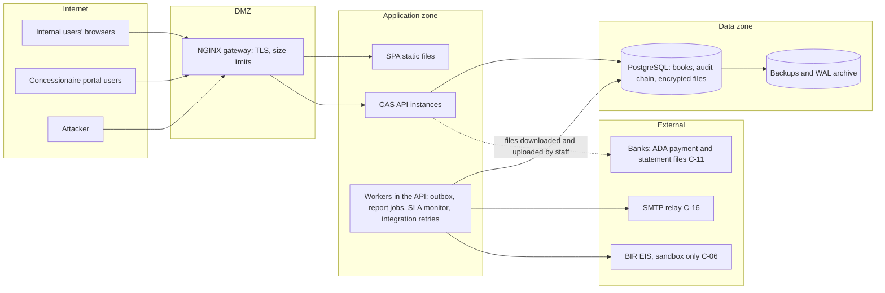

# 05 — Authentication, Authorization and Segregation of Duties

## 1. Login state machine

```
POST /auth/login {username|email, password}
   ├─ bad credentials ──► 401 AUTH_INVALID_CREDENTIALS  (+failed_login_count, lockout at N)
   ├─ locked / inactive / access expired ──► 401 (same generic message; reason in security_events)
   └─ ok ──► 200 {status: MFA_REQUIRED | MFA_ENROLLMENT_REQUIRED, mfaToken}
                    mfaToken = RS256 JWT, aud=cas-mfa, 5 min, single purpose

MFA_ENROLLMENT_REQUIRED:
   POST /auth/mfa/totp/enroll   {mfaToken}          ──► {secret, otpauthUri}   (PENDING method)
   POST /auth/mfa/totp/activate {mfaToken, code}    ──► tokens (method ACTIVE)
MFA_REQUIRED:
   POST /auth/mfa/verify        {mfaToken, code}    ──► tokens

tokens = 200 {accessToken, expiresIn, user}  +  Set-Cookie: CAS_REFRESH=<opaque>;
         HttpOnly; Secure; SameSite=Strict; Path=/api/v1/auth
```

* MFA is mandatory for every interactive user. The only path that issues an access token without
  a verified second factor is the development shortcut `cas.mfa.dev-bypass-users` (`DevMfaBypass`).
  It works only when the `dev` profile is explicitly active and never with `prod` (startup fails
  otherwise), and every use is a security event (`DevMfaBypassTest`).
* The `mfaToken` is useless against the API (`aud=cas-mfa` is rejected by the resource server).
* TOTP: RFC 6238, SHA-1, 6 digits, 30 s step, ±1 step skew; the last accepted step is stored
  so a code can never be used twice.

## 2. Tokens

| Token | Format | Lifetime | Storage | Claims |
|---|---|---|---|---|
| Access | RS256 JWT, `kid` header | 10 min (config) | SPA memory only | `iss`, `aud=cas-api`, `sub` (user UUID), `sid` (session UUID), `jti`, `iat`, `exp`, `pwd_change` (only when forced change pending) |
| Refresh | 256-bit random, base64url | 8 h absolute session, each token 8 h max | `HttpOnly` cookie; DB stores SHA-256 hash | none (opaque) |
| MFA challenge | RS256 JWT | 5 min | SPA memory | `aud=cas-mfa`, `sub`, `jti` |

**Permissions are not placed in the token.** On every request the resource server
resolves `sub`+`sid` to the user, checks the user is active, the session is not revoked and
not expired, then loads the effective permission set. Consequences: role changes and
session revocations take effect immediately; one indexed query per request (acceptable at
the target scale; cache with short TTL if load tests require it).

**Rotation & reuse detection:** each `/auth/refresh` consumes the presented token
(`used_at`) inside a `SELECT … FOR UPDATE` and issues a successor. Presenting an already
used token revokes the whole session (`revoke_reason=REFRESH_TOKEN_REUSE`) and records a
`HIGH` security event. Exception: a token rotated less than `cas.session.refresh-reuse-grace` (10 s)
ago whose successor was never used is accepted once (the client lost the rotation response, e.g. a
reload); the successor is retired and a `REFRESH_TOKEN_GRACE_REUSE` event recorded (C-20). The SPA
also serialises refreshes across tabs with the Web Locks API.

**CSRF:** only `/auth/refresh` and `/auth/logout` read a cookie, so only they require the
double-submit `X-XSRF-TOKEN` header (Spring `CookieCsrfTokenRepository`). All other
endpoints are bearer-token authenticated and therefore not CSRF-exposed.

**Key management:** private/public PEM files mounted from the secrets manager
(`CAS_JWT_PRIVATE_KEY_PATH`, `CAS_JWT_PUBLIC_KEY_PATH`, optional
`CAS_JWT_PREVIOUS_PUBLIC_KEY_PATH` during rotation). In the `prod` profile the application
refuses to start without them; in `dev`/`test` an ephemeral key pair is generated with a warning.

## 3. Password policy (configurable `cas.security.password.*`)

Minimum 12 characters, maximum 128; at least three of {upper, lower, digit, symbol}; must not
contain the username or e-mail local part; rejected if on the bundled common-password
list; history check against the current hash. Argon2id (Spring Security
`Argon2PasswordEncoder`, 16 MiB, 3 iterations, parallelism 1 — tune on production hardware
to ~250 ms per hash).

## 4. Lockout and throttling

* Per account: 5 consecutive failures → locked 15 minutes (DB-backed, therefore cluster-wide).
  Admins can unlock (`USER_ADMINISTER`), audited.
* Per client IP: Bucket4j token bucket on `/api/v1/auth/**` (20 requests/minute default,
  `AuthRateLimitFilter`). Per instance; the account lockout above is the cluster-wide control (ADR-004).
* General API limit (gap 6): 600 requests per minute per signed-in user and 120 per client address
  when unauthenticated, counted in the database (`ApiRateLimiter`, `ApiRateLimitFilter`, UNLOGGED
  `api_rate_windows`, V36), so the limit is shared by every instance (`ApiRateLimitIT`).
* Responses never reveal whether a username exists.

## 5. Authorization model

* `@PreAuthorize("hasAuthority('PERM_X')")` on every controller method; the security filter
  chain denies anything not explicitly matched (`anyRequest().denyAll()` after the authenticated
  API matcher), so a new controller without a rule is unreachable.
* Authorities: `PERM_<code>` per permission plus `ROLE_<code>` per role.
* When `must_change_password` is set, the only authority granted is `PASSWORD_CHANGE_REQUIRED`,
  which opens `/auth/me`, `/auth/password/change`, `/auth/logout` only.
* Object-level authorization (e.g., concessionaire sees only its own account) is enforced in
  application services by scoping queries to the caller — implemented with the portal (Phase 4)
  and covered by cross-tenant tests.

### Seeded roles (proposals pending C-08)

Fourteen roles are seeded. The full permission lists live in the database (`role_permissions`) and are
shown on Roles & permissions; the summary below is from V41.

| Role | Permissions | Main authority | Notes |
|---|---|---|---|
| SYSTEM_ADMINISTRATOR | 13 | Users, roles, sessions, organisation, integrations, ticket administration, security events | **No** financial permissions |
| CHIEF_ACCOUNTANT | 31 | Review, approve, post and reverse vouchers; period open/close; chart of accounts; AP/AR approval; bank accounts; supplier bank verification; migration apply; clearing; close tasks; access-grant approval | |
| ACCOUNTANT | 26 | Prepare vouchers, AP invoices, billings, customers, suppliers, reconciliations, assets, DV certification, migration upload, clearing | |
| FINANCE_MANAGER | 22 | Payment approval, budget approval, period reopen, reconciliation approval, change approval, approval limits | |
| BUDGET_OFFICER | 5 | Budget preparation and reservation | |
| CASHIER | 11 | Collections, deposits, payment release | |
| DISBURSEMENT_OFFICER | 6 | Disbursement preparation | |
| INVENTORY_CLERK | 6 | Inventory documents | |
| FINANCIAL_REPORTING | 11 | Statements and report export | read-only on books |
| INTERNAL_AUDITOR | 16 | View everything financial, audit and security trails, access reviews | read-only on books |
| EXTERNAL_AUDITOR | 12 | View, audit trail | read-only, time-bound (`access_expires_at`) |
| MANAGEMENT_VIEWER | 7 | Dashboard and reports | read-only |
| SUPPORT_AGENT | 3 | Work support tickets | |
| CONCESSIONAIRE | 1 | `PORTAL_SELF_VIEW` | portal only, scoped to its own customer |

### Segregation-of-duties rules (seeded in V4–V37)

136 rules (`sod_conflict_rules`, enforced by `SodPolicy` on every role assignment and role-permission
change): 127 `BLOCK` and 9 `WARN`. By family:

| Family | Rules | Example |
|---|---|---|
| Technical administration vs financial authority | `USER_ADMINISTER` and `ROLE_ADMINISTER` against every financial permission (BLOCK) | Administrators cannot hold posting, payment or approval rights |
| Auditor independence | `AUDIT_LOG_VIEW` against every originate, approve, post or configure permission (BLOCK) | Auditors cannot transact |
| Cash custody vs recording and reconciliation | `COLLECTION_RECORD`, `DEPOSIT_PREPARE`, `PAYMENT_RELEASE` against billing, customer maintenance and bank reconciliation (BLOCK) | A cashier cannot reconcile the bank |
| Payment chain | `DISBURSEMENT_PREPARE` / `PAYMENT_APPROVE` / `PAYMENT_RELEASE`; `SUPPLIER_MANAGE`, `SUPPLIER_BANK_VERIFY` and `BANK_ACCOUNT_MANAGE` against release or approval (BLOCK) | Whoever maintains a supplier's bank details cannot pay them |
| Stock custody | `INVENTORY_MANAGE` against invoice approval, posting and payment release (BLOCK) | |
| Maker and checker at role level | `JOURNAL_CREATE`/`JOURNAL_POST`, `BUDGET_PREPARE`/`BUDGET_APPROVE`, document purge request/approve (BLOCK); prepare/approve pairs of AP, AR, reconciliation, migration, supplier bank details, period close/reopen and tickets (WARN) | WARN pairs rely on the transaction-level rule below |
| Access governance | `USER_ADMINISTER`/`ROLE_ADMINISTER` vs `ACCESS_GRANT_APPROVE`; `USER_ADMINISTER` vs `ACCESS_REVIEW_PERFORM` (BLOCK) | |

**Transaction-level rule.** Whatever the roles allow, the preparer of a document can never approve,
post, apply or verify that same document. A person also takes at most one step of a workflow cycle
(`DocumentWorkflow.canAct`, the voucher workflow, and each module's service checks).

Additional controls: administrators cannot change their own roles, deactivate themselves,
or reset their own MFA through the admin API; every change is audited with before/after
role sets.


The financial-access maker-checker (gap 7) adds one more control. A role change that adds financial
permissions waits for a second person with `ACCESS_GRANT_APPROVE` (`RoleGrantService`, V37,
`CAS_FINANCIAL_GRANT_APPROVAL`). Periodic access reviews (`AccessReviewService`) close only when every
review and resulting change is done.

## 6. Threat model

Updated 2026-10-26 for the system as of V41. Method: STRIDE per component, with each control traced to the
code or configuration that implements it and the test that shows it. Residual risks that need a decision or
an environment are listed in §6.5. This model is an input to MIAA's penetration test, not a substitute for it.

### 6.1 Context and trust boundaries



Trust boundaries:
* **TB1** browser ↔ gateway: untrusted input, TLS.
* **TB2** gateway ↔ API: every request authenticated and authorised in the API, never at the gateway.
* **TB3** API ↔ database: two database roles, `cas_owner` for migrations and `cas_app` at runtime.
* **TB4** API ↔ external services: outbound only, through the outbox and the transmission log.
* **TB5** internal users ↔ portal users: a different user type, tenant-scoped.

**Assets:**
* posted journal entries and sub-ledgers (integrity);
* the audit and security chains (integrity, non-repudiation);
* credentials, MFA secrets and session tokens;
* supplier bank accounts, TINs and customer data (confidentiality, Data Privacy Act);
* supporting documents and generated reports and payment files;
* availability during month-end and year-end close.

**Actors:**
* internal staff in 14 roles, including administrators (no financial authority) and auditors (read-only);
* concessionaire portal users;
* an external attacker;
* a malicious or careless insider;
* a compromised dependency.

### 6.2 STRIDE by component

| Component | Threat | Control (implementation) | Evidence | Residual |
|---|---|---|---|---|
| Sign-in | **S** credential stuffing, guessing | Argon2id (`PasswordPolicy`, Spring `Argon2PasswordEncoder`); account lockout 5/15 min in the DB; per-address limit on `/auth/**` (`AuthRateLimitFilter`); mandatory TOTP (`Totp`, replay blocked by `last_used_step`); generic errors | `AuthFlowIT`, `TotpTest`, `PasswordPolicyTest`, `AuthRateLimitFilterTest` | Per-address auth limit is per instance (ADR-004); SMS/e-mail OTP not built (C-16) |
| Sign-in | **S** phishing of the authenticator code | Codes valid for one 30 s step ±1 and single use; MFA token is 5 min, single purpose (`aud=cas-mfa`) | `AuthFlowIT` | Real-time phishing proxies remain possible; WebAuthn not built |
| Sessions | **S** stolen refresh cookie | HttpOnly, Secure, SameSite=Strict, path-scoped (`RefreshCookies`); rotation with reuse detection revoking the session and raising a HIGH event; 8 h cap; admin revocation (`SESSION_REVOKE`) | `AuthFlowIT` | — |
| Sessions | **E** stale privileges after a role change | Permissions are resolved per request from `sub`+`sid` (`CallerResolver`); not carried in the JWT | `AuthFlowIT`, `RoleAdminIT` | One query per request (performance only) |
| API | **T/I** CSRF | Bearer tokens on all API calls; only `/auth/refresh` and `/auth/logout` read a cookie, and they need the double-submit header | `AuthFlowIT.refreshRequiresCsrf` | — |
| API | **T** SQL injection | Bound parameters everywhere (ADR-006); SpotBugs/FindSecBugs in `mvn verify` with every dynamic-SQL site reviewed (`spotbugs-exclude.xml`) | `SqlInjectionIT`, `mvn verify` | New code must keep the rule; the build fails on new unreviewed findings |
| API | **T** mass assignment, over-posting | Request records per operation (no entity binding); `@Valid` constraints | Module ITs | — |
| API | **I** error leakage | RFC 7807 ProblemDetail without stack traces; correlation id instead of detail (`CorrelationIdFilter`, which echoes only ids matching `[A-Za-z0-9-]{8,64}`) | `SecurityBaselineIT` | Validation runs before method security, so an unauthorised caller sending an invalid body gets 400 with field messages instead of 403. Low impact: it reveals DTO constraints, not data |
| API | **D** flooding, oversized requests | Cluster-wide per-user and per-address limits (`ApiRateLimiter`, V36); 10 MB body limit in NGINX and Spring; bounded connection pool; paged lists (max 200) | `ApiRateLimitIT`, `ApiConventionsIT` | Network-level DDoS protection belongs to the hosting (C-04) |
| Authorisation | **E** missing or wrong rule | `@PreAuthorize` on every controller method; filter chain ends in `denyAll()`; object-level scoping in services | `SecurityBaselineIT`, Playwright `auditor-readonly.spec.ts` | Role matrix is a proposal (C-08) |
| Authorisation | **E** insider collusion or self-approval | 136 SoD rules (`SodPolicy`); transaction-level maker-checker (`DocumentWorkflow.canAct`); maker-checker on financial role grants (`RoleGrantService`); approval limits per role (`ApprovalLimitService`, values C-24); access reviews | `ApprovalInboxIT`, `AccessGovernanceIT`, module ITs | Two colluding people can still act together; detection is through the audit trail and reviews |
| Portal | **I/E** one concessionaire seeing another's data | Separate user type; every portal query scoped to the linked customer (`PortalInquiryService`, `PortalAccessService`); linking approved by a second person (V25) | `PortalIT`, `PortalSelfServiceIT` | Identity-evidence rules are C-18 |
| Ledger and documents | **T** altering posted records | Immutable triggers on entries, lines, decisions, movements, ticket events and batch rows; deferred balance trigger; optimistic locking; corrections only by new documents | `PostingInvariantsIT`, `JournalWorkflowIT`, `PeriodCloseIT` | DB superuser can disable triggers (see audit row) |
| Ledger | **T** duplicate postings on retry | Idempotency keys (`IdempotencyService`, constant-time hash comparison) on posting, receipts, payment instructions and allocations; one entry per source document (unique) | `ApiConventionsIT` | — |
| Audit | **T/R** erasing or rewriting history | Append-only triggers plus `cas_app` grants of INSERT/SELECT only (`deploy/db/post-migrate-grants.sql`); SHA-256 hash chain including actor roles (V34) with a verification endpoint; actor, address, correlation id on every event | `AuditIntegrityIT`, `SecurityAlertsIT`, DR exercise chain check | Tamper-evident, not tamper-proof: sealed WORM exports pending (C-05, C-13) |
| Audit | **R** denying an action | Every state change audited with the actor and their roles at the time; security events for sign-ins, lockouts, MFA and permission changes | Module ITs | — |
| Uploads | **T/E** malicious files | Extension allow-list, magic-byte signature check, sanitised names, 10 MB cap; HTML, SVG and scripts refused; downloads as attachments with nosniff | `XssIT`, `DocumentsAndRecurringIT` | No malware engine yet: files are labelled NOT_SCANNED (`UnconfiguredMalwareScanner`, C-25) |
| Frontend | **T/I** XSS | React text rendering only; source scan forbids raw-HTML sinks; CSP `script-src 'self'`, `object-src 'none'`, `frame-ancestors 'none'`; nosniff; JSON-only API | `XssIT`, `security/xss.test.tsx` | `style-src` allows `'unsafe-inline'` (styling only) |
| Stored data | **I** database or backup theft | AES-256-GCM (`AesGcmEncryptor`, `ContentCipher`) for MFA secrets, supplier bank accounts and stored files (V35); hashes only for tokens; own bank accounts stored as last four digits | `AesGcmEncryptorTest`, `DocumentsAndRecurringIT`, `PaymentFileIT` | Key rotation not built; full-disk and backup encryption are infrastructure (C-04) |
| Logs | **I** secrets or personal data in logs | Masking of tokens, passwords, OTPs, TINs, account numbers and e-mails in text and ECS JSON logs (`LogMasker`, `MaskingMessageConverter`, `MaskingJsonMembersCustomizer`) | `LogMaskerTest`, `SensitiveLogIT` | Dev e-mail logger is unmasked by design and exists only in the `dev` profile |
| Workers and integrations | **T/R** duplicate or lost outbound messages | Outbox written in the business transaction (`OutboxService`); transmission log idempotent per document with every attempt recorded; `SKIP LOCKED` workers; dead transmissions alert (`AlertService`) | `IntegrationsIT`, `SecurityAlertsIT` | BIR production transmission not built (C-06) |
| Payment files | **T** altered payee details | Supplier bank accounts verified by a second person; payment files encrypted at rest with a recorded hash; release separated from approval and bank maintenance by SoD | `PaymentFileIT` | Bank-specific formats and the channel to the bank (C-11) |
| E-mail | **S/I** spoofed or leaked mail | SMTP with authentication over TLS (`SmtpEmailSender`); reset links carry single-use hashed tokens with a 30 min lifetime | `SmtpEmailSenderTest`, `PasswordRecoveryIT` | Relay, SPF/DKIM and sender domain are C-16 |
| Configuration | **E** development shortcuts in production | `prod` profile refuses ephemeral JWT keys and the MFA bypass; secure cookies forced; OpenAPI off | `DevMfaBypassTest` | Depends on deploying with the `prod` profile (docs/19) |
| Supply chain | **T** compromised dependency | Pinned lock files; `npm audit`; Trivy filesystem and image scans; gitleaks; SBOM (`docs/sbom`) | CI workflow (not yet run) | CI has not executed; SBOM regeneration per release proposed |
| Alerting | **R** attacks going unnoticed | HIGH security events and dead integrations raise throttled alerts (`AlertService`, `alert_throttle`) | `SecurityAlertsIT` | Central monitoring and on-call are C-04 |

### 6.3 OWASP Top 10 (2021)

| Risk | Status | Main controls |
|---|---|---|
| A01 Broken access control | Mitigated | Deny-by-default, `@PreAuthorize`, object scoping, SoD, maker-checker, auditor read-only e2e |
| A02 Cryptographic failures | Mitigated, key rotation open | TLS (gateway), Argon2id, AES-256-GCM at rest, RS256 tokens, hashed tokens |
| A03 Injection | Mitigated | Bound parameters, FindSecBugs, `SqlInjectionIT`, `XssIT`, CSP |
| A04 Insecure design | Mitigated | Threat model, immutable ledger, maker-checker throughout, idempotency |
| A05 Security misconfiguration | Partly | Security headers, prod profile guards, OpenAPI off; environment hardening depends on C-04 |
| A06 Vulnerable components | Partly | SBOM, `npm audit`, Trivy, gitleaks in CI, which has not run yet |
| A07 Identification and authentication failures | Mitigated | MFA for all, lockout, rate limits, rotating refresh tokens with reuse detection |
| A08 Software and data integrity failures | Partly | Hash-chained audit, signed tokens, outbox; image signing and a release pipeline are not built |
| A09 Logging and monitoring failures | Partly | Complete audit and security trails, masking, alerts; central monitoring is C-04 |
| A10 Server-side request forgery | Not applicable today | No user-supplied URLs are fetched; integration endpoints are configuration |

### 6.4 Abuse cases checked by tests

* A user with every role still cannot approve their own document (`ApprovalInboxIT`).
* An auditor sees every area and changes nothing, in the UI or through the API (`auditor-readonly.spec.ts`).
* A concessionaire cannot read another customer's billings (`PortalIT`).
* A reused refresh token revokes the session (`AuthFlowIT`).
* Injection payloads on every search, filter and sort parameter fail harmlessly (`SqlInjectionIT`).
* HTML disguised as a PDF is refused (`XssIT`).
* No secret reaches the logs at DEBUG (`SensitiveLogIT`).
* The assignee of a change cannot validate it on staging (`TicketsIT`).

### 6.5 Open risks needing a decision or an environment

| Risk | Needs | Owner |
|---|---|---|
| Uploaded files are not malware-scanned | Approved scanning engine (C-25) | MISD / InfoSec |
| Audit chain is tamper-evident only | Sealed WORM exports and retention (C-05, C-13) | MISD, COA liaison |
| E-mail spoofing and deliverability | Relay, SPF/DKIM, sender domain (C-16) | MISD |
| Network DDoS, WAF, intrusion detection, central logging and monitoring | Hosting decision (C-04) | MISD |
| Backup encryption and off-site immutable copies | C-04 | MISD |
| Final role matrix and approval limits | C-08, C-24 | Chief Accountant, Finance |
| Data encryption key rotation | Development work, after hosting and a KMS are chosen | Developer, MISD |
| Grant-level protection of the other append-only tables (journal entries, decisions, movements) in addition to triggers | Development follow-up (docs/19 §9) | Developer |
| Independent penetration test | MIAA's chosen tester, staging environment | MIAA |
