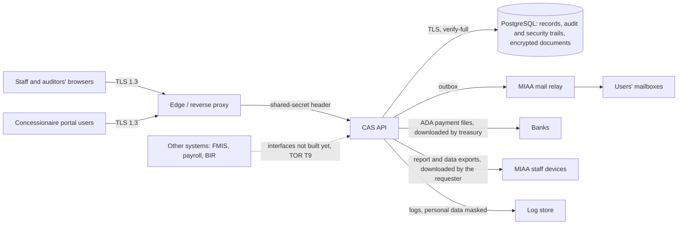

# 23. Privacy Impact Assessment (draft)

**Status: DRAFT prepared by the development team from the system as built (schema V51, October 2026), for MIAA's
Data Protection Officer to review, complete and approve (TOR Annex H; CMP-01).** It describes what personal data the
CAS holds, where it flows, and the controls in place, and proposes risks and actions. Decisions on lawful basis,
retention, risk acceptance and the breach procedure are MIAA's and are marked **[DPO]**. It is written to fit the
structure the National Privacy Commission expects of a PIA (description, inventory, flows, risks, controls,
actions); the DPO should align it with MIAA's own PIA template **[DPO]**.

## 1. The system

The Computerized Accounting System (CAS) records MIAA's accounting: journals and the general ledger, payables and
disbursements, receivables and the concessionaire portal, treasury, fixed assets, inventory, budgets, reports, audit
trail and support tickets. It is a web application (React front end, Spring Boot API, PostgreSQL). Personal data is
incidental to the accounting purpose: it identifies the people who use the system, the people MIAA pays or bills when
they are natural persons, and the people who represent concessionaires on the portal.

## 2. Data subjects

| Data subject | How they appear |
|---|---|
| MIAA staff using the CAS | User accounts; their username on every record they prepare, approve or post |
| External auditors (COA) | Time-limited user accounts |
| Concessionaire representatives | Portal user accounts linked to a customer; inquiries they submit |
| Customers and suppliers who are natural persons (sole proprietors, individual lessees) | Customer and supplier master data; billings, invoices, receipts, payments |
| Payees | Name on checks |
| People named in free text | Particulars, descriptions, notes, ticket and inquiry text, attachments |

## 3. Personal data inventory

Access is by permission (roles in [05](05-security-design.md) §5); every change is audited, and downloads of
documents and reports are audited.

| # | Data | Where (table.columns) | Source | Purpose | Who can see it | Kept | Protection |
|---|---|---|---|---|---|---|---|
| 1 | Staff identity: username, display name, e-mail, roles, office | `users` (username, display_name, email), `user_roles`, `user_office_assignments` | Administrator | Sign-in, accountability, notifications | `USER_VIEW` (administrators, auditors); username shown on the records they touched | While the account exists; deactivated, never deleted | Access control; e-mail used only for sign-in and notices |
| 2 | Sign-in credentials | `users.password_hash`, `mfa_methods`, `mfa_recovery_codes`, `webauthn_credentials`, `refresh_tokens`, `password_reset_tokens`, `mfa_email_codes` | The user | Authentication | Nobody (not shown, not exported) | Until replaced or expired | Argon2id hashes; TOTP seeds AES-256-GCM encrypted; tokens stored as SHA-256 hashes |
| 3 | Sign-in activity: time, IP address, browser (user agent), outcome | `user_sessions` (client_ip, user_agent), `security_events` (client_ip), `users.last_login_at` | Automatic | Security monitoring, investigation | `SECURITY_EVENT_VIEW` (administrators, internal auditors) | **Indefinitely** (no purge yet; see R4) | Append-only, hash-chained security trail |
| 4 | Accountability trail: who did what and when, with roles and IP | `audit_events` (actor_username, actor_roles, client_ip, details); `*_by` columns on business records | Automatic | Audit trail required for government accounting | `AUDIT_LOG_VIEW` (auditors) and readers of each record | Indefinitely (record retention, C-05/C-13) | Append-only, hash-chained; INSERT/SELECT-only grants |
| 5 | Customers and suppliers: name, TIN, address, e-mail | `customers` (name, tin, address, email), `suppliers` (name, tin, address) | MIAA staff from contracts and invoices | Billing, payment, tax reporting | `AR_VIEW`, `AP_VIEW` and auditors | With the financial records (≥ 10 years, C-13) | Access control |
| 6 | Supplier bank accounts: bank, account name, account number | `supplier_bank_accounts` | MIAA staff from the supplier | Paying suppliers by ADA | `AP_VIEW` sees bank and last four digits; full number only to the payment process | With the payment records | Number AES-256-GCM encrypted, bound to its row; entry and verification by two people |
| 7 | Payees on checks | `check_register.payee` | From the supplier | Payment | `TREASURY_VIEW`, auditors | With the payment records | Access control |
| 8 | Portal users and link evidence | `users` (user_type CONCESSIONAIRE, customer_id), `portal_link_requests` (evidence, decision_note) | The representative; MIAA staff | Letting a concessionaire see its own account | `PORTAL_ACCESS_APPROVE` (chief accountant); the user sees only their own customer's records | While linked; requests kept | Approval of the link by a second person (C-18) |
| 9 | Portal inquiries and payment advices | `portal_inquiries` (subject, message, payment details) | The representative | Questions and payment notices | `AR_VIEW` staff; the submitting customer | With the receivables records | Access control |
| 10 | Support tickets | `tickets` (reporter, assignee, title, description), `ticket_events` | Staff | Support and change control | Reporter, assignee, `TICKET_VIEW_ALL` | Indefinitely | Access control |
| 11 | Free text and attachments | particulars, descriptions and notes on every document; `supporting_documents` and their files | Staff | Supporting evidence for transactions | Readers of the owning record (`DOCUMENT_VIEW`) | With the records | Files AES-256-GCM encrypted at rest; malware scan interface (C-25); downloads audited |
| 12 | Notifications and queued e-mail | `notifications` (title, body), outbox | Automatic | Telling users about work and alerts | The recipient | Indefinitely (no purge yet) | E-mails carry links, never report contents |
| 13 | Exports | `report_jobs` files (30 days), `data_exports` files (7 days) | Requested by staff | Reports; full data export (TOR §3.6) | The requester only | Deleted when they expire | Encrypted at rest; data export needs two people |

Not collected: date of birth, government ID numbers other than the TIN, health, biometric templates (passkeys keep
biometrics on the user's device; the CAS stores only a public key), photographs, or location beyond the IP address.

## 4. Data flows

* In the demonstration deployment the edge is Cloudflare, which processes traffic outside the Philippines. The
  production hosting and edge are MIAA's decision **[DPO: cross-border transfer assessment if the edge or hosting is
  outside the Philippines]**.
* Mail goes through MIAA's relay (configured by MIAA). Messages carry a title and a link; report and export contents
  never leave by e-mail.
* Bank payment files contain supplier names and account numbers; they are produced for treasury to send through the
  bank's channel (formats pending, C-11).

## 5. Privacy principles (RA 10173, §11)

| Principle | How the CAS supports it | Open **[DPO]** |
|---|---|---|
| Transparency | Users see their own profile, sessions and security activity | Privacy notice for staff and portal users |
| Legitimate purpose | Personal data serves accounting, payment, tax and audit duties | Confirm the lawful basis for each category in §3 |
| Proportionality | Minimal fields; no sensitive personal information collected; bank numbers masked; portal users see only their own customer | Whether TINs of natural persons should be masked in lists |

## 6. Risks and controls

Likelihood and impact on a 1–4 scale (proposed; **[DPO]** to rate).

| # | Risk | L | I | Controls in place | Proposed action |
|---|---|---|---|---|---|
| R1 | Staff read personal data they do not need | 2 | 2 | Roles by duty, segregation-of-duties rules, periodic access reviews, every access to documents and exports audited | Review role scope with the DPO; include personal-data access in access reviews |
| R2 | Account takeover exposes data | 2 | 3 | Mandatory MFA (TOTP, passkeys, e-mail codes), lockout, session limits, alerts on high-severity security events | — |
| R3 | Bulk extraction of personal data | 2 | 4 | Report exports audited and requester-only; full data export needs two people, a stated purpose, and expires after 7 days | Policy on where exported files may be kept **[DPO]** |
| R4 | IP addresses, browser details and notifications kept indefinitely | 3 | 2 | Access limited to security staff and auditors | Set retention periods for `user_sessions`, `security_events`, `notifications` and build a purge (with T10, C-05/C-13) **[DPO]** |
| R5 | Personal data typed into free text or attached files | 3 | 2 | Encrypted documents, access by record, audited downloads | Guidance to staff on what not to write; malware scanning engine (C-25) |
| R6 | Sole proprietors' TINs and addresses visible to AR/AP readers | 2 | 2 | Access limited to AR/AP and auditors | Decide on masking TINs in lists **[DPO]** |
| R7 | Bank account numbers misused or changed to divert payments | 2 | 4 | Encrypted at rest, last four digits shown, two-person entry and verification, anomaly rule for payments soon after a bank change (T2) | — |
| R8 | A breach goes unnoticed or is reported late | 2 | 4 | Tamper-evident trails with verification, security alerts, correlation ids, anomaly detection | MIAA's breach management and NPC notification procedure **[DPO]**; central monitoring (C-04) |
| R9 | Personal data in application logs | 2 | 2 | Secrets and tokens never logged (`SensitiveLogIT`); logs at INFO by default | Log retention and access **[DPO]** |
| R10 | Data subjects cannot exercise their rights | 2 | 2 | Users and portal users can view their own data; staff can correct master data with an audit trail | Request procedure; erasure versus record retention (C-13) **[DPO]** |
| R11 | Personal data processed abroad by the hosting or edge provider | — | — | TLS 1.3, encrypted documents and secrets | Assessment once hosting is decided **[DPO]** |

## 7. For the DPO

1. Confirm the inventory (§3) and add any processing done outside the CAS with its data.
2. Record the lawful basis per category and the privacy notices for staff and portal users.
3. Set retention periods per category (R4, C-13) and approve the archive and purge design (T10, C-05).
4. Decide on TIN masking (R6) and on the custody of exported files (R3).
5. Adopt the breach procedure and notification contacts (R8), and assess the hosting and edge (R11).
6. Rate the risks, accept the residual risk, sign and date this assessment, and register it as MIAA requires.
